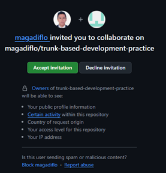
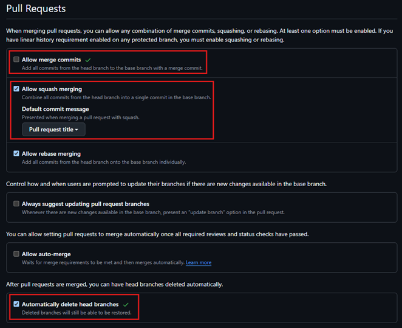
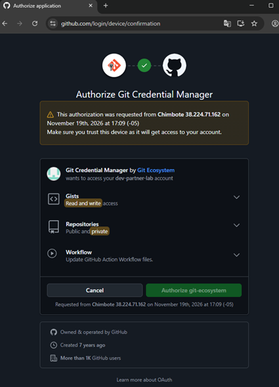
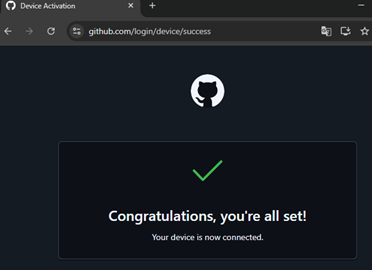

# Trunk Based Development y GitHub

- [Trunk Based Development (sitio de referencia)](https://trunkbaseddevelopment.com/)
    - Y su sección [You're doing it wrong](https://trunkbaseddevelopment.com/youre-doing-it-wrong)
- [How to Implement Trunk-Based Development: A Practical Guide (Unleash)](https://getunleash.io/trunk-based-development)
- [What Is Trunk-Based Development? A Complete Guide (Flagsmith)](https://flagsmith.com/blog/trunk-based-development)
- [Trunk-Based Development (Mergify)](https://mergify.com/learn/trunk-based-development)
- [Available rules for rulesets (GitHub Docs)](https://docs.github.com/en/repositories/configuring-branches-and-merges-in-your-repository/managing-rulesets/available-rules-for-rulesets)
- [Git Credential Manager: varios usuarios (multiple-users.md)](https://github.com/git-ecosystem/git-credential-manager/blob/release/docs/multiple-users.md)
- [Managing your personal access tokens (GitHub Docs)](https://docs.github.com/en/authentication/keeping-your-account-and-data-secure/managing-your-personal-access-tokens)

> **Cómo leer esta documentación**
>
> - La práctica se hace en **GitHub real** con dos cuentas: **`magadiflo`** (dueño del repositorio, el desarrollador
>   principal) y **`dev-partner-lab`** (el compañero de equipo). El repositorio se llama
>   **`trunk-based-development-practice`**.
> - Los bloques `bash` muestran **quién** ejecuta cada comando con una etiqueta: `[magadiflo]` o
>   `[dev-partner-lab]`.
> - **Cada comando se explica al pie del bloque donde aparece por primera vez** (primero qué hace el comando completo y
>   luego cada una de sus partes). Si más adelante reaparece, ya no se vuelve a explicar; solo se explica lo nuevo
>   (por ejemplo, una opción que antes no se había usado). Los bloques de explicación empiezan con **📖 Comandos de
>   este bloque**.
> - Las salidas de terminal (`text`) provienen de **una simulación local** con los mismos usuarios, repositorio y
>   comandos. Los **hashes** (`93fd7e3`, etc.) y las fechas serán distintos en tu máquina. Como en la simulación el
>   remoto es una carpeta local y no GitHub, en tu terminal verás además líneas `remote:` que agrega GitHub (por
>   ejemplo, un enlace para crear el PR) y la URL `https://github.com/...` en vez de una ruta local.
> - Lo que es propio de GitHub (pantallas, rulesets, Actions, mensajes de rechazo del remoto) y de Git Credential
>   Manager está escrito a partir de la documentación y **no fue ejecutado**. Se indica con **(GitHub, no
>   verificado)**
>   o **(GCM, no verificado)**. Si algo no coincide con lo que ves, la interfaz habrá cambiado: ajústalo y anótalo.
> - Donde dice **📷 Captura sugerida**, conviene guardar una imagen en `./assets/` (como hiciste en GitFlow).

## ¿Qué es Trunk Based Development?

Trunk Based Development (TBD) es una estrategia de branching donde **todos los desarrolladores integran sus cambios en
una única rama compartida, el `trunk` (el "tronco"), que en Git es `main`**, con cambios **pequeños y frecuentes**, en
lugar de trabajar semanas en ramas largas.

La idea central no es "no usar ramas", sino **que las ramas vivan muy poco** (horas, a lo sumo uno o dos días) y que
`main` esté **siempre en un estado desplegable**.

> En GitFlow la pregunta es *"¿en qué rama va esto?"*. En TBD la pregunta es *"¿cómo lo hago lo bastante pequeño para
> integrarlo hoy sin romper nada?"*.

```text
GitFlow                                   Trunk Based Development

main     ──●────────────────●──           main  ──●──●──●──●──●──●──●──●──
develop  ──●──●──●──●──●──●──●──                    \/   \/    \/
feature     └──────●────┘                       (ramas de horas, se borran)
release              └──●──┘
```

### Principios

- Existe **una sola rama de vida infinita: `main`**. No hay `develop`.
- Los cambios se integran **al menos una vez al día**.
- `main` **siempre debe compilar y pasar las pruebas**. Se protege con integración continua (CI).
- El trabajo incompleto **no se esconde en una rama larga**: se integra a `main` **apagado detrás de un feature flag**.
- Los lanzamientos salen desde `main` (o desde una *release branch* corta).

### Estilos de TBD según el tamaño del equipo

| Estilo                                 | Cuándo se usa                               | Cómo se integra                                                                      |
|----------------------------------------|---------------------------------------------|--------------------------------------------------------------------------------------|
| **Commit directo al trunk**            | Equipos pequeños y de mucha confianza       | `git pull --rebase` → `git commit` → `git push` directo a `main`                     |
| **Ramas de vida corta + Pull Request** | Equipos medianos/grandes (el más común hoy) | Rama de menos de 1 día → PR pequeño → *Squash and merge* a `main` → se borra la rama |

En esta práctica se recorren **los dos estilos**: primero commits directos (Cambios `#1` y `#2`) y luego se **protege
`main`** y se trabaja con PR (Cambios `#3` al `#7`).

### Tipos de ramas

| Rama                   | Vida                   | Descripción                                                                                                                                                       |
|------------------------|------------------------|-------------------------------------------------------------------------------------------------------------------------------------------------------------------|
| `main` (trunk)         | Infinita               | Única fuente de verdad. Siempre desplegable.                                                                                                                      |
| `feature/*`, `fix/*`   | Horas, máximo 1-2 días | Una sola persona (o pareja). Se borra al integrarse.                                                                                                              |
| `release/*` (opcional) | Corta                  | Solo si se necesita una "foto" estable para producción. **No es una línea de desarrollo**: los arreglos se hacen primero en `main` y se llevan con `cherry-pick`. |

### Feature flags (feature toggles)

Si una funcionalidad tarda 2 semanas, **no** se deja 2 semanas en una rama. Se divide en pedazos pequeños que se
integran cada día, y el código incompleto queda **desactivado por un flag**:

```bash
if (nuevoCheckoutHabilitado) {
    return procesarConNuevoFlujo();   // en construcción
}
return procesarConFlujoActual();      // lo que ve producción
```

Así se **desacopla el despliegue (deploy) del lanzamiento (release)**: el código llega a producción, pero el usuario no
lo ve hasta que se enciende el flag.

### Requisitos para que funcione

Sin estas prácticas, TBD termina degradándose a "feature branching con otro nombre":

1. **CI rápida** en cada PR/commit (compilar + pruebas).
2. **Pruebas automatizadas** confiables.
3. **Feature flags** para código incompleto.
4. **Revisión de código ágil** (PR pequeños que se revisan en minutos, no en días).
5. **Cultura de commits pequeños.**

## Comparación: GitFlow vs Trunk Based Development

| Aspecto                      | GitFlow                                                           | Trunk Based Development                                    |
|------------------------------|-------------------------------------------------------------------|------------------------------------------------------------|
| Ramas de vida infinita       | `main` y `develop`                                                | Solo `main`                                                |
| Vida de las ramas de trabajo | Días o semanas (`feature`)                                        | Horas o 1-2 días                                           |
| Rama de integración          | `develop`                                                         | `main` directamente                                        |
| Preparar un lanzamiento      | Rama `release-*` con ajustes                                      | `main` ya está lista (o `release/*` corta con cherry-pick) |
| Hotfix                       | Rama `hotfix-*` → `main` **y** `develop`                          | Fix en `main` (+ cherry-pick a la release si aplica)       |
| Código incompleto            | Se queda en la rama `feature`                                     | Se integra apagado con feature flag                        |
| Riesgo de conflictos         | Alto (las ramas divergen mucho)                                   | Bajo (cambios pequeños y frecuentes)                       |
| Frecuencia de despliegue     | Por versiones planificadas                                        | Continua / varias veces al día                             |
| Exigencia de CI/CD y tests   | Moderada                                                          | **Alta (imprescindible)**                                  |
| Encaja mejor con             | Software con versiones calendarizadas (móvil, embebido, regulado) | Aplicaciones web/backend con despliegue continuo           |

### Cuándo conviene y cuándo no

- **Conviene:** servicios backend (Spring Boot, microservicios), equipos con CI/CD y buenas pruebas, despliegue
  frecuente.
- **No tanto:** software que se publica por calendario con revisiones largas (app stores) o que debe mantener varias
  versiones en paralelo durante años. Ahí las *release branches* de larga vida tienen sentido real.

## Origen y destino de las ramificaciones

| Rama                   | Origen                                                                                               | Destino                                                      | Convención          | Ejemplo                 |
|------------------------|------------------------------------------------------------------------------------------------------|--------------------------------------------------------------|---------------------|-------------------------|
| **main** (trunk)       |                                                                                                      |                                                              |                     |                         |
| **feature / fix**      | main                                                                                                 | main (PR + *Squash and merge*)                               | `feature/` · `fix/` | `feature/validar-email` |
| **release** (opcional) | main                                                                                                 | **no se fusiona de vuelta** (se borra al salir la siguiente) | `release/`          | `release/1.0`           |
| **hotfix**             | **No existe como rama aparte**: el arreglo nace en `main` y se lleva con `cherry-pick` a `release/*` |                                                              |                     |                         |

## Práctica: Tabla de cambios

| ID        | DESCRIPCIÓN CORTA                                        | RAMA DE TRABAJO                           | RAMA ORIGEN | RAMA DESTINO         | QUIÉN TRABAJA                               | QUIÉN REVISA    |
|-----------|----------------------------------------------------------|-------------------------------------------|-------------|----------------------|---------------------------------------------|-----------------|
| Cambio #1 | Endpoint `/api/saludo` (commit directo)                  | *(ninguna)*                               | main        | main                 | magadiflo                                   | —               |
| Cambio #2 | Conflicto: ambos editan `application.yml` (push directo) | *(ninguna)*                               | main        | main                 | magadiflo y dev-partner-lab                 | —               |
| Cambio #3 | Validar email al registrar usuario                       | `feature/validar-email`                   | main        | main                 | dev-partner-lab                             | magadiflo       |
| Cambio #4 | Nuevo checkout **incompleto** detrás de un feature flag  | `feature/nuevo-checkout`                  | main        | main                 | magadiflo                                   | dev-partner-lab |
| Cambio #5 | Dos PR en paralelo: el segundo entra en conflicto        | `feature/configurar-reintentos`           | main        | main                 | dev-partner-lab                             | magadiflo       |
| Cambio #6 | Preparar la versión 1.0                                  | `release/1.0`                             | main        | *(no vuelve a main)* | magadiflo                                   | —               |
| Cambio #7 | Bug en producción (v1.0.0) → v1.0.1                      | `fix/email-con-signo-mas` y `cherry-pick` | main        | main y `release/1.0` | dev-partner-lab (fix) y magadiflo (release) | magadiflo       |

> Entre los Cambios `#2` y `#3` se **activa la protección de `main`**. Por eso los dos primeros se hacen con commit
> directo y el resto con Pull Request.

## Inicio: preparación del entorno

### 1. Crear el repositorio en GitHub

Con la cuenta `magadiflo`:

> **GitHub > New repository**
> - **Repository name:** `trunk-based-development-practice`
> - **Visibility:** **Public** (los *rulesets* están disponibles en repositorios públicos con el plan gratuito)
> - **No** marcar *Add a README*, *.gitignore* ni *license* (el repositorio debe quedar vacío)


### 2. Invitar a `dev-partner-lab` como colaborador

Con `magadiflo`:

> **Repositorio > Settings > Collaborators > Add people** → buscar `dev-partner-lab` → rol **Write**

Con `dev-partner-lab`: aceptar la invitación desde el correo, o entrando a:

```text
https://github.com/magadiflo/trunk-based-development-practice/invitations
```



### 3. Dos cuentas en la misma PC: HTTPS y configuración local de Git

Si utilizas HTTPS, puedes trabajar con dos cuentas de GitHub desde la misma PC sin necesidad de generar y administrar
una llave SSH por cada cuenta.

La idea es mantener la configuración global de Git para tu cuenta principal (`magadiflo`) y establecer una configuración
local para el repositorio donde trabajarás como colaborador (`dev-partner-lab`). De esta manera, cada clon tendrá su
propia identidad de Git, sin afectar los demás repositorios de tu equipo.

#### Configuración global (`magadiflo`)

Si ya tienes configurada tu identidad principal, no necesitas modificar nada. Puedes comprobarla con:

```bash
C:\cmder
$ git config --global user.name
Martín Díaz

C:\cmder
$ git config --global user.email
tu-correo@ejemplo.com
```

> **📖 Comandos de este bloque**
>
> **`git config --global user.name`** y **`git config --global user.email`**: muestran la identidad que Git usa por
> defecto en **todos** tus repositorios.
> - `git config`: lee o escribe la configuración de Git. Si le das **solo la clave** (como aquí), **muestra** su valor;
>   si le das la clave **y un valor**, lo **guarda**.
> - `--global`: indica que se trabaja con la configuración **de tu usuario del sistema** (archivo `.gitconfig` de tu
>   carpeta personal), que vale para todos los repositorios. Los otros niveles son `--system` (toda la PC) y `--local`
>   (un solo repositorio).
> - `user.name` / `user.email`: las claves con el nombre y el correo que Git escribe como **autor** de cada commit.

#### Configuración local (`dev-partner-lab`)

Cuando clones el repositorio para trabajar como colaborador, configurarás su identidad únicamente dentro de ese
repositorio:

```bash
$ git config --local user.name "dev-partner-lab"
$ git config --local user.email "martin.g.diaz.flores@gmail.com"
```

> **📖 Comandos de este bloque**
>
> **`git config --local user.name "dev-partner-lab"`** y
> **`git config --local user.email "martin.g.diaz.flores@gmail.com"`**: guardan la identidad de `dev-partner-lab` **solo
> en este repositorio**.
> - `--local`: el valor se guarda en el archivo `.git/config` del repositorio actual. Tiene **prioridad** sobre
>   `--global`, así que dentro de este clon manda la identidad local y en los demás proyectos sigue la global. (Orden
>   de prioridad: local → global → system.)
> - `"dev-partner-lab"` / `"martin.g.diaz.flores@gmail.com"`: ahora sí hay **valor**, por eso el comando **escribe** en
>   lugar de mostrar. Si el correo no pertenece a la cuenta, GitHub mostrará los commits sin el usuario asociado.

> `git config --local` no modifica la configuración global ni afecta a los demás proyectos.

#### ¿Cómo funciona la autenticación con HTTPS?

La identidad configurada mediante `user.name` y `user.email` determina quién aparece como **autor de los commits**, pero
**no determina qué cuenta de GitHub realiza el push**. De hecho, la documentación de Git Credential Manager lo advierte:
`user.name` y `user.email` no afectan a GCM.

Para autenticar las operaciones HTTPS utilizaremos **Git Credential Manager (GCM)**, que gestiona las credenciales de
GitHub:

- `magadiflo` seguirá utilizando su autenticación habitual.
- `dev-partner-lab` deberá autenticarse con sus propias credenciales de GitHub.

**El problema:** si no se le indica nada, Git le pide credenciales a GCM **sin decirle qué usuario quiere** (para Git,
el usuario del remoto queda vacío). Si GCM ya tiene guardada tu cuenta principal, **puede reutilizarla**, y entonces el
push de `dev-partner-lab` saldría como `magadiflo` sin darte ningún error: los commits dirían `dev-partner-lab`, pero
quien empuja sería `magadiflo`. Con dos cuentas en el mismo dominio (`github.com`) hay que indicar el usuario de forma
explícita.

#### Indicar a GCM qué cuenta usa cada clon

GCM documenta dos formas de hacerlo: poner el usuario en la URL del remoto, o configurar
`credential.https://github.com.username`. Aquí usamos la segunda, **de forma local en cada clon**, porque encaja con la
idea de "configurar el repositorio local":

```bash
# en el clon de magadiflo
$ git config --local credential.https://github.com.username "magadiflo"

# en el clon de dev-partner-lab
$ git config --local credential.https://github.com.username "dev-partner-lab"
```

> **📖 Comandos de este bloque**
>
> `git config --local credential.https://github.com.username "..."`: le dice a Git qué **usuario de GitHub** debe
> pedirle a GCM al hablar con `https://github.com` desde este repositorio.
> - `credential.https://github.com.username`: es una clave con el formato `credential.<URL>.username`. El `<URL>` (aquí
>   `https://github.com`) limita el efecto a ese sitio: para otros servidores (GitLab, etc.) no se envía ningún
>   usuario.
> - `"dev-partner-lab"` / `"magadiflo"`: el usuario que GCM debe buscar o crear. Cada usuario tiene sus propias
>   credenciales guardadas, así que **ya no se mezclan**.

> Se configura la cuenta de **magadiflo** también, aunque sea la principal: cuando GCM tenga **dos** cuentas para
> `github.com`, un clon sin usuario definido es ambiguo.

> **Alternativa equivalente:** poner el usuario en la URL,
> `https://dev-partner-lab@github.com/magadiflo/trunk-based-development-practice.git`. Funciona igual, pero deja el
> usuario visible dentro de la URL del remoto.

#### Primer push de `dev-partner-lab`: iniciar sesión con la cuenta correcta

La primera vez que `dev-partner-lab` empuje, GCM no encontrará credenciales para ese usuario y abrirá su ventana de
inicio de sesión de GitHub.

Precauciones:

- Si tu navegador predeterminado tiene abierta la sesión de **magadiflo**, autoriza con **dev-partner-lab**: abre el
  enlace en una ventana de incógnito o elige la opción de **código de dispositivo** (*device code*), que puedes
  completar en un navegador donde esté la otra cuenta.
- Si prefieres un token, debe ser un **token clásico (*classic*) con el permiso `repo`**. Según GitHub Docs, los tokens
  de grano fino (*fine-grained*) todavía no cubren el caso de contribuir a repositorios donde eres colaborador de otra
  cuenta personal.

Para comprobar qué cuentas guardó GCM:

```bash
$ git credential-manager github list
```

> **📖 Comandos de este bloque**
>
> `git credential-manager github list`: lista las cuentas de GitHub que Git Credential Manager tiene guardadas.
> - `git credential-manager`: invoca a GCM desde Git.
> - `github`: el subcomando para el proveedor GitHub (también existen `login` y `logout` para iniciar o cerrar sesión de
>   una cuenta; mira `git credential-manager github --help` para sus opciones).
> - `list`: muestra las cuentas guardadas. Tras el primer push de `dev-partner-lab` deberían aparecer **las dos**.

No es necesario configurar una llave SSH por cuenta ni modificar la configuración global de Git para establecer las
identidades locales.

### 4. Clonar dos copias del repositorio

Cada "desarrollador" tendrá su propia carpeta y su propio clon del repositorio. De esta manera, podremos simular el
trabajo de dos integrantes de un equipo desde una misma PC.

```text
M:\practice\
├── magadiflo\
│   └── trunk-based-development-practice\      ← clon de magadiflo
└── dev-partner-lab\
    └── trunk-based-development-practice\      ← clon de dev-partner-lab
```

#### `[magadiflo]`

Ubicados en el directorio `M:\practice` mediante el CMD (usaré para este usuario el `Cmder`), realizamos los siguientes
pasos para preparar nuestro repositorio local y clonar el repositorio utilizando HTTPS:

```bash
M:\practice
$ mkdir magadiflo && cd magadiflo

M:\practice\magadiflo
$ git clone https://github.com/magadiflo/trunk-based-development-practice.git
Cloning into 'trunk-based-development-practice'...
warning: You appear to have cloned an empty repository.

M:\practice\magadiflo
$ cd trunk-based-development-practice\

M:\practice\magadiflo\trunk-based-development-practice (main -> origin)
$ git config --local credential.https://github.com.username "magadiflo"
```

> **📖 Comandos de este bloque**
>
> `mkdir magadiflo && cd magadiflo`: crea una carpeta y entra en ella.
> - `mkdir magadiflo`: *make directory*, crea la carpeta `magadiflo`.
> - `&&`: ejecuta el comando siguiente **solo si el anterior terminó bien**.
> - `cd magadiflo`: *change directory*, cambia la carpeta actual a `magadiflo`.
>
> `git clone https://github.com/magadiflo/trunk-based-development-practice.git`: descarga una copia completa del
> repositorio remoto.
> - `git clone`: crea una carpeta con el nombre del repositorio, descarga todo su historial, define el remoto `origin`
>   apuntando a esa URL y deja listo el seguimiento de `main`.
> - `https://github.com/...git`: la URL HTTPS del repositorio (se copia del botón **Code** de GitHub).
>
> **`cd trunk-based-development-practice`**: entra en la carpeta recién clonada (todos los comandos Git siguientes se
> ejecutan ahí dentro).

Si la identidad global ya está configurada para `magadiflo`, no necesitamos configurar `user.name` ni `user.email`. Lo
comprobamos mostrando **de dónde viene** cada valor:

```bash
M:\practice\magadiflo\trunk-based-development-practice (main -> origin)
$ git config --show-origin user.name
file:C:/Users/magadiflo/.gitconfig      Martín Díaz

M:\practice\magadiflo\trunk-based-development-practice (main -> origin)
$ git config --show-origin user.email
file:C:/Users/magadiflo/.gitconfig      magadiflo@gmail.com
```

> **📖 Comandos de este bloque**
>
> `git config --show-origin user.name`: muestra el valor que Git usará **y el archivo donde está definido**.
> - `--show-origin`: antepone la ruta del archivo de configuración. Así distingues si el valor viene de `.git/config`
>   (local) o del `.gitconfig` global. (Sin esta opción solo verías el valor.)
> - `user.name` / `user.email`: las claves que se consultan.

#### `[dev-partner-lab]`

Clonamos otra copia del mismo repositorio (el repositorio sigue perteneciendo a `magadiflo`). Así que nos posicionamos
en el directorio `M:\practice` y esta vez usaremos una línea de comandos distinta, para este usuario usaremos
`GitBash`.

````bash
magadiflo@SysEngJava UCRT64 /m/practice
$ mkdir dev-partner-lab && cd dev-partner-lab

magadiflo@SysEngJava UCRT64 /m/practice/dev-partner-lab
$ git clone https://github.com/magadiflo/trunk-based-development-practice.git
Cloning into 'trunk-based-development-practice'...
warning: You appear to have cloned an empty repository.

magadiflo@SysEngJava UCRT64 /m/practice/dev-partner-lab
$ cd trunk-based-development-practice/ 
````

Ahora configuramos la identidad local del colaborador y la cuenta que usará GCM:

```bash
magadiflo@SysEngJava UCRT64 /m/practice/dev-partner-lab/trunk-based-development-practice (main)
$ git config --local user.name "dev-partner-lab"

magadiflo@SysEngJava UCRT64 /m/practice/dev-partner-lab/trunk-based-development-practice (main)
$ git config --local user.email "martin.g.diaz.flores@gmail.com"

magadiflo@SysEngJava UCRT64 /m/practice/dev-partner-lab/trunk-based-development-practice (main)
$ git config --local credential.https://github.com.username "dev-partner-lab"
```

Verificamos que se hayan aplicado correctamente los datos, y **de dónde** vienen:

```bash
magadiflo@SysEngJava UCRT64 /m/practice/dev-partner-lab/trunk-based-development-practice (main)
$ git config --show-origin user.name
file:.git/config        dev-partner-lab

magadiflo@SysEngJava UCRT64 /m/practice/dev-partner-lab/trunk-based-development-practice (main)
$ git config --show-origin user.email
file:.git/config        martin.g.diaz.flores@gmail.com

magadiflo@SysEngJava UCRT64 /m/practice/dev-partner-lab/trunk-based-development-practice (main)
$ git config --local --get-regexp "^(user|credential)\."
user.name dev-partner-lab
user.email martin.g.diaz.flores@gmail.com
credential.https://github.com.username dev-partner-lab

magadiflo@SysEngJava UCRT64 /m/practice/dev-partner-lab/trunk-based-development-practice (main)
$ git remote -v
origin  https://github.com/magadiflo/trunk-based-development-practice.git (fetch)
origin  https://github.com/magadiflo/trunk-based-development-practice.git (push)
```

> **📖 Comandos de este bloque**
>
> `git config --local --get-regexp "^(user|credential)\."`: lista las claves de la configuración **local** cuyo
> nombre empieza por `user.` o `credential.`.
> - `--get-regexp`: busca claves cuyo nombre coincide con una **expresión regular** y muestra `clave valor`.
> - `"^(user|credential)\."`: la expresión regular: `^` = al inicio del nombre; `(user|credential)` = una de las dos
>   palabras; `\.` = un punto literal.
>
> `git remote -v`: muestra los repositorios remotos configurados y sus URL.
> - `git remote`: administra los remotos. Sin más argumentos, solo lista sus nombres (`origin` es el que crea
>   `git clone`).
> - `-v`: *verbose*, agrega la URL de cada remoto, una para bajar cambios (*fetch*) y otra para subirlos (*push*).

> **Importante:** el repositorio sigue perteneciendo a `magadiflo`. Sin embargo, `dev-partner-lab` podrá contribuir
> porque previamente habrá aceptado la invitación como colaborador.

> **Sobre la autenticación:** cuando `dev-partner-lab` realice su primer push, GCM deberá utilizar las credenciales de
> esa cuenta
> (ver [Primer push de dev-partner-lab](#primer-push-de-dev-partner-lab-iniciar-sesión-con-la-cuenta-correcta)).

### 5. Proyecto base Spring Boot + CI (commit inicial)

El proyecto base se genera una sola vez y lo sube `magadiflo`.

**Paso 1: generar el proyecto** en
[start.spring.io](https://start.spring.io/#!type=maven-project&language=java&platformVersion=4.1.2&packaging=jar&configurationFileFormat=yaml&jvmVersion=25&groupId=dev.magadiflo&artifactId=trunk-based-development-practice&packageName=dev.magadiflo.tbd&dependencies=web,lombok):

| Campo        | Valor                                             |
|--------------|---------------------------------------------------|
| Project      | Maven                                             |
| Language     | Java                                              |
| Spring Boot  | 4.1.2                                             |
| Group        | `dev.magadiflo`                                   |
| Artifact     | `trunk-based-development-practice`                |
| Package name | `dev.magadiflo.tbd`                               |
| Packaging    | Jar                                               |
| Java         | 25 *(o la que uses; debe coincidir con `ci.yml`)* |
| Dependencies | Spring Web, Lombok                                |

Descomprime el `.zip` y copia **su contenido** (`pom.xml`, `mvnw`, `mvnw.cmd`, `.mvn/`, `.gitignore`, `src/`) dentro del
clon de `magadiflo`.

**Paso 2: el workflow de CI.** El archivo se crea dentro del proyecto, en la raíz del clon de `magadiflo` (la carpeta
`trunk-based-development-practice`, junto a `pom.xml`). GitHub solo reconoce los workflows que estén exactamente en
`.github/workflows/`. Si esas carpetas no existen, créalas:

````bash
M:\practice\magadiflo\trunk-based-development-practice (main -> origin)
$ mkdir .github\workflows 
````

> **📖 Comandos de este bloque**
>
> `mkdir .github\workflows`: crea las dos carpetas anidadas de una sola vez.
> - `mkdir`: ya explicado.

Dentro de esa carpeta crearemos el archivo `ci.yml`. El nombre es solo una convención: puede llamarse como quieras
(`build.yml`, `pruebas.yml`, etc.), siempre que termine en `.yml` o `.yaml`. Aun así, conviene que sea semántico, es
decir, que el nombre diga qué hace el workflow (`ci.yml` para integración continua, `deploy.yml` para despliegue),
porque en un proyecto real habrá varios archivos en esa carpeta y así se distinguen de un vistazo.

Lo que sí debes respetar es lo que hay dentro del archivo: el identificador del job (`build`) es el nombre del check
que más adelante exigiremos en el `ruleset`. Si lo cambias, también tendrías que actualizar el ruleset.

````bash
M:\practice\magadiflo\trunk-based-development-practice (main -> origin)
$ type nul > .github\workflows\ci.yml

M:\practice\magadiflo\trunk-based-development-practice (main -> origin)
$ cd .github\workflows

M:\practice\magadiflo\trunk-based-development-practice\.github\workflows (main -> origin)
$ ls -l
total 0
-rw-r--r-- 1 magadiflo 197121 0 Nov 16 23:07 ci.yml
````

**¿Qué es el archivo `ci.yml` y cómo funciona?**

Este archivo describe un **workflow de GitHub Actions**: una receta que GitHub ejecuta automáticamente en sus propios
servidores cada vez que ocurre algo en el repositorio. Aquí la receta es la **Integración Continua (CI)**: compilar el
proyecto y correr las pruebas **en un entorno limpio**, para que "en mi máquina funciona" deje de ser la medida de
calidad.

**Qué pasa, paso a paso:**

1. Subes tu rama y abres un `Pull Request` hacia `main`.
2. GitHub lee los archivos de `.github/workflows/` y detecta que este workflow debe ejecutarse por ese evento.
3. GitHub levanta una **máquina virtual nueva y vacía** (llamada *runner*).
4. En esa máquina ejecuta, en orden, los pasos del archivo: descargar el código, instalar Java, compilar y probar.
5. Si todo pasa, el PR muestra un check verde ✅. Si algo falla, muestra una ❌ y puedes abrir el log para ver el motivo.
6. Nuestro *ruleset* exige que el check `build` esté en verde. Con ❌ **no se puede hacer el merge**.

**¿Cuándo se ejecuta?** No en cualquier `push`. Según la sección `on:`:

| Situación                                                        | ¿Se ejecuta?                     |
|------------------------------------------------------------------|----------------------------------|
| Abres un `PR` hacia `main`                                       | Sí                               |
| Subes más commits a la rama de un PR abierto                     | Sí (se vuelve a ejecutar)        |
| Haces `push` a una rama `feature/*` **sin** `PR` abierto         | No                               |
| El `PR` se fusiona (Squash and merge) y el commit llega a `main` | Sí (valida que `main` siga sano) |
| Haces `push` directo a `main`                                    | Sí                               |

Los resultados están en la pestaña **Actions** del repositorio, y dentro de cada PR, en la sección de checks.

**Una máquina nueva en cada ejecución:** como el runner empieza vacío, el workflow tiene que traer el código, instalar
Java y descargar las dependencias cada vez. Por eso aparecen esos pasos.

El archivo `ci.yml` tendrá el siguiente contenido:

```yaml
name: CI

on:
  pull_request:
    branches: [ main ]
  push:
    branches: [ main ]
  merge_group:            # solo necesario si algún día usamos merge queue

jobs:
  build:
    runs-on: ubuntu-latest
    steps:
      - uses: actions/checkout@v7
      - uses: actions/setup-java@v6
        with:
          distribution: temurin
          java-version: '25'
          cache: maven
      - name: Compilar y ejecutar pruebas
        run: ./mvnw -B verify
```

**Reglas básicas de YAML** (el formato del archivo):

- La estructura se define con la **indentación**, usando espacios (2 por nivel) y **nunca tabuladores**. Un espacio mal
  puesto cambia el significado o rompe el archivo.
- `clave: valor` define una propiedad.
- Una línea que empieza con `- ` es un **elemento de una lista**.
- `[ main ]` es una lista escrita en una sola línea (equivale a `- main`).
- `#` inicia un comentario.

#### `name: CI`

El nombre del workflow. Aparece en la pestaña *Actions* y en el PR, junto al nombre del job (verás algo como
`CI / build (pull_request)`). Es solo una etiqueta: no es el nombre del archivo ni afecta el funcionamiento.

#### `on:`

Define **cuándo** se ejecuta el workflow, es decir, qué eventos lo disparan. Si falta o queda vacío, GitHub marca el
error `No event triggers defined in on`.

```yaml
  pull_request:
    branches: [ main ]
```

- `pull_request`: se ejecuta cuando se **abre**, se **actualiza** (nuevo commit) o se **reabre** un Pull Request.
- `branches: [ main ]`: filtro. Solo cuenta si el PR **apunta a `main`** (la rama destino).
- Qué código prueba: GitHub prueba el resultado de **fusionar tu rama con `main`**, es decir, cómo quedaría el código si
  se hiciera el merge ahora.

```yaml
  push:
    branches: [ main ]
```

- `push`: se ejecuta cuando alguien sube commits al repositorio.
- `branches: [ main ]`: solo si el `push` es a `main`. Cubre el merge de un PR (el squash genera un commit nuevo en
  `main`) y los `push` directos.
- Sin este filtro, se ejecutaría en cada `push` a cualquier rama.

```yaml
  merge_group:            # solo necesario si algún día usamos merge queue
```

- `merge_group`: evento de la *merge queue* (cola de fusión), una función de GitHub que encola los PR y los prueba
  combinados antes de integrarlos.
- No la usamos, así que este evento nunca se dispara y la línea es inofensiva. Se deja por si algún día se activa la
  cola: sin ella, los checks requeridos no se reportarían.
- No lleva valor después de los dos puntos, y es válido.

#### `jobs:`

Agrupa los **trabajos** del workflow. Cada job se ejecuta en su propia máquina virtual. Aquí hay uno solo.

#### `build:`

El **identificador** del job (nosotros lo elegimos). Importante: **este nombre es el que se registra como check
requerido** en el ruleset (`build`). Si lo renombras aquí, debes actualizar también el ruleset, o el PR se quedará
esperando un check que nunca llega.

#### `runs-on: ubuntu-latest`

El tipo de máquina donde corre el job: una máquina virtual con **Linux (Ubuntu)** alojada por GitHub. `ubuntu-latest`
apunta a la versión estable más reciente que GitHub ofrece, así que con el tiempo puede cambiar de versión. En
repositorios públicos su uso es gratuito.

Como es Linux, el script se invoca como `./mvnw` y necesita permiso de ejecución. Por eso hicimos
`git update-index --chmod=+x mvnw` en el commit inicial.

#### `steps:`

La lista de **pasos** del job. Se ejecutan **en orden**, y si uno falla, los siguientes no se ejecutan y el job queda en
❌. Cada elemento empieza con `- `.

#### `- uses: actions/checkout@v7`

- `uses`: ejecuta una **acción** ya hecha, publicada por alguien. El formato es `propietario/repositorio@versión`.
- `actions/checkout`: acción oficial de GitHub que **descarga el código del repositorio** en el runner. Como la máquina
  arranca vacía, sin este paso no habría nada que compilar.
- `@v7`: versión mayor de la acción. Recibe las correcciones menores de esa versión, pero no los cambios de versión
  mayor.

#### `- uses: actions/setup-java@v6` y su `with:`

- `actions/setup-java`: acción oficial que **instala un JDK** en el runner y lo deja configurado.
- `with:`: bloque con los **parámetros** de la acción anterior. Está indentado un nivel más porque pertenece a ese paso.
- `distribution: temurin`: qué distribución de OpenJDK instalar. *Temurin* es la distribución de Eclipse Adoptium, de
  uso muy común.
- `java-version: '25'`: la versión de Java. Debe coincidir con `<java.version>` del `pom.xml`. Va entre comillas para
  que YAML la lea como texto y no como número (una versión como `21.0` se interpretaría mal).
- `cache: maven`: guarda las dependencias descargadas por Maven y las restaura en las siguientes ejecuciones. La primera
  vez descarga todo, pero las siguientes son más rápidas. La caché se renueva cuando cambia el `pom.xml`.

#### `- name: Compilar y ejecutar pruebas` y `run: ./mvnw -B verify`

- `name`: etiqueta **opcional** del paso, que se muestra en el log. Los pasos con `uses` no la tienen aquí, y en el log
  aparecen con su nombre técnico (por ejemplo, `Run actions/checkout@v7`).
- `run`: ejecuta un **comando de terminal** en el runner (a diferencia de `uses`, que ejecuta una acción empaquetada).

> **📖 Comandos de este bloque**
>
> `./mvnw -B verify`: compila el proyecto, ejecuta las pruebas y valida el resultado, sin pedir nada por consola.
> - `./mvnw`: el *Maven Wrapper* del proyecto; usa la versión de Maven definida en el proyecto sin tener que instalarla
>   (`./` = "el archivo de esta carpeta").
> - `-B`: *batch mode*, modo no interactivo con salida más limpia, pensado para servidores de CI.
> - `verify`: fase del ciclo de vida de Maven. Ejecuta todas las anteriores (compilar, probar, empaquetar) y luego las
>   verificaciones finales.

**Si `verify` falla** (una prueba rota o un error de compilación), el comando devuelve un código de error. El paso se
marca como fallido, el job queda en ❌, el check `build` del PR no pasa y el ruleset bloquea el merge.

**Sobre Java:** `java-version: '25'` debe coincidir con la versión de tu proyecto (`<java.version>` en el `pom.xml`) y
con la que usas en tu máquina (`java -version`). `temurin` es la distribución de Java (Eclipse Temurin); el README de
`setup-java` v6 acepta versiones mayores como `'25'`. `cache: maven` guarda las dependencias de Maven entre ejecuciones
para que la CI sea más rápida.

**Paso 3: el permiso de ejecución de `mvnw`.** Al descomprimir en Windows, `mvnw` suele subirse **sin permiso de
ejecución** y en el runner Linux de GitHub la CI fallaría con `Permission denied`. Se corrige en el índice de Git:

`[magadiflo]`

```bash
M:\practice\magadiflo\trunk-based-development-practice (main -> origin)
$ git add .

M:\practice\magadiflo\trunk-based-development-practice (main -> origin)
$ git update-index --chmod=+x mvnw

M:\practice\magadiflo\trunk-based-development-practice (main -> origin)
$ git ls-files -s mvnw
100755 bd8896bf2217b46faa0291585e01ac1a3441a958 0       mvnw
```

> **📖 Comandos de este bloque**
>
> `git add .`: prepara (*stage*) todos los cambios de la carpeta actual para el próximo commit.
> - `git add`: mueve cambios al *staging area*, la "lista" de lo que entrará en el commit.
> - `.`: significa "la carpeta actual y todo lo que contiene". Respeta el `.gitignore`.
>
> `git update-index --chmod=+x mvnw`: marca `mvnw` como ejecutable **dentro de Git**.
> - `git update-index`: comando de bajo nivel que modifica el índice (el *staging area*) directamente.
> - `--chmod=+x`: agrega el permiso de ejecución. Se hace en el índice porque en Windows el sistema de archivos no lo
>   guarda como en Linux.
> - `mvnw`: el archivo al que se aplica.
>
> `git ls-files -s mvnw`: muestra cómo está registrado `mvnw` en el índice.
> - `git ls-files`: lista los archivos que Git está siguiendo.
> - `-s` (*--stage*): agrega modo, hash y número de etapa de cada archivo.
> - `mvnw`: limita la salida a ese archivo.
> - El `100755` de la salida significa "archivo ejecutable" (antes era `100644`, archivo normal).

**Paso 4: commit inicial y push.**

`[magadiflo]`

```bash
M:\practice\magadiflo\trunk-based-development-practice (main -> origin)
$ git commit -m "Initial commit"

M:\practice\magadiflo\trunk-based-development-practice (main -> origin)
$ git push -u origin main

M:\practice\magadiflo\trunk-based-development-practice (main -> origin)
$ git lg
* 79389aa (HEAD -> main, origin/main) Initial commit
```

En mis configuraciones globales tengo configurado el siguiente alias:

- `alias.lg=log --oneline --decorate --all --graph`

Por lo que los siguientes comandos son equivalentes:

- `git lg` == `git log --oneline --graph --all --decorate`

> **📖 Comandos de este bloque**
>
> `git commit -m "Initial commit"`: guarda en el historial una "foto" de lo que está en el *staging area*.
> - `git commit`: crea el commit con los cambios preparados con `git add`.
> - `-m "Initial commit"`: el mensaje del commit, escrito directamente en el comando (sin abrir un editor).
>
> `git push -u origin main`: sube la rama `main` local al repositorio remoto.
> - `git push`: envía tus commits al remoto.
> - `origin`: el nombre del remoto (el repositorio de GitHub, creado por `git clone`).
> - `main`: la rama que se sube.
> - `-u` (*--set-upstream*): enlaza tu `main` local con `origin/main`, de modo que luego bastan `git push` y `git pull`
>   sin argumentos.

En **GitHub > Actions** debe aparecer la primera ejecución del workflow **CI** (job `build`). Espera a que quede en
verde.


Ahora `dev-partner-lab` recibe el proyecto. Como clonó el repositorio cuando estaba vacío, aquí hace su primer `pull`;
**este es también su primer contacto con GitHub como colaborador**, así que es donde GCM puede pedirle iniciar sesión:

`[dev-partner-lab]`

````bash
magadiflo@SysEngJava UCRT64 /m/practice/dev-partner-lab/trunk-based-development-practice (main)
$ git pull --rebase
remote: Enumerating objects: 28, done.
remote: Counting objects: 100% (28/28), done.
remote: Compressing objects: 100% (16/16), done.
remote: Total 28 (delta 0), reused 28 (delta 0), pack-reused 0 (from 0)
Unpacking objects: 100% (28/28), 9.82 KiB | 201.00 KiB/s, done.
From https://github.com/magadiflo/trunk-based-development-practice
 * [new branch]      main       -> origin/main

magadiflo@SysEngJava UCRT64 /m/practice/dev-partner-lab/trunk-based-development-practice (main)
$ git s
## main...origin/main

magadiflo@SysEngJava UCRT64 /m/practice/dev-partner-lab/trunk-based-development-practice (main)
$ git lg
* 79389aa (HEAD -> main, origin/main, origin/HEAD) Initial commit
````

En mis configuraciones globales tengo configurado el siguiente alias:

- `alias.s=status -s -b`

Por lo que los siguientes comandos son equivalentes:

- `git s` == `git status -sb`

> **📖 Comandos de este bloque**
>
> `git pull --rebase`: trae los cambios nuevos del remoto y los integra en tu rama, **manteniendo el historial en
> línea recta**.
> - `git pull`: hace dos cosas seguidas: `git fetch` (descargar lo nuevo del remoto) y luego integrarlo en tu rama
>   actual.
> - `--rebase`: en lugar de crear un commit de unión (*merge*), "levanta" tus commits locales y los vuelve a colocar
>   encima de lo que bajó del remoto. Resultado: historial lineal, sin commits de merge.
>
> `git status -sb`: muestra el estado del repositorio en formato corto.
> - `git status`: indica qué archivos cambiaron, cuáles están en el *staging* y en qué rama estás.
> - `-s` (*--short*): formato compacto, una línea por archivo (por ejemplo, `UU` significa "conflicto: modificado por
>   ambos lados").
> - `-b` (*--branch*): agrega arriba la línea `## rama...remoto` con el seguimiento. Que aparezca
>   `## main...origin/main` confirma que tu `main` está enlazada con la remota.
>
> `git log --oneline --graph --all --decorate`: dibuja el historial de commits.
> - `git log`: lista los commits.
> - `--oneline`: un commit por línea (hash corto + mensaje).
> - `--graph`: dibuja el árbol de ramas con líneas ASCII.
> - `--all`: incluye todas las ramas (locales y remotas), no solo la actual.
> - `--decorate`: muestra los nombres junto al commit: `HEAD -> main` es dónde estás parado y `origin/main` es la copia
>   local de la rama remota.

**¿Quién rebasa a quién?** Siempre **tus commits locales** (los que aún no subiste) se colocan **encima** de lo que
trajo el remoto. Nunca al revés:

1. `git fetch` descarga los commits nuevos del remoto y mueve `origin/main`.
2. `git rebase origin/main` toma tus commits locales que no están en el remoto, los "levanta" y los vuelve a colocar
   encima del último commit de `origin/main`.
3. Tu `main` queda apuntando al final de esa línea. No hace falta ningún `git merge`.

Antes (tú tienes `D` y `E` sin subir; el remoto ya tiene `C`):

```text
A---B---C                origin/main (lo que bajó el fetch)
     \
      D---E              main (local)
```

- `A` y `B` están en ambos lados.
- `C` solo existe en el remoto.
- `D` y `E` solo existen en tu local, y nacen de `B`.

Después de `git pull --rebase`:

```text
A---B---C---D'---E'      main (local)
        |
        origin/main
```

- `D'` y `E'` son **copias** de `D` y `E`: mismo contenido y mismo mensaje, pero **con otro hash**, porque ahora tienen
  otro commit padre. Por eso se dice que el rebase "reescribe" tus commits locales.
- Los commits del remoto (`C`) **no se tocan**.
- Si no tenías commits locales, no hay nada que rebasar: tu `main` solo avanza hasta `origin/main`.
- Si un commit tuyo choca con lo que trajo el remoto, el rebase se detiene para que resuelvas el conflicto (lo veremos
  en el [Cambio #2](#cambio-2-conflicto-en-push-directo)).

> ⚠️ **Regla de oro:** solo se rebasan commits que **todavía no subiste**. Reescribir commits que otros ya descargaron
> les complica el historial.

#### 🔎 ¿Por qué `origin/HEAD` aparece en un clon y en otro no?

En el `git lg` de los dos clones, justo después del commit inicial, se ve esto:

`[magadiflo]`

````bash
M:\practice\magadiflo\trunk-based-development-practice (main -> origin)
$ git lg
* 79389aa (HEAD -> main, origin/main) Initial commit
````

`[dev-partner-lab]`

````bash
magadiflo@SysEngJava UCRT64 /m/practice/dev-partner-lab/trunk-based-development-practice (main)
$ git lg
* 79389aa (HEAD -> main, origin/main, origin/HEAD) Initial commit
````

**Qué es `origin/HEAD`.** Es una referencia que le dice a Git **cuál es la rama principal (por defecto) del remoto.**
En realidad es un “apuntador” a otra referencia: en este caso, a `origin/main`. Sirve para que Git y algunas
herramientas sepan cuál es la rama por defecto de origin (por ejemplo, `git remote show origin` la muestra como
`HEAD branch`). No cambia ni tu historial ni tus commits, y no influye en nada de lo que hacemos en la práctica.

**Por qué en `magadiflo` no está.** Git la crea al clonar un repositorio que ya tiene contenido, porque en ese momento
el remoto puede decirle cuál es su rama por defecto. Pero clonamos el repositorio vacío, y un repositorio vacío no tiene
rama por defecto que recordar. Después, `git push -u origin main` sube commits, pero no crea esa referencia. Por eso
`magadiflo` todavía no la tiene.

**Por qué en `dev-partner-lab` sí está.** Su clon también se hizo con el repositorio vacío, pero luego ejecutó
`git pull --rebase`, que primero hace un `git fetch`. Desde `Git 2.48`, `git fetch` tiene la opción
`remote.<nombre>.followRemoteHEAD`, cuyo valor por defecto es `create`: si el remoto tiene un `HEAD` y en tu copia
local no existe `origin/HEAD`, el fetch la crea. Con versiones anteriores de Git, esa referencia no se crea en este
flujo.

Cómo comprobarlo en tu máquina:

````bash
magadiflo@SysEngJava UCRT64 /m/practice/dev-partner-lab/trunk-based-development-practice (main)
$ git --version
git version 2.56.1.windows.1
````

````bash
magadiflo@SysEngJava UCRT64 /m/practice/dev-partner-lab/trunk-based-development-practice (main)
$ git symbolic-ref refs/remotes/origin/HEAD
refs/remotes/origin/main
````

````bash
magadiflo@SysEngJava UCRT64 /m/practice/dev-partner-lab/trunk-based-development-practice (main)
$ git branch -r
  origin/HEAD -> origin/main
  origin/main
````

> **📖 Comandos de este bloque**
>
> `git --version`: muestra la versión de Git instalada. Si es 2.48 o superior, tu Git crea `origin/HEAD` durante el
> fetch.
>
> `git symbolic-ref refs/remotes/origin/HEAD`: muestra a qué apunta `origin/HEAD`.
>
> - `git symbolic-ref`: lee (o escribe) una referencia simbólica, es decir, una referencia que apunta a otra.
> - `refs/remotes/origin/HEAD`: el nombre completo de `origin/HEAD`.
> - Si existe, responde `refs/remotes/origin/main`. Si no existe, no imprime nada y termina con error.
>
> `git branch -r`: lista las ramas remotas que tu copia local conoce.
>
> - `git branch`: administra ramas (ya explicado; sin argumentos lista las locales).
> - `-r (--remotes)`: en lugar de las locales, lista las ramas de seguimiento remoto `(origin/...)`.
> - La línea `origin/HEAD -> origin/main` muestra con claridad que `origin/HEAD` es un apuntador a `origin/main`.

**Qué pasará con `magadiflo`:** su clon todavía no tiene `origin/HEAD`, pero la tendrá en cuanto ejecute su primer
`git pull --rebase`, porque ese comando hace un `git fetch` y el `fetch` crea la referencia, aunque no haya commits
nuevos que descargar. Eso ocurre al empezar el `Cambio #1`, donde lo comprobaremos. Desde ese momento, los dos clones
se verán iguales.

### 6. Configurar cómo se integran los PR

Con `magadiflo`:

> **Repositorio > Settings > General > Pull Requests**
> - ⬜ Desmarca **Allow merge commits** (para mantener el historial lineal)
> - ✅ **Allow squash merging** (en *Default commit message* elige **Pull request title**)
> - ✅ **Automatically delete head branches** (la rama remota se borra sola al integrar el PR)



### Recomendación: `pull` siempre con `rebase`

En TBD se hace `git pull` muy seguido. Para mantener el historial lineal conviene configurarlo una vez en cada clon:

```bash
$ git config --local pull.rebase true
```

> **📖 Comandos de este bloque**
>
> `git config --local pull.rebase true`: hace que `git pull` use `--rebase` por defecto en este repositorio.
> - `pull.rebase`: la clave que decide cómo integra `git pull` lo que baja del remoto.
> - `true`: el valor; equivale a escribir siempre `--rebase`.

En los ejemplos se escribe de forma explícita `git pull --rebase`.

> En esta documentación se usa `git switch -c <rama>` en lugar de `git checkout -b <rama>`. Son equivalentes; `switch`
> es el comando más moderno.

---

## Cambio #1: commit directo a main (magadiflo)

Un cambio **pequeño y de bajo riesgo**: un endpoint de saludo con su prueba. Todavía **no hay protección** en `main`,
así que se puede empujar directo.

### Funcionalidad

`[magadiflo]`

```bash
M:\practice\magadiflo\trunk-based-development-practice (main -> origin)
$ git pull --rebase
Already up to date.

M:\practice\magadiflo\trunk-based-development-practice (main -> origin)
$ git lg
* 79389aa (HEAD -> main, origin/main, origin/HEAD) Initial commit
```

Observa que `git pull` respondió `Already up to date.` y, aun así, `origin/HEAD` apareció en el `git lg`. Es lo que
adelantamos en el apartado **¿Por qué `origin/HEAD` aparece en un clon y en otro no?**

Crea `src/main/java/dev/magadiflo/tbd/SaludoController.java`:

```java
package dev.magadiflo.tbd;

import org.springframework.web.bind.annotation.GetMapping;
import org.springframework.web.bind.annotation.RestController;

@RestController
public class SaludoController {

    @GetMapping(path = "/api/saludo")
    public String saludo() {
        return "Hola";
    }
}
```

Y su prueba, `src/test/java/dev/magadiflo/tbd/SaludoControllerTest.java`:

```java
package dev.magadiflo.tbd;

import org.junit.jupiter.api.Test;

import static org.assertj.core.api.Assertions.assertThat;

class SaludoControllerTest {
    @Test
    void saludoRetornaHola() {
        assertThat(new SaludoController().saludo())
                .isEqualTo("Hola");
    }
}
```

Antes de subir, **corre las pruebas en tu máquina** (en TBD nunca se sube sin probar):

```bash
M:\practice\magadiflo\trunk-based-development-practice (main -> origin)
$ mvnw verify
[INFO] Scanning for projects...
[INFO] Loaded 24543 auto-discovered prefixes for remote repository central (prefixes-central.txt)
...
[INFO] ------------------------------------------------------------------------
[INFO] BUILD SUCCESS
[INFO] ------------------------------------------------------------------------
[INFO] Total time:  5.546 s
[INFO] Finished at: 2026-11-18T18:10:40-05:00
[INFO] ------------------------------------------------------------------------
```

📖 **Comandos de este bloque**

**`mvnw verify`** ejecuta el ciclo de vida de Maven hasta la fase `verify`: compila, corre las pruebas, empaqueta la
aplicación y revisa que el resultado sea válido. Es la verificación completa del proyecto.

- **`mvnw`**: el *Maven Wrapper*. Es un script que viene dentro del proyecto y descarga la versión de Maven que el
  proyecto necesita, así que no hace falta tener Maven instalado. En Linux o macOS (y en el CI) se escribe `./mvnw`.
- **`verify`**: es una *fase* del ciclo de vida de Maven. Al pedir una fase, Maven ejecuta **todas las anteriores** en
  orden.

**¿En qué se diferencia de `mvnw test`?**

Las fases principales del ciclo, en orden, son:

```text
compile  →  test  →  package  →  integration-test  →  verify
```

| Comando       | Qué ejecuta                                                                                                                    | Qué deja en `target/`                        |
|---------------|--------------------------------------------------------------------------------------------------------------------------------|----------------------------------------------|
| `mvnw test`   | compila el código y ejecuta las pruebas unitarias                                                                              | solo clases compiladas y reportes de pruebas |
| `mvnw verify` | todo lo anterior + `package` (genera el `.jar`) + pruebas de integración si el proyecto las configuró + comprobaciones finales | además, el `.jar` ejecutable de Spring Boot  |

En un proyecto recién creado con Spring Initializr no hay pruebas de integración separadas. Por eso, aquí `verify`
equivale a **`test` + `package`**. La diferencia práctica es que `verify` también confirma que la aplicación **se puede
empaquetar** (por ejemplo, que `spring-boot-maven-plugin` genera el `.jar` sin errores), algo que `test` no comprueba.

**¿Cuál usar?**

- **Mientras desarrollas** (ciclo rápido de escribir, probar, corregir): `mvnw test` es suficiente y más rápido.
- **Antes de hacer `push` y en el CI**: `mvnw verify`. Si pasa en tu máquina, el CI debería pasar igual, porque ejecuta
  el mismo comando (`./mvnw -B verify`).

`-B`: *batch mode* (modo por lotes). Le dice a Maven que corra en modo **no interactivo**: nunca se detiene a pedir
datos por teclado y, si necesitara una respuesta, usa el valor por defecto en lugar de esperar. En un CI es
imprescindible, porque no hay nadie frente a la terminal y una pregunta dejaría el job colgado. Como efecto
secundario, también desactiva los colores y las animaciones de progreso en la salida, que en los logs de GitHub
Actions solo estorban.

Si comprobamos la salida en nuestra propia máquina: Con `verify` veremos, después de las pruebas
(`maven-surefire-plugin ... test`), las líneas de `maven-jar-plugin ... jar` y `spring-boot-maven-plugin ...
repackage`. Con `test` el comando termina justo después de las pruebas.

```bash
M:\practice\magadiflo\trunk-based-development-practice (main -> origin)
$ git add .

M:\practice\magadiflo\trunk-based-development-practice (main -> origin)
$ git commit -m "Agregar endpoint /api/saludo"
[main 2c7b7de] Agregar endpoint /api/saludo
 2 files changed, 26 insertions(+)
 create mode 100644 src/main/java/dev/magadiflo/tbd/SaludoController.java
 create mode 100644 src/test/java/dev/magadiflo/tbd/SaludoControllerTest.java

M:\practice\magadiflo\trunk-based-development-practice (main -> origin)
$ git push
Enumerating objects: 25, done.
Counting objects: 100% (25/25), done.
Delta compression using up to 8 threads
Compressing objects: 100% (8/8), done.
Writing objects: 100% (15/15), 1.29 KiB | 440.00 KiB/s, done.
Total 15 (delta 1), reused 0 (delta 0), pack-reused 0 (from 0)
remote: Resolving deltas: 100% (1/1), completed with 1 local object.
To https://github.com/magadiflo/trunk-based-development-practice.git
   79389aa..2c7b7de  main -> main
```

> **📖 Comandos de este bloque**
>
> `git push` (sin argumentos): sube los commits de la rama actual a la rama remota con la que está enlazada.
> Funciona sin `origin main` porque `-u` ya dejó ese enlace hecho.

`[dev-partner-lab]` recibe el cambio:

```bash
magadiflo@SysEngJava UCRT64 /m/practice/dev-partner-lab/trunk-based-development-practice (main)
$ git pull --rebase
remote: Enumerating objects: 25, done.
remote: Counting objects: 100% (25/25), done.
remote: Compressing objects: 100% (7/7), done.
remote: Total 15 (delta 1), reused 15 (delta 1), pack-reused 0 (from 0)
Unpacking objects: 100% (15/15), 1.27 KiB | 33.00 KiB/s, done.
From https://github.com/magadiflo/trunk-based-development-practice
   79389aa..2c7b7de  main       -> origin/main
Updating 79389aa..2c7b7de
Fast-forward
 src/main/java/dev/magadiflo/tbd/SaludoController.java     | 13 +++++++++++++
 src/test/java/dev/magadiflo/tbd/SaludoControllerTest.java | 13 +++++++++++++
 2 files changed, 26 insertions(+)
 create mode 100644 src/main/java/dev/magadiflo/tbd/SaludoController.java
 create mode 100644 src/test/java/dev/magadiflo/tbd/SaludoControllerTest.java

magadiflo@SysEngJava UCRT64 /m/practice/dev-partner-lab/trunk-based-development-practice (main)
$ git lg
* 2c7b7de (HEAD -> main, origin/main, origin/HEAD) Agregar endpoint /api/saludo
* 79389aa Initial commit
```

### Resultado

- Historial **lineal**, sin ramas ni commits de merge.
- En **GitHub > Actions** aparece una nueva ejecución de **CI** disparada por el `push` a `main`.


> **¡IMPORTANTE!** El commit directo a `main` solo es sano si tienes **pruebas locales y CI**. Cuando más abajo se
> active el `ruleset` que exige `Pull Request`, este tipo de push será **rechazado**.

---

## Cambio #2: conflicto en un push directo (magadiflo y dev-partner-lab)

Es el caso real de integrar seguido: **los dos tocan la misma zona del mismo archivo**. Ambos parten de `main`
actualizado.

### Funcionalidad

`[dev-partner-lab]` agrega una línea al final de `src/main/resources/application.yml` y **sube primero**:

````yml
spring:
  application:
    name: trunk-based-development-practice

app:
  cache:
    ttl: 60s
````

````bash
magadiflo@SysEngJava UCRT64 /m/practice/dev-partner-lab/trunk-based-development-practice (main)
$ git add .

magadiflo@SysEngJava UCRT64 /m/practice/dev-partner-lab/trunk-based-development-practice (main)
$ git commit -m "Configurar TTL de caché"
[main 0d0d372] Configurar TTL de caché
 1 file changed, 4 insertions(+)
 
magadiflo@SysEngJava UCRT64 /m/practice/dev-partner-lab/trunk-based-development-practice (main)
$ git push
````

Apenas ejecutamos el comando `git push` se nos abre la siguiente ventana de GitHub para iniciar sesión con nuestra
cuenta de colaborador `dev-partner-lab`:


Seleccionamos `Sign in with a code` dado que si elegimos `Sign in with your browser`, lo más probable es que se use la
sesión que ya tenemos abierta en nuestro navegador predeterminado, es decir `magadiflo`. Así que para evitarnos
problemas elegiremos `Sign in with a code` y seguimos los siguientes pasos:

1. Con esta opción **no dependemos del navegador donde ya hay una sesión:** nos muestra un código y una dirección
   (normalmente https://github.com/login/device).


2. **Abrimos un navegador e iniciamos sesión como `dev-partner-lab`**


3. **En ese mismo navegador ingresamos a la dirección https://github.com/login/device** e introducimos el código.






Una vez que nos hemos autenticado con nuestro usuario `dev-partner-lab` el comando `git push` continuará con su curso
y subirá nuestros commits al repositorio remoto:

````bash
magadiflo@SysEngJava UCRT64 /m/practice/dev-partner-lab/trunk-based-development-practice (main)
$ git push
Enumerating objects: 11, done.
Counting objects: 100% (11/11), done.
Delta compression using up to 8 threads
Compressing objects: 100% (5/5), done.
Writing objects: 100% (6/6), 557 bytes | 557.00 KiB/s, done.
Total 6 (delta 1), reused 0 (delta 0), pack-reused 0 (from 0)
remote: Resolving deltas: 100% (1/1), completed with 1 local object.
To https://github.com/magadiflo/trunk-based-development-practice.git
   2c7b7de..0d0d372  main -> main
   
magadiflo@SysEngJava UCRT64 /m/practice/dev-partner-lab/trunk-based-development-practice (main)
$ git lg
* 0d0d372 (HEAD -> main, origin/main, origin/HEAD) Configurar TTL de caché
* 2c7b7de Agregar endpoint /api/saludo
* 79389aa Initial commit 
````

`[magadiflo]`, sin haber hecho `pull`, agrega **otra línea en el mismo lugar** `src/main/resources/application.yml`
e intenta subir:

````yml
spring:
  application:
    name: trunk-based-development-practice

app:
  timeout: 5s
````

````bash
M:\practice\magadiflo\trunk-based-development-practice (main -> origin)
$ git add . && git commit -m "Configurar timeout de integración"
warning: in the working copy of 'src/main/resources/application.yml', LF will be replaced by CRLF the next time Git touches it
[main a8e7628] Configurar timeout de integración
 1 file changed, 3 insertions(+)
````

### El push es rechazado

`magadiflo` intenta subir su commit, pero Git **rechaza el push**: el remoto tiene un commit (el de `dev-partner-lab`)
que `magadiflo` todavía no tiene. Git no sobrescribe trabajo ajeno, así que pide integrar primero esos cambios. La pista
está en el mensaje: `rejected ... (fetch first)`.

````bash
M:\practice\magadiflo\trunk-based-development-practice (main -> origin)
$ git push
To https://github.com/magadiflo/trunk-based-development-practice.git
 ! [rejected]        main -> main (fetch first)
error: failed to push some refs to 'https://github.com/magadiflo/trunk-based-development-practice.git'
hint: Updates were rejected because the remote contains work that you do not
hint: have locally. This is usually caused by another repository pushing to
hint: the same ref. If you want to integrate the remote changes, use
hint: 'git pull' before pushing again.
hint: See the 'Note about fast-forwards' in 'git push --help' for details.
````

### Integrar los cambios del remoto con `git pull --rebase`

Antes de volver a subir, `magadiflo` debe traer el commit del remoto y colocar el suyo encima. El `hint` de Git sugiere
`git pull`, pero usaremos `git pull --rebase`: por defecto, `git pull` crearía un commit de merge, y con `--rebase`
el historial se mantiene en **línea recta**, que es lo que buscamos en `Trunk Based Development`.

```bash
M:\practice\magadiflo\trunk-based-development-practice (main -> origin)
$ git pull --rebase
remote: Enumerating objects: 11, done.
remote: Counting objects: 100% (11/11), done.
remote: Compressing objects: 100% (4/4), done.
remote: Total 6 (delta 1), reused 6 (delta 1), pack-reused 0 (from 0)
Unpacking objects: 100% (6/6), 537 bytes | 53.00 KiB/s, done.
From https://github.com/magadiflo/trunk-based-development-practice
   2c7b7de..0d0d372  main       -> origin/main
Auto-merging src/main/resources/application.yml
CONFLICT (content): Merge conflict in src/main/resources/application.yml
error: could not apply a8e7628... Configurar timeout de integración
hint: Resolve all conflicts manually, mark them as resolved with
hint: "git add/rm <conflicted_files>", then run "git rebase --continue".
hint: You can instead skip this commit: run "git rebase --skip".
hint: To abort and get back to the state before "git rebase", run "git rebase --abort".
hint: Disable this message with "git config set advice.mergeConflict false"
Could not apply a8e7628... # Configurar timeout de integración
```

### Aquí aparece el conflicto

Al ejecutar `git pull --rebase`, Git trajo el commit de `dev-partner-lab` y empezó a re-aplicar encima el commit de
`magadiflo`. Como los dos modificaron la misma zona de `application.yml`, Git no puede decidir solo qué conservar y
**detiene el rebase**. Lo que sigue es resolver ese conflicto.

Estas son las líneas clave de la salida:

- `CONFLICT (content): Merge conflict in src/main/resources/application.yml`: indica **en qué archivo** está el
  conflicto.
- `error: could not apply a8e7628... Configurar timeout de integración`: indica **qué commit** (el de `magadiflo`) no se
  pudo re-aplicar.
- Las líneas `hint:` son sugerencias de Git. Las tres opciones son:
    - resolver el conflicto, hacer `git add` y `git rebase --continue`;
    - `git rebase --skip`, que descarta ese commit;
    - `git rebase --abort`, que cancela todo y vuelve al estado anterior.

El prompt también cambió: ahora dice `(HEAD detached at 0d0d372)` en lugar de `(main -> origin)`. Es normal. Mientras
dura el rebase, Git se coloca temporalmente en el commit del remoto (`0d0d372`) y desde ahí re-aplica tus commits. Al
terminar, `main` vuelve a apuntar al resultado final.

Vemos el estado con `git s` y el contenido del archivo con `cat`:

````bash
M:\practice\magadiflo\trunk-based-development-practice (HEAD detached at 0d0d372)
$ git s
## HEAD (no branch)
UU src/main/resources/application.yml

M:\practice\magadiflo\trunk-based-development-practice (HEAD detached at 0d0d372)
$ cat src/main/resources/application.yml
spring:
  application:
    name: trunk-based-development-practice

app:
<<<<<<< HEAD
  cache:
    ttl: 60s
=======
  timeout: 5s
>>>>>>> a8e7628 (Configurar timeout de integración)
````

Podemos abrir el archivo `application.yml` con el usuario `magadiflo` y vemos que tenemos el conflicto que debemos
resolver:

```text
spring:
  application:
    name: trunk-based-development-practice

app:
<<<<<<< HEAD
  cache:
    ttl: 60s
=======
  timeout: 5s
>>>>>>> a8e7628 (Configurar timeout de integración)
```

> **📖 Comandos de este bloque**
>
> `cat src/main/resources/application.yml`: muestra en pantalla el contenido del archivo.
> - `cat`: imprime el contenido de un archivo.
> - La ruta indica cuál. Aquí sirve para ver las **marcas de conflicto** (`<<<<<<<`, `=======`, `>>>>>>>`) que dejó Git.

> **Ojo con la inversión de nombres durante un `rebase`:** `HEAD` (lo de arriba) es **lo que ya estaba en el remoto**
> (el cambio de `dev-partner-lab`) y lo de abajo es **el commit de `magadiflo` que se está re-aplicando**. Es al revés
> que en un `merge`.

`magadiflo` **conserva ambas líneas** (edita el archivo manualmente y borra las marcas `<<<<<<<`, `=======`, `>>>>>>>`;
en IntelliJ puedes usar *Git > Resolve Conflicts*):

```yml
spring:
  application:
    name: trunk-based-development-practice

app:
  cache:
    ttl: 60s
  timeout: 5s
```

````bash
M:\practice\magadiflo\trunk-based-development-practice (HEAD detached at 0d0d372)
$ git add src/main/resources/application.yml
````

Al hacer `git rebase --continue` se nos abrirá el editor para editar el commit, nosotros simplemente lo cerramos y
mantenemos el commit inicial *"Configurar timeout de integración"*.

````bash
M:\practice\magadiflo\trunk-based-development-practice (HEAD detached at 0d0d372)
$ git rebase --continue
[detached HEAD 7af7e27] Configurar timeout de integración
 1 file changed, 2 insertions(+)
Successfully rebased and updated refs/heads/main.
````

### Resumen: cómo resolver este conflicto

| Paso | Qué haces                                                            | Qué ocurre                                                                                                              |
|------|----------------------------------------------------------------------|-------------------------------------------------------------------------------------------------------------------------|
| 1    | `git pull --rebase`                                                  | Git trae los commits del remoto y empieza a re-aplicar el tuyo encima. Aparece el conflicto y el rebase **se detiene**. |
| 2    | `git status` (opcional)                                              | Muestra el archivo en conflicto marcado como `UU`.                                                                      |
| 3    | Editar el archivo a mano (o con IntelliJ: *Git > Resolve Conflicts*) | Decides qué se conserva y **borras las marcas** `<<<<<<<`, `=======` y `>>>>>>>`.                                       |
| 4    | `git add <archivo>`                                                  | Le avisas a Git que ese conflicto ya está resuelto.                                                                     |
| 5    | `git rebase --continue`                                              | Git crea el commit con la resolución y termina el rebase. Si se abre un editor, ciérralo.                               |

Si te pierdes en cualquier momento antes del paso 5, `git rebase --abort` cancela todo y vuelves al estado anterior.

> **El `git push` que viene a continuación ya no forma parte de la resolución del conflicto.** Es el mismo `push` que
> Git había **rechazado** al principio. Ahora que tu rama está encima de lo que había en el remoto, el `push` ya puede
> subir tus commits.

```bash
M:\practice\magadiflo\trunk-based-development-practice (main -> origin)
$ git push
Enumerating objects: 11, done.
Counting objects: 100% (11/11), done.
Delta compression using up to 8 threads
Compressing objects: 100% (5/5), done.
Writing objects: 100% (6/6), 521 bytes | 521.00 KiB/s, done.
Total 6 (delta 2), reused 0 (delta 0), pack-reused 0 (from 0)
remote: Resolving deltas: 100% (2/2), completed with 2 local objects.
To https://github.com/magadiflo/trunk-based-development-practice.git
   0d0d372..7af7e27  main -> main
```

> **📖 Comandos de este bloque**
>
> `git add src/main/resources/application.yml`: igual que `git add .`, pero prepara **solo ese archivo**.
> Aquí le avisa a Git que el conflicto de ese archivo ya está resuelto.
>
> `git rebase --continue`: sigue con el `rebase` después de resolver un conflicto.
> - `git rebase`: vuelve a aplicar tus commits sobre otra base (aquí, sobre el commit nuevo del remoto).
> - `--continue`: "ya resolví el conflicto y lo preparé con `git add`; continúa con los commits que faltan".
> - Su contraparte es `--abort`: cancela el `rebase` y deja la rama como estaba antes de empezarlo.

### Resultado

```bash
M:\practice\magadiflo\trunk-based-development-practice (main -> origin)
$ git lg
* 7af7e27 (HEAD -> main, origin/main, origin/HEAD) Configurar timeout de integración
* 0d0d372 Configurar TTL de caché
* 2c7b7de Agregar endpoint /api/saludo
* 79389aa Initial commit
```

Historial lineal otra vez. **Lección:** como los cambios son pequeños y frecuentes, el conflicto es de **una línea** y
se resuelve en un minuto. En `GitFlow`, ese mismo conflicto aparecería **semanas después**, al fusionar dos `feature`
enormes en `develop`.

> Si en medio del `rebase` te pierdes, vuelves atrás con `git rebase --abort`.

---
