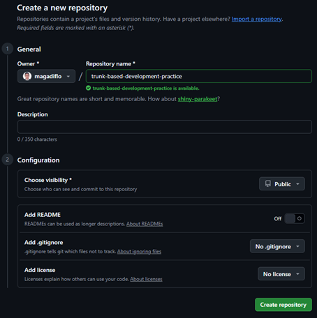

# Trunk Based Development y GitHub

- [Trunk Based Development (sitio de referencia)](https://trunkbaseddevelopment.com/) y su
  sección [You're doing it wrong](https://trunkbaseddevelopment.com/youre-doing-it-wrong)
- [How to Implement Trunk-Based Development: A Practical Guide (Unleash)](https://getunleash.io/trunk-based-development)
- [What Is Trunk-Based Development? A Complete Guide (Flagsmith)](https://flagsmith.com/blog/trunk-based-development)
- [Trunk-Based Development (Mergify)](https://mergify.com/learn/trunk-based-development)
- [Available rules for rulesets (GitHub Docs)](https://docs.github.com/en/repositories/configuring-branches-and-merges-in-your-repository/managing-rulesets/available-rules-for-rulesets)

> **Cómo leer esta documentación**
>
> - La práctica se hace en **GitHub real** con dos cuentas: **`magadiflo`** (dueño del repositorio, el desarrollador
    principal) y **`dev-partner-lab`** (el compañero de equipo). El repositorio se llama
    `trunk-based-development-practice`.
> - Los bloques `bash` muestran **quién** ejecuta cada comando con una etiqueta: **[magadiflo]** o
    **[dev-partner-lab]**.
> - Las salidas de terminal (`text`) provienen de **una simulación local** con los mismos usuarios, repositorio y
    comandos. Los **hashes** (`2b871c4`, etc.) y las fechas serán distintos en tu máquina.
> - Lo que es propio de GitHub (pantallas, rulesets, Actions, mensajes de rechazo del remoto) está escrito a partir de
    la documentación y **no fue ejecutado**. Cada vez que ocurre, se indica con **(GitHub, no verificado)**. Si algo no
    coincide con lo que ves, la interfaz de GitHub habrá cambiado: ajústalo y anótalo.
> - Donde dice **📷 Captura sugerida**, conviene guardar una imagen en `./assets/` (como hiciste en GitFlow).

---

## ¿Qué es Trunk Based Development?

`Trunk Based Development (TBD)` es una estrategia de branching donde **todos los desarrolladores integran sus cambios en
una única rama compartida, el `trunk` (el "tronco"), que en Git es `main`**, con cambios **pequeños y frecuentes**, en
lugar de trabajar semanas en ramas largas.

La idea central no es *"no usar ramas"*, sino **que las ramas vivan muy poco** (horas, a lo sumo uno o dos días) y que
`main` esté **siempre en un estado desplegable**.

> En GitFlow la pregunta es *"¿en qué rama va esto?"*. En TBD la pregunta es *"¿cómo lo hago lo bastante pequeño para
> integrarlo hoy sin romper nada?"*.

```text
GitFlow                                   Trunk Based Development

main     ──●────────────────●──           main  ──●──●──●──●──●──●──●──●──
develop  ──●──●──●──●──●──●──●──                    \/   \/    \/
feature     └──────●────┘                       (ramas de horas, se borran)
release              └──●──┘
```

### Principios

- Existe **una sola rama de vida infinita: `main`**. No hay `develop`.
- Los cambios se integran **al menos una vez al día**.
- `main` **siempre debe compilar y pasar las pruebas**. Se protege con integración continua (CI).
- El trabajo incompleto **no se esconde en una rama larga**: se integra a `main` **apagado detrás de un feature flag**.
- Los lanzamientos salen desde `main` (o desde una *release branch* corta).

### Estilos de TBD según el tamaño del equipo

| Estilo                                 | Cuándo se usa                               | Cómo se integra                                                                      |
|----------------------------------------|---------------------------------------------|--------------------------------------------------------------------------------------|
| **Commit directo al trunk**            | Equipos pequeños y de mucha confianza       | `git pull --rebase` → `git commit` → `git push` directo a `main`                     |
| **Ramas de vida corta + Pull Request** | Equipos medianos/grandes (el más común hoy) | Rama de menos de 1 día → PR pequeño → *Squash and merge* a `main` → se borra la rama |

En esta práctica se recorren **los dos estilos**: primero commits directos (Cambios `#1` y `#2`) y luego se **protege
`main`** y se trabaja con PR (Cambios `#3` al `#7`).

### Tipos de ramas

| Rama                   | Vida                   | Descripción                                                                                                                                                       |
|------------------------|------------------------|-------------------------------------------------------------------------------------------------------------------------------------------------------------------|
| `main` (trunk)         | Infinita               | Única fuente de verdad. Siempre desplegable.                                                                                                                      |
| `feature/*`, `fix/*`   | Horas, máximo 1-2 días | Una sola persona (o pareja). Se borra al integrarse.                                                                                                              |
| `release/*` (opcional) | Corta                  | Solo si se necesita una "foto" estable para producción. **No es una línea de desarrollo**: los arreglos se hacen primero en `main` y se llevan con `cherry-pick`. |

### Feature flags (feature toggles)

Si una funcionalidad tarda 2 semanas, **no** se deja 2 semanas en una rama. Se divide en pedazos pequeños que se
integran cada día, y el código incompleto queda **desactivado por un flag**:

```bash
if (nuevoCheckoutHabilitado) {
    return procesarConNuevoFlujo();   // en construcción
}
return procesarConFlujoActual();      // lo que ve producción
```

Así se **desacopla el despliegue (deploy) del lanzamiento (release)**: el código llega a producción, pero el usuario no
lo ve hasta que se enciende el flag.

### Requisitos para que funcione

Sin estas prácticas, TBD termina degradándose a "feature branching con otro nombre":

1. **CI rápida** en cada PR/commit (compilar + pruebas).
2. **Pruebas automatizadas** confiables.
3. **Feature flags** para código incompleto.
4. **Revisión de código ágil** (PR pequeños que se revisan en minutos, no en días).
5. **Cultura de commits pequeños.**

## Comparación: GitFlow vs Trunk Based Development

| Aspecto                      | GitFlow                                                           | Trunk Based Development                                    |
|------------------------------|-------------------------------------------------------------------|------------------------------------------------------------|
| Ramas de vida infinita       | `main` y `develop`                                                | Solo `main`                                                |
| Vida de las ramas de trabajo | Días o semanas (`feature`)                                        | Horas o 1-2 días                                           |
| Rama de integración          | `develop`                                                         | `main` directamente                                        |
| Preparar un lanzamiento      | Rama `release-*` con ajustes                                      | `main` ya está lista (o `release/*` corta con cherry-pick) |
| Hotfix                       | Rama `hotfix-*` → `main` **y** `develop`                          | Fix en `main` (+ cherry-pick a la release si aplica)       |
| Código incompleto            | Se queda en la rama `feature`                                     | Se integra apagado con feature flag                        |
| Riesgo de conflictos         | Alto (las ramas divergen mucho)                                   | Bajo (cambios pequeños y frecuentes)                       |
| Frecuencia de despliegue     | Por versiones planificadas                                        | Continua / varias veces al día                             |
| Exigencia de CI/CD y tests   | Moderada                                                          | **Alta (imprescindible)**                                  |
| Encaja mejor con             | Software con versiones calendarizadas (móvil, embebido, regulado) | Aplicaciones web/backend con despliegue continuo           |

### Cuándo conviene y cuándo no

- **Conviene:** servicios backend (Spring Boot, microservicios), equipos con CI/CD y buenas pruebas, despliegue
  frecuente.
- **No tanto:** software que se publica por calendario con revisiones largas (app stores) o que debe mantener varias
  versiones en paralelo durante años. Ahí las *release branches* de larga vida tienen sentido real.

## Origen y destino de las ramificaciones

| Rama                   | Origen                                                                                               | Destino                                                      | Convención          | Ejemplo                 |
|------------------------|------------------------------------------------------------------------------------------------------|--------------------------------------------------------------|---------------------|-------------------------|
| **main** (trunk)       |                                                                                                      |                                                              |                     |                         |
| **feature / fix**      | main                                                                                                 | main (PR + *Squash and merge*)                               | `feature/` · `fix/` | `feature/validar-email` |
| **release** (opcional) | main                                                                                                 | **no se fusiona de vuelta** (se borra al salir la siguiente) | `release/`          | `release/1.0`           |
| **hotfix**             | **No existe como rama aparte**: el arreglo nace en `main` y se lleva con `cherry-pick` a `release/*` |                                                              |                     |                         |

## Práctica: Tabla de cambios

| ID        | DESCRIPCIÓN CORTA                                               | RAMA DE TRABAJO                           | RAMA ORIGEN | RAMA DESTINO         | QUIÉN TRABAJA                               | QUIÉN REVISA    |
|-----------|-----------------------------------------------------------------|-------------------------------------------|-------------|----------------------|---------------------------------------------|-----------------|
| Cambio #1 | Endpoint `/api/saludo` (commit directo)                         | *(ninguna)*                               | main        | main                 | magadiflo                                   | —               |
| Cambio #2 | Conflicto: ambos editan `application.properties` (push directo) | *(ninguna)*                               | main        | main                 | magadiflo y dev-partner-lab                 | —               |
| Cambio #3 | Validar email al registrar usuario                              | `feature/validar-email`                   | main        | main                 | dev-partner-lab                             | magadiflo       |
| Cambio #4 | Nuevo checkout **incompleto** detrás de un feature flag         | `feature/nuevo-checkout`                  | main        | main                 | magadiflo                                   | dev-partner-lab |
| Cambio #5 | Dos PR en paralelo: el segundo entra en conflicto               | `feature/configurar-reintentos`           | main        | main                 | dev-partner-lab                             | magadiflo       |
| Cambio #6 | Preparar la versión 1.0                                         | `release/1.0`                             | main        | *(no vuelve a main)* | magadiflo                                   | —               |
| Cambio #7 | Bug en producción (v1.0.0) → v1.0.1                             | `fix/email-con-signo-mas` y `cherry-pick` | main        | main y `release/1.0` | dev-partner-lab (fix) y magadiflo (release) | magadiflo       |

> Entre los Cambios `#2` y `#3` se **activa la protección de `main`**. Por eso los dos primeros se hacen con commit
> directo y el resto con Pull Request.

## Inicio: preparación del entorno

### 1. Crear el repositorio en GitHub

Con la cuenta **magadiflo**:

> **GitHub > New repository**
> - **Repository name:** `trunk-based-development-practice`
> - **Visibility:** **Public** (los *rulesets* están disponibles en repositorios públicos con el plan gratuito)
> - **No** marcar *Add a README*, *.gitignore* ni *license* (el repositorio debe quedar vacío)



### 2. Invitar a `dev-partner-lab` como colaborador

Con **magadiflo**:

> **Repositorio > Settings > Collaborators > Add people** → buscar `dev-partner-lab` → rol **Write**

Con **dev-partner-lab**: aceptar la invitación desde el correo, o entrando a:

```text
https://github.com/magadiflo/trunk-based-development-practice/invitations
```


