# Trunk Based Development y GitHub

- [Trunk Based Development (sitio de referencia)](https://trunkbaseddevelopment.com/)
    - Y su sección [You're doing it wrong](https://trunkbaseddevelopment.com/youre-doing-it-wrong)
- [How to Implement Trunk-Based Development: A Practical Guide (Unleash)](https://getunleash.io/trunk-based-development)
- [What Is Trunk-Based Development? A Complete Guide (Flagsmith)](https://flagsmith.com/blog/trunk-based-development)
- [Trunk-Based Development (Mergify)](https://mergify.com/learn/trunk-based-development)
- [Available rules for rulesets (GitHub Docs)](https://docs.github.com/en/repositories/configuring-branches-and-merges-in-your-repository/managing-rulesets/available-rules-for-rulesets)
- [Git Credential Manager: varios usuarios (multiple-users.md)](https://github.com/git-ecosystem/git-credential-manager/blob/release/docs/multiple-users.md)
- [Managing your personal access tokens (GitHub Docs)](https://docs.github.com/en/authentication/keeping-your-account-and-data-secure/managing-your-personal-access-tokens)

> **Cómo leer esta documentación**
>
> - La práctica se hace en **GitHub real** con dos cuentas: **`magadiflo`** (dueño del repositorio, el desarrollador
>   principal) y **`dev-partner-lab`** (el compañero de equipo). El repositorio se llama
>   **`trunk-based-development-practice`**.
> - Los bloques `bash` muestran **quién** ejecuta cada comando con una etiqueta: `[magadiflo]` o
>   `[dev-partner-lab]`.
> - **Cada comando se explica al pie del bloque donde aparece por primera vez** (primero qué hace el comando completo y
>   luego cada una de sus partes). Si más adelante reaparece, ya no se vuelve a explicar; solo se explica lo nuevo
>   (por ejemplo, una opción que antes no se había usado). Los bloques de explicación empiezan con **📖 Comandos de
>   este bloque**.
> - Las salidas de terminal (`text`) provienen de **una simulación local** con los mismos usuarios, repositorio y
>   comandos. Los **hashes** (`93fd7e3`, etc.) y las fechas serán distintos en tu máquina. Como en la simulación el
>   remoto es una carpeta local y no GitHub, en tu terminal verás además líneas `remote:` que agrega GitHub (por
>   ejemplo, un enlace para crear el PR) y la URL `https://github.com/...` en vez de una ruta local.
> - Lo que es propio de GitHub (pantallas, rulesets, Actions, mensajes de rechazo del remoto) y de Git Credential
>   Manager está escrito a partir de la documentación y **no fue ejecutado**. Se indica con **(GitHub, no
>   verificado)**
>   o **(GCM, no verificado)**. Si algo no coincide con lo que ves, la interfaz habrá cambiado: ajústalo y anótalo.
> - Donde dice **📷 Captura sugerida**, conviene guardar una imagen en `./assets/` (como hiciste en GitFlow).

## ¿Qué es Trunk Based Development?

Trunk Based Development (TBD) es una estrategia de branching donde **todos los desarrolladores integran sus cambios en
una única rama compartida, el `trunk` (el "tronco"), que en Git es `main`**, con cambios **pequeños y frecuentes**, en
lugar de trabajar semanas en ramas largas.

La idea central no es "no usar ramas", sino **que las ramas vivan muy poco** (horas, a lo sumo uno o dos días) y que
`main` esté **siempre en un estado desplegable**.

> En GitFlow la pregunta es *"¿en qué rama va esto?"*. En TBD la pregunta es *"¿cómo lo hago lo bastante pequeño para
> integrarlo hoy sin romper nada?"*.

```text
GitFlow                                   Trunk Based Development

main     ──●────────────────●──           main  ──●──●──●──●──●──●──●──●──
develop  ──●──●──●──●──●──●──●──                    \/   \/    \/
feature     └──────●────┘                       (ramas de horas, se borran)
release              └──●──┘
```

### Principios

- Existe **una sola rama de vida infinita: `main`**. No hay `develop`.
- Los cambios se integran **al menos una vez al día**.
- `main` **siempre debe compilar y pasar las pruebas**. Se protege con integración continua (CI).
- El trabajo incompleto **no se esconde en una rama larga**: se integra a `main` **apagado detrás de un feature flag**.
- Los lanzamientos salen desde `main` (o desde una *release branch* corta).

### Estilos de TBD según el tamaño del equipo

| Estilo                                 | Cuándo se usa                               | Cómo se integra                                                                      |
|----------------------------------------|---------------------------------------------|--------------------------------------------------------------------------------------|
| **Commit directo al trunk**            | Equipos pequeños y de mucha confianza       | `git pull --rebase` → `git commit` → `git push` directo a `main`                     |
| **Ramas de vida corta + Pull Request** | Equipos medianos/grandes (el más común hoy) | Rama de menos de 1 día → PR pequeño → *Squash and merge* a `main` → se borra la rama |

En esta práctica se recorren **los dos estilos**: primero commits directos (Cambios `#1` y `#2`) y luego se **protege
`main`** y se trabaja con PR (Cambios `#3` al `#7`).

### Tipos de ramas

| Rama                   | Vida                   | Descripción                                                                                                                                                       |
|------------------------|------------------------|-------------------------------------------------------------------------------------------------------------------------------------------------------------------|
| `main` (trunk)         | Infinita               | Única fuente de verdad. Siempre desplegable.                                                                                                                      |
| `feature/*`, `fix/*`   | Horas, máximo 1-2 días | Una sola persona (o pareja). Se borra al integrarse.                                                                                                              |
| `release/*` (opcional) | Corta                  | Solo si se necesita una "foto" estable para producción. **No es una línea de desarrollo**: los arreglos se hacen primero en `main` y se llevan con `cherry-pick`. |

### Feature flags (feature toggles)

Si una funcionalidad tarda 2 semanas, **no** se deja 2 semanas en una rama. Se divide en pedazos pequeños que se
integran cada día, y el código incompleto queda **desactivado por un flag**:

```bash
if (nuevoCheckoutHabilitado) {
    return procesarConNuevoFlujo();   // en construcción
}
return procesarConFlujoActual();      // lo que ve producción
```

Así se **desacopla el despliegue (deploy) del lanzamiento (release)**: el código llega a producción, pero el usuario no
lo ve hasta que se enciende el flag.

### Requisitos para que funcione

Sin estas prácticas, TBD termina degradándose a "feature branching con otro nombre":

1. **CI rápida** en cada PR/commit (compilar + pruebas).
2. **Pruebas automatizadas** confiables.
3. **Feature flags** para código incompleto.
4. **Revisión de código ágil** (PR pequeños que se revisan en minutos, no en días).
5. **Cultura de commits pequeños.**

## Comparación: GitFlow vs Trunk Based Development

| Aspecto                      | GitFlow                                                           | Trunk Based Development                                    |
|------------------------------|-------------------------------------------------------------------|------------------------------------------------------------|
| Ramas de vida infinita       | `main` y `develop`                                                | Solo `main`                                                |
| Vida de las ramas de trabajo | Días o semanas (`feature`)                                        | Horas o 1-2 días                                           |
| Rama de integración          | `develop`                                                         | `main` directamente                                        |
| Preparar un lanzamiento      | Rama `release-*` con ajustes                                      | `main` ya está lista (o `release/*` corta con cherry-pick) |
| Hotfix                       | Rama `hotfix-*` → `main` **y** `develop`                          | Fix en `main` (+ cherry-pick a la release si aplica)       |
| Código incompleto            | Se queda en la rama `feature`                                     | Se integra apagado con feature flag                        |
| Riesgo de conflictos         | Alto (las ramas divergen mucho)                                   | Bajo (cambios pequeños y frecuentes)                       |
| Frecuencia de despliegue     | Por versiones planificadas                                        | Continua / varias veces al día                             |
| Exigencia de CI/CD y tests   | Moderada                                                          | **Alta (imprescindible)**                                  |
| Encaja mejor con             | Software con versiones calendarizadas (móvil, embebido, regulado) | Aplicaciones web/backend con despliegue continuo           |

### Cuándo conviene y cuándo no

- **Conviene:** servicios backend (Spring Boot, microservicios), equipos con CI/CD y buenas pruebas, despliegue
  frecuente.
- **No tanto:** software que se publica por calendario con revisiones largas (app stores) o que debe mantener varias
  versiones en paralelo durante años. Ahí las *release branches* de larga vida tienen sentido real.

## Origen y destino de las ramificaciones

| Rama                   | Origen                                                                                               | Destino                                                      | Convención          | Ejemplo                 |
|------------------------|------------------------------------------------------------------------------------------------------|--------------------------------------------------------------|---------------------|-------------------------|
| **main** (trunk)       |                                                                                                      |                                                              |                     |                         |
| **feature / fix**      | main                                                                                                 | main (PR + *Squash and merge*)                               | `feature/` · `fix/` | `feature/validar-email` |
| **release** (opcional) | main                                                                                                 | **no se fusiona de vuelta** (se borra al salir la siguiente) | `release/`          | `release/1.0`           |
| **hotfix**             | **No existe como rama aparte**: el arreglo nace en `main` y se lleva con `cherry-pick` a `release/*` |                                                              |                     |                         |

## Práctica: Tabla de cambios

| ID        | DESCRIPCIÓN CORTA                                        | RAMA DE TRABAJO                           | RAMA ORIGEN | RAMA DESTINO         | QUIÉN TRABAJA                               | QUIÉN REVISA    |
|-----------|----------------------------------------------------------|-------------------------------------------|-------------|----------------------|---------------------------------------------|-----------------|
| Cambio #1 | Endpoint `/api/saludo` (commit directo)                  | *(ninguna)*                               | main        | main                 | magadiflo                                   | —               |
| Cambio #2 | Conflicto: ambos editan `application.yml` (push directo) | *(ninguna)*                               | main        | main                 | magadiflo y dev-partner-lab                 | —               |
| Cambio #3 | Validar email al registrar usuario                       | `feature/validar-email`                   | main        | main                 | dev-partner-lab                             | magadiflo       |
| Cambio #4 | Nuevo checkout **incompleto** detrás de un feature flag  | `feature/nuevo-checkout`                  | main        | main                 | magadiflo                                   | dev-partner-lab |
| Cambio #5 | Dos PR en paralelo: el segundo entra en conflicto        | `feature/configurar-reintentos`           | main        | main                 | dev-partner-lab                             | magadiflo       |
| Cambio #6 | Preparar la versión 1.0                                  | `release/1.0`                             | main        | *(no vuelve a main)* | magadiflo                                   | —               |
| Cambio #7 | Bug en producción (v1.0.0) → v1.0.1                      | `fix/email-con-signo-mas` y `cherry-pick` | main        | main y `release/1.0` | dev-partner-lab (fix) y magadiflo (release) | magadiflo       |

> Entre los Cambios `#2` y `#3` se **activa la protección de `main`**. Por eso los dos primeros se hacen con commit
> directo y el resto con Pull Request.

## Inicio: preparación del entorno

### 1. Crear el repositorio en GitHub

Con la cuenta `magadiflo`:

> **GitHub > New repository**
> - **Repository name:** `trunk-based-development-practice`
> - **Visibility:** **Public** (los *rulesets* están disponibles en repositorios públicos con el plan gratuito)
> - **No** marcar *Add a README*, *.gitignore* ni *license* (el repositorio debe quedar vacío)


### 2. Invitar a `dev-partner-lab` como colaborador

Con `magadiflo`:

> **Repositorio > Settings > Collaborators > Add people** → buscar `dev-partner-lab` → rol **Write**

Con `dev-partner-lab`: aceptar la invitación desde el correo, o entrando a:

```text
https://github.com/magadiflo/trunk-based-development-practice/invitations
```


### 3. Dos cuentas en la misma PC: HTTPS y configuración local de Git

Si utilizas HTTPS, puedes trabajar con dos cuentas de GitHub desde la misma PC sin necesidad de generar y administrar
una llave SSH por cada cuenta.

La idea es mantener la configuración global de Git para tu cuenta principal (`magadiflo`) y establecer una configuración
local para el repositorio donde trabajarás como colaborador (`dev-partner-lab`). De esta manera, cada clon tendrá su
propia identidad de Git, sin afectar los demás repositorios de tu equipo.

#### Configuración global (`magadiflo`)

Si ya tienes configurada tu identidad principal, no necesitas modificar nada. Puedes comprobarla con:

```bash
C:\cmder
$ git config --global user.name
Martín Díaz

C:\cmder
$ git config --global user.email
tu-correo@ejemplo.com
```

> **📖 Comandos de este bloque**
>
> **`git config --global user.name`** y **`git config --global user.email`**: muestran la identidad que Git usa por
> defecto en **todos** tus repositorios.
> - `git config`: lee o escribe la configuración de Git. Si le das **solo la clave** (como aquí), **muestra** su valor;
>   si le das la clave **y un valor**, lo **guarda**.
> - `--global`: indica que se trabaja con la configuración **de tu usuario del sistema** (archivo `.gitconfig` de tu
>   carpeta personal), que vale para todos los repositorios. Los otros niveles son `--system` (toda la PC) y `--local`
>   (un solo repositorio).
> - `user.name` / `user.email`: las claves con el nombre y el correo que Git escribe como **autor** de cada commit.

#### Configuración local (`dev-partner-lab`)

Cuando clones el repositorio para trabajar como colaborador, configurarás su identidad únicamente dentro de ese
repositorio:

```bash
$ git config --local user.name "dev-partner-lab"
$ git config --local user.email "martin.g.diaz.flores@gmail.com"
```

> **📖 Comandos de este bloque**
>
> **`git config --local user.name "dev-partner-lab"`** y
> **`git config --local user.email "martin.g.diaz.flores@gmail.com"`**: guardan la identidad de `dev-partner-lab` **solo
> en este repositorio**.
> - `--local`: el valor se guarda en el archivo `.git/config` del repositorio actual. Tiene **prioridad** sobre
>   `--global`, así que dentro de este clon manda la identidad local y en los demás proyectos sigue la global. (Orden
>   de prioridad: local → global → system.)
> - `"dev-partner-lab"` / `"martin.g.diaz.flores@gmail.com"`: ahora sí hay **valor**, por eso el comando **escribe** en
>   lugar de mostrar. Si el correo no pertenece a la cuenta, GitHub mostrará los commits sin el usuario asociado.

> `git config --local` no modifica la configuración global ni afecta a los demás proyectos.

#### ¿Cómo funciona la autenticación con HTTPS?

La identidad configurada mediante `user.name` y `user.email` determina quién aparece como **autor de los commits**, pero
**no determina qué cuenta de GitHub realiza el push**. De hecho, la documentación de Git Credential Manager lo advierte:
`user.name` y `user.email` no afectan a GCM.

Para autenticar las operaciones HTTPS utilizaremos **Git Credential Manager (GCM)**, que gestiona las credenciales de
GitHub:

- `magadiflo` seguirá utilizando su autenticación habitual.
- `dev-partner-lab` deberá autenticarse con sus propias credenciales de GitHub.

**El problema:** si no se le indica nada, Git le pide credenciales a GCM **sin decirle qué usuario quiere** (para Git,
el usuario del remoto queda vacío). Si GCM ya tiene guardada tu cuenta principal, **puede reutilizarla**, y entonces el
push de `dev-partner-lab` saldría como `magadiflo` sin darte ningún error: los commits dirían `dev-partner-lab`, pero
quien empuja sería `magadiflo`. Con dos cuentas en el mismo dominio (`github.com`) hay que indicar el usuario de forma
explícita.

#### Indicar a GCM qué cuenta usar

GCM documenta dos formas de hacerlo: poner el usuario en la URL del remoto, o configurar
`credential.https://github.com.username`. Aquí usamos la segunda, pero con **alcance distinto para cada usuario**:

- `magadiflo` es la cuenta que se usa normalmente en esta PC, así que se configura de forma **global**: vale para
  cualquier repositorio de `github.com`, no solo para esta práctica.
- `dev-partner-lab` es la excepción, así que se configura de forma **local**, solo en su clon.

```bash
# magadiflo: global, se ejecuta una sola vez y desde cualquier carpeta
$ git config --global credential.https://github.com.username "magadiflo"

# dev-partner-lab: local, se ejecuta dentro de su clon
$ git config --local credential.https://github.com.username "dev-partner-lab"
```

> **📖 Comandos de este bloque**
>
> `git config --global credential.https://github.com.username "..."`: le dice a Git qué **usuario de GitHub** debe
> pedirle a GCM al hablar con `https://github.com`.
> - `credential.https://github.com.username`: es una clave con el formato `credential.<URL>.username`. El `<URL>`
>   (aquí `https://github.com`) limita el efecto a ese sitio: para otros servidores (GitLab, etc.) no se envía ningún
>   usuario.
> - `--global`: guarda la configuración en el archivo `.gitconfig` de tu usuario del sistema, así que **aplica a todos
>   los repositorios de tu PC**. (`--local`, la guarda solo dentro del repositorio actual.)
> - `"magadiflo"` / `"dev-partner-lab"`: el usuario que GCM debe buscar o crear. Cada usuario tiene sus propias
>   credenciales guardadas, así que **ya no se mezclan**.

**¿Por qué `magadiflo` va en global y no en local?** Porque en esta PC habrá **dos** cuentas guardadas para
`github.com`. En cualquier proyecto que no tenga un usuario definido, GCM no sabrá cuál usar y te mostrará una ventana
para elegir entre las dos, aunque ese proyecto no tenga nada que ver con esta práctica. Dejando a `magadiflo` como
valor global, esos proyectos usarán siempre su cuenta habitual, sin preguntar.

**¿Y no se pisan?** No. Git aplica primero la configuración **local** y luego la global, y la local gana. En el clon
de `dev-partner-lab` se usa `dev-partner-lab`, y en cualquier otro repositorio, `magadiflo`.

Para comprobar qué valor se aplica y de dónde viene:

```bash
$ git config --show-origin --get-regexp credential
```

- `git config --get-regexp credential`: muestra las claves cuyo nombre contiene `credential`.
- `--show-origin`: añade al inicio de cada línea el archivo de donde sale (el `.gitconfig` global o el `config` local
  del repositorio).

> **Dos cosas a tener en cuenta:**
> - Como el valor global aplica a **todos** los repositorios de `github.com`, si en algún otro proyecto necesitas otra
>   cuenta, ese proyecto debe llevar su propia configuración local, igual que el clon de `dev-partner-lab`.
> - Si la URL del remoto ya trae el usuario (`https://usuario@github.com/...`), esa URL tiene prioridad sobre las dos
>   configuraciones.

> **Alternativa equivalente:** poner el usuario en la URL,
> `https://dev-partner-lab@github.com/magadiflo/trunk-based-development-practice.git`. Funciona igual, pero deja el
> usuario visible dentro de la URL del remoto.

#### Primer push de `dev-partner-lab`: iniciar sesión con la cuenta correcta

La primera vez que `dev-partner-lab` empuje, GCM no encontrará credenciales para ese usuario y abrirá su ventana de
inicio de sesión de GitHub.

Precauciones:

- Si tu navegador predeterminado tiene abierta la sesión de **magadiflo**, autoriza con **dev-partner-lab**: abre el
  enlace en una ventana de incógnito o elige la opción de **código de dispositivo** (*device code*), que puedes
  completar en un navegador donde esté la otra cuenta.
- Si prefieres un token, debe ser un **token clásico (*classic*) con el permiso `repo`**. Según GitHub Docs, los tokens
  de grano fino (*fine-grained*) todavía no cubren el caso de contribuir a repositorios donde eres colaborador de otra
  cuenta personal.

Para comprobar qué cuentas guardó GCM:

```bash
$ git credential-manager github list
```

> **📖 Comandos de este bloque**
>
> `git credential-manager github list`: lista las cuentas de GitHub que Git Credential Manager tiene guardadas.
> - `git credential-manager`: invoca a GCM desde Git.
> - `github`: el subcomando para el proveedor GitHub (también existen `login` y `logout` para iniciar o cerrar sesión de
>   una cuenta; mira `git credential-manager github --help` para sus opciones).
> - `list`: muestra las cuentas guardadas. Tras el primer push de `dev-partner-lab` deberían aparecer **las dos**.

No es necesario configurar una llave SSH por cuenta ni modificar la configuración global de Git para establecer las
identidades locales.

### 4. Clonar dos copias del repositorio

Cada "desarrollador" tendrá su propia carpeta y su propio clon del repositorio. De esta manera, podremos simular el
trabajo de dos integrantes de un equipo desde una misma PC.

```text
M:\practice\
├── magadiflo\
│   └── trunk-based-development-practice\      ← clon de magadiflo
└── dev-partner-lab\
    └── trunk-based-development-practice\      ← clon de dev-partner-lab
```

#### `[magadiflo]`

Ubicados en el directorio `M:\practice` mediante el CMD (usaré para este usuario el `Cmder`), realizamos los siguientes
pasos para preparar nuestro repositorio local y clonar el repositorio utilizando HTTPS:

```bash
M:\practice
$ mkdir magadiflo && cd magadiflo

M:\practice\magadiflo
$ git clone https://github.com/magadiflo/trunk-based-development-practice.git
Cloning into 'trunk-based-development-practice'...
warning: You appear to have cloned an empty repository.

M:\practice\magadiflo
$ cd trunk-based-development-practice\
```

> **📖 Comandos de este bloque**
>
> `mkdir magadiflo && cd magadiflo`: crea una carpeta y entra en ella.
> - `mkdir magadiflo`: *make directory*, crea la carpeta `magadiflo`.
> - `&&`: ejecuta el comando siguiente **solo si el anterior terminó bien**.
> - `cd magadiflo`: *change directory*, cambia la carpeta actual a `magadiflo`.
>
> `git clone https://github.com/magadiflo/trunk-based-development-practice.git`: descarga una copia completa del
> repositorio remoto.
> - `git clone`: crea una carpeta con el nombre del repositorio, descarga todo su historial, define el remoto `origin`
>   apuntando a esa URL y deja listo el seguimiento de `main`.
> - `https://github.com/...git`: la URL HTTPS del repositorio (se copia del botón **Code** de GitHub).
>
> **`cd trunk-based-development-practice`**: entra en la carpeta recién clonada (todos los comandos Git siguientes se
> ejecutan ahí dentro).

Si la identidad global ya está configurada para `magadiflo`, no necesitamos configurar `user.name` ni `user.email`. Lo
comprobamos mostrando **de dónde viene** cada valor:

```bash
M:\practice\magadiflo\trunk-based-development-practice (main -> origin)
$ git config --show-origin user.name
file:C:/Users/magadiflo/.gitconfig      Martín Díaz

M:\practice\magadiflo\trunk-based-development-practice (main -> origin)
$ git config --show-origin user.email
file:C:/Users/magadiflo/.gitconfig      magadiflo@gmail.com
```

> **📖 Comandos de este bloque**
>
> `git config --show-origin user.name`: muestra el valor que Git usará **y el archivo donde está definido**.
> - `--show-origin`: antepone la ruta del archivo de configuración. Así distingues si el valor viene de `.git/config`
>   (local) o del `.gitconfig` global. (Sin esta opción solo verías el valor.)
> - `user.name` / `user.email`: las claves que se consultan.


Antes de agregar al segundo usuario falta una configuración **importante**: indicarle a GCM cuál será la cuenta por
defecto.

Ahora mismo GCM solo conoce a `magadiflo`. Cuando más adelante autentiquemos también a `dev-partner-lab`, habrá **dos**
cuentas guardadas para `github.com`. En cualquier repositorio que no tenga un usuario definido, GCM no sabrá cuál usar
y mostrará una ventana para elegir. Para evitarlo, dejamos a `magadiflo` como cuenta por defecto en la configuración
**global**, que aplica a cualquier repositorio de esta PC. Es el comando que ya explicamos en
[Indicar a GCM qué cuenta usar](#indicar-a-gcm-qué-cuenta-usar); aquí lo ejecutamos. Como es global, podemos
ejecutarlo desde cualquier ubicación:

````bash
C:\cmder
$ git config --global credential.https://github.com.username "magadiflo"

C:\cmder
$ git config --global --list
core.editor="C:\Users\magadiflo\AppData\Local\Programs\Microsoft VS Code\bin\code" --wait
filter.lfs.clean=git-lfs clean -- %f
filter.lfs.smudge=git-lfs smudge -- %f
filter.lfs.process=git-lfs filter-process
filter.lfs.required=true
user.name=Martín Díaz
user.email=magadiflo@gmail.com
alias.lg=log --oneline --decorate --all --graph
alias.s=status -s -b
credential.https://github.com.username=magadiflo
````

> **📖 Comandos de este bloque**
>
> `git config --global --list`: muestra **todas** las configuraciones guardadas en el archivo global.
> - `--global`: limita la consulta al `.gitconfig` de tu usuario del sistema.
> - `--list`: lista todas las claves con su valor (`clave=valor`), en lugar de consultar una sola.

En la última línea de la salida vemos que ya quedó configurado el `credential`:
`credential.https://github.com.username=magadiflo`.

> Para consultar solo ese valor, sin la lista completa, se puede usar
> `git config --global credential.https://github.com.username`.

> **Sobre las líneas `alias.lg` y `alias.s`:** son **alias personales** que ya tenía en mi configuración global.
> Por eso, en el resto del documento, `git lg` equivale a `git log --oneline --decorate --all --graph` y `git s`
> equivale a `git status -s -b`. Si quieres usarlos, se crean así:
>
> ```bash
> git config --global alias.lg "log --oneline --decorate --all --graph"
> git config --global alias.s "status -s -b"
> ```
>
> Si no los defines, escribe en cada caso el comando completo.

**Cómo quitar esta configuración** (solo como referencia, **no lo ejecutes ahora**, porque dejaría a GCM sin usuario por
defecto):

````bash
# quitarla de la configuración global
$ git config --global --unset credential.https://github.com.username

# quitarla de un repositorio en específico (se ejecuta dentro de ese repositorio)
$ git config --local --unset credential.https://github.com.username
````

> **📖 Comandos de este bloque**
>
> `git config --unset <clave>`: elimina esa clave de la configuración.
> - `--global` / `--local`: indica de **cuál** archivo se elimina: el global de tu usuario o el del repositorio donde
>   estás parado.

#### `[dev-partner-lab]`

Clonamos otra copia del mismo repositorio (el repositorio sigue perteneciendo a `magadiflo`). Así que nos posicionamos
en el directorio `M:\practice` y esta vez usaremos una línea de comandos distinta, para este usuario usaremos
`GitBash`.

````bash
magadiflo@SysEngJava UCRT64 /m/practice
$ mkdir dev-partner-lab && cd dev-partner-lab

magadiflo@SysEngJava UCRT64 /m/practice/dev-partner-lab
$ git clone https://github.com/magadiflo/trunk-based-development-practice.git
Cloning into 'trunk-based-development-practice'...
warning: You appear to have cloned an empty repository.

magadiflo@SysEngJava UCRT64 /m/practice/dev-partner-lab
$ cd trunk-based-development-practice/ 
````

Ahora configuramos la identidad local del colaborador y la cuenta que usará GCM:

```bash
magadiflo@SysEngJava UCRT64 /m/practice/dev-partner-lab/trunk-based-development-practice (main)
$ git config --local user.name "dev-partner-lab"

magadiflo@SysEngJava UCRT64 /m/practice/dev-partner-lab/trunk-based-development-practice (main)
$ git config --local user.email "martin.g.diaz.flores@gmail.com"

magadiflo@SysEngJava UCRT64 /m/practice/dev-partner-lab/trunk-based-development-practice (main)
$ git config --local credential.https://github.com.username "dev-partner-lab"
```

Verificamos que se hayan aplicado correctamente los datos, y **de dónde** vienen:

```bash
magadiflo@SysEngJava UCRT64 /m/practice/dev-partner-lab/trunk-based-development-practice (main)
$ git config --show-origin user.name
file:.git/config        dev-partner-lab

magadiflo@SysEngJava UCRT64 /m/practice/dev-partner-lab/trunk-based-development-practice (main)
$ git config --show-origin user.email
file:.git/config        martin.g.diaz.flores@gmail.com

magadiflo@SysEngJava UCRT64 /m/practice/dev-partner-lab/trunk-based-development-practice (main)
$ git config --local --get-regexp "^(user|credential)\."
user.name dev-partner-lab
user.email martin.g.diaz.flores@gmail.com
credential.https://github.com.username dev-partner-lab

magadiflo@SysEngJava UCRT64 /m/practice/dev-partner-lab/trunk-based-development-practice (main)
$ git remote -v
origin  https://github.com/magadiflo/trunk-based-development-practice.git (fetch)
origin  https://github.com/magadiflo/trunk-based-development-practice.git (push)
```

> **📖 Comandos de este bloque**
>
> `git config --local --get-regexp "^(user|credential)\."`: lista las claves de la configuración **local** cuyo
> nombre empieza por `user.` o `credential.`.
> - `--get-regexp`: busca claves cuyo nombre coincide con una **expresión regular** y muestra `clave valor`.
> - `"^(user|credential)\."`: la expresión regular: `^` = al inicio del nombre; `(user|credential)` = una de las dos
>   palabras; `\.` = un punto literal.
>
> `git remote -v`: muestra los repositorios remotos configurados y sus URL.
> - `git remote`: administra los remotos. Sin más argumentos, solo lista sus nombres (`origin` es el que crea
>   `git clone`).
> - `-v`: *verbose*, agrega la URL de cada remoto, una para bajar cambios (*fetch*) y otra para subirlos (*push*).

> **Importante:** el repositorio sigue perteneciendo a `magadiflo`. Sin embargo, `dev-partner-lab` podrá contribuir
> porque previamente habrá aceptado la invitación como colaborador.

> **Sobre la autenticación:** cuando `dev-partner-lab` realice su primer push, GCM deberá utilizar las credenciales de
> esa cuenta
> (ver [Primer push de dev-partner-lab](#primer-push-de-dev-partner-lab-iniciar-sesión-con-la-cuenta-correcta)).

### 5. Proyecto base Spring Boot + CI (commit inicial)

El proyecto base se genera una sola vez y lo sube `magadiflo`.

**Paso 1: generar el proyecto** en
[start.spring.io](https://start.spring.io/#!type=maven-project&language=java&platformVersion=4.1.2&packaging=jar&configurationFileFormat=yaml&jvmVersion=25&groupId=dev.magadiflo&artifactId=trunk-based-development-practice&packageName=dev.magadiflo.tbd&dependencies=web,lombok):

| Campo        | Valor                                             |
|--------------|---------------------------------------------------|
| Project      | Maven                                             |
| Language     | Java                                              |
| Spring Boot  | 4.1.2                                             |
| Group        | `dev.magadiflo`                                   |
| Artifact     | `trunk-based-development-practice`                |
| Package name | `dev.magadiflo.tbd`                               |
| Packaging    | Jar                                               |
| Java         | 25 *(o la que uses; debe coincidir con `ci.yml`)* |
| Dependencies | Spring Web, Lombok                                |

Descomprime el `.zip` y copia **su contenido** (`pom.xml`, `mvnw`, `mvnw.cmd`, `.mvn/`, `.gitignore`, `src/`) dentro del
clon de `magadiflo`.

**Paso 2: el workflow de CI.** El archivo se crea dentro del proyecto, en la raíz del clon de `magadiflo` (la carpeta
`trunk-based-development-practice`, junto a `pom.xml`). GitHub solo reconoce los workflows que estén exactamente en
`.github/workflows/`. Si esas carpetas no existen, créalas:

````bash
M:\practice\magadiflo\trunk-based-development-practice (main -> origin)
$ mkdir .github\workflows 
````

> **📖 Comandos de este bloque**
>
> `mkdir .github\workflows`: crea las dos carpetas anidadas de una sola vez.
> - `mkdir`: ya explicado.

Dentro de esa carpeta crearemos el archivo `ci.yml`. El nombre es solo una convención: puede llamarse como quieras
(`build.yml`, `pruebas.yml`, etc.), siempre que termine en `.yml` o `.yaml`. Aun así, conviene que sea semántico, es
decir, que el nombre diga qué hace el workflow (`ci.yml` para integración continua, `deploy.yml` para despliegue),
porque en un proyecto real habrá varios archivos en esa carpeta y así se distinguen de un vistazo.

Lo que sí debes respetar es lo que hay dentro del archivo: el identificador del job (`build`) es el nombre del check
que más adelante exigiremos en el `ruleset`. Si lo cambias, también tendrías que actualizar el ruleset.

````bash
M:\practice\magadiflo\trunk-based-development-practice (main -> origin)
$ type nul > .github\workflows\ci.yml

M:\practice\magadiflo\trunk-based-development-practice (main -> origin)
$ cd .github\workflows

M:\practice\magadiflo\trunk-based-development-practice\.github\workflows (main -> origin)
$ ls -l
total 0
-rw-r--r-- 1 magadiflo 197121 0 Nov 16 23:07 ci.yml
````

**¿Qué es el archivo `ci.yml` y cómo funciona?**

Este archivo describe un **workflow de GitHub Actions**: una receta que GitHub ejecuta automáticamente en sus propios
servidores cada vez que ocurre algo en el repositorio. Aquí la receta es la **Integración Continua (CI)**: compilar el
proyecto y correr las pruebas **en un entorno limpio**, para que "en mi máquina funciona" deje de ser la medida de
calidad.

**Qué pasa, paso a paso:**

1. Subes tu rama y abres un `Pull Request` hacia `main`.
2. GitHub lee los archivos de `.github/workflows/` y detecta que este workflow debe ejecutarse por ese evento.
3. GitHub levanta una **máquina virtual nueva y vacía** (llamada *runner*).
4. En esa máquina ejecuta, en orden, los pasos del archivo: descargar el código, instalar Java, compilar y probar.
5. Si todo pasa, el PR muestra un check verde ✅. Si algo falla, muestra una ❌ y puedes abrir el log para ver el motivo.
6. Nuestro *ruleset* exige que el check `build` esté en verde. Con ❌ **no se puede hacer el merge**.

**¿Cuándo se ejecuta?** No en cualquier `push`. Según la sección `on:`:

| Situación                                                        | ¿Se ejecuta?                     |
|------------------------------------------------------------------|----------------------------------|
| Abres un `PR` hacia `main`                                       | Sí                               |
| Subes más commits a la rama de un PR abierto                     | Sí (se vuelve a ejecutar)        |
| Haces `push` a una rama `feature/*` **sin** `PR` abierto         | No                               |
| El `PR` se fusiona (Squash and merge) y el commit llega a `main` | Sí (valida que `main` siga sano) |
| Haces `push` directo a `main`                                    | Sí                               |

Los resultados están en la pestaña **Actions** del repositorio, y dentro de cada PR, en la sección de checks.

**Una máquina nueva en cada ejecución:** como el runner empieza vacío, el workflow tiene que traer el código, instalar
Java y descargar las dependencias cada vez. Por eso aparecen esos pasos.

El archivo `ci.yml` tendrá el siguiente contenido:

```yaml
name: CI

on:
  pull_request:
    branches: [ main ]
  push:
    branches: [ main ]
  merge_group:            # solo necesario si algún día usamos merge queue

jobs:
  build:
    runs-on: ubuntu-latest
    steps:
      - uses: actions/checkout@v7
      - uses: actions/setup-java@v6
        with:
          distribution: temurin
          java-version: '25'
          cache: maven
      - name: Compilar y ejecutar pruebas
        run: ./mvnw -B verify
```

**Reglas básicas de YAML** (el formato del archivo):

- La estructura se define con la **indentación**, usando espacios (2 por nivel) y **nunca tabuladores**. Un espacio mal
  puesto cambia el significado o rompe el archivo.
- `clave: valor` define una propiedad.
- Una línea que empieza con `- ` es un **elemento de una lista**.
- `[ main ]` es una lista escrita en una sola línea (equivale a `- main`).
- `#` inicia un comentario.

#### `name: CI`

El nombre del workflow. Aparece en la pestaña *Actions* y en el PR, junto al nombre del job (verás algo como
`CI / build (pull_request)`). Es solo una etiqueta: no es el nombre del archivo ni afecta el funcionamiento.

#### `on:`

Define **cuándo** se ejecuta el workflow, es decir, qué eventos lo disparan. Si falta o queda vacío, GitHub marca el
error `No event triggers defined in on`.

```yaml
  pull_request:
    branches: [ main ]
```

- `pull_request`: se ejecuta cuando se **abre**, se **actualiza** (nuevo commit) o se **reabre** un Pull Request.
- `branches: [ main ]`: filtro. Solo cuenta si el PR **apunta a `main`** (la rama destino).
- Qué código prueba: GitHub prueba el resultado de **fusionar tu rama con `main`**, es decir, cómo quedaría el código si
  se hiciera el merge ahora.

```yaml
  push:
    branches: [ main ]
```

- `push`: se ejecuta cuando alguien sube commits al repositorio.
- `branches: [ main ]`: solo si el `push` es a `main`. Cubre el merge de un PR (el squash genera un commit nuevo en
  `main`) y los `push` directos.
- Sin este filtro, se ejecutaría en cada `push` a cualquier rama.

```yaml
  merge_group:            # solo necesario si algún día usamos merge queue
```

- `merge_group`: evento de la *merge queue* (cola de fusión), una función de GitHub que encola los PR y los prueba
  combinados antes de integrarlos.
- No la usamos, así que este evento nunca se dispara y la línea es inofensiva. Se deja por si algún día se activa la
  cola: sin ella, los checks requeridos no se reportarían.
- No lleva valor después de los dos puntos, y es válido.

#### `jobs:`

Agrupa los **trabajos** del workflow. Cada job se ejecuta en su propia máquina virtual. Aquí hay uno solo.

#### `build:`

El **identificador** del job (nosotros lo elegimos). Importante: **este nombre es el que se registra como check
requerido** en el ruleset (`build`). Si lo renombras aquí, debes actualizar también el ruleset, o el PR se quedará
esperando un check que nunca llega.

#### `runs-on: ubuntu-latest`

El tipo de máquina donde corre el job: una máquina virtual con **Linux (Ubuntu)** alojada por GitHub. `ubuntu-latest`
apunta a la versión estable más reciente que GitHub ofrece, así que con el tiempo puede cambiar de versión. En
repositorios públicos su uso es gratuito.

Como es Linux, el script se invoca como `./mvnw` y necesita permiso de ejecución. Por eso hicimos
`git update-index --chmod=+x mvnw` en el commit inicial.

#### `steps:`

La lista de **pasos** del job. Se ejecutan **en orden**, y si uno falla, los siguientes no se ejecutan y el job queda en
❌. Cada elemento empieza con `- `.

#### `- uses: actions/checkout@v7`

- `uses`: ejecuta una **acción** ya hecha, publicada por alguien. El formato es `propietario/repositorio@versión`.
- `actions/checkout`: acción oficial de GitHub que **descarga el código del repositorio** en el runner. Como la máquina
  arranca vacía, sin este paso no habría nada que compilar.
- `@v7`: versión mayor de la acción. Recibe las correcciones menores de esa versión, pero no los cambios de versión
  mayor.

#### `- uses: actions/setup-java@v6` y su `with:`

- `actions/setup-java`: acción oficial que **instala un JDK** en el runner y lo deja configurado.
- `with:`: bloque con los **parámetros** de la acción anterior. Está indentado un nivel más porque pertenece a ese paso.
- `distribution: temurin`: qué distribución de OpenJDK instalar. *Temurin* es la distribución de Eclipse Adoptium, de
  uso muy común.
- `java-version: '25'`: la versión de Java. Debe coincidir con `<java.version>` del `pom.xml`. Va entre comillas para
  que YAML la lea como texto y no como número (una versión como `21.0` se interpretaría mal).
- `cache: maven`: guarda las dependencias descargadas por Maven y las restaura en las siguientes ejecuciones. La primera
  vez descarga todo, pero las siguientes son más rápidas. La caché se renueva cuando cambia el `pom.xml`.

#### `- name: Compilar y ejecutar pruebas` y `run: ./mvnw -B verify`

- `name`: etiqueta **opcional** del paso, que se muestra en el log. Los pasos con `uses` no la tienen aquí, y en el log
  aparecen con su nombre técnico (por ejemplo, `Run actions/checkout@v7`).
- `run`: ejecuta un **comando de terminal** en el runner (a diferencia de `uses`, que ejecuta una acción empaquetada).

> **📖 Comandos de este bloque**
>
> `./mvnw -B verify`: compila el proyecto, ejecuta las pruebas y valida el resultado, sin pedir nada por consola.
> - `./mvnw`: el *Maven Wrapper* del proyecto; usa la versión de Maven definida en el proyecto sin tener que instalarla
>   (`./` = "el archivo de esta carpeta").
> - `-B`: *batch mode*, modo no interactivo con salida más limpia, pensado para servidores de CI.
> - `verify`: fase del ciclo de vida de Maven. Ejecuta todas las anteriores (compilar, probar, empaquetar) y luego las
>   verificaciones finales.

**Si `verify` falla** (una prueba rota o un error de compilación), el comando devuelve un código de error. El paso se
marca como fallido, el job queda en ❌, el check `build` del PR no pasa y el ruleset bloquea el merge.

**Sobre Java:** `java-version: '25'` debe coincidir con la versión de tu proyecto (`<java.version>` en el `pom.xml`) y
con la que usas en tu máquina (`java -version`). `temurin` es la distribución de Java (Eclipse Temurin); el README de
`setup-java` v6 acepta versiones mayores como `'25'`. `cache: maven` guarda las dependencias de Maven entre ejecuciones
para que la CI sea más rápida.

**Paso 3: el permiso de ejecución de `mvnw`.** Al descomprimir en Windows, `mvnw` suele subirse **sin permiso de
ejecución** y en el runner Linux de GitHub la CI fallaría con `Permission denied`. Se corrige en el índice de Git:

`[magadiflo]`

```bash
M:\practice\magadiflo\trunk-based-development-practice (main -> origin)
$ git add .

M:\practice\magadiflo\trunk-based-development-practice (main -> origin)
$ git update-index --chmod=+x mvnw

M:\practice\magadiflo\trunk-based-development-practice (main -> origin)
$ git ls-files -s mvnw
100755 bd8896bf2217b46faa0291585e01ac1a3441a958 0       mvnw
```

> **📖 Comandos de este bloque**
>
> `git add .`: prepara (*stage*) todos los cambios de la carpeta actual para el próximo commit.
> - `git add`: mueve cambios al *staging area*, la "lista" de lo que entrará en el commit.
> - `.`: significa "la carpeta actual y todo lo que contiene". Respeta el `.gitignore`.
>
> `git update-index --chmod=+x mvnw`: marca `mvnw` como ejecutable **dentro de Git**.
> - `git update-index`: comando de bajo nivel que modifica el índice (el *staging area*) directamente.
> - `--chmod=+x`: agrega el permiso de ejecución. Se hace en el índice porque en Windows el sistema de archivos no lo
>   guarda como en Linux.
> - `mvnw`: el archivo al que se aplica.
>
> `git ls-files -s mvnw`: muestra cómo está registrado `mvnw` en el índice.
> - `git ls-files`: lista los archivos que Git está siguiendo.
> - `-s` (*--stage*): agrega modo, hash y número de etapa de cada archivo.
> - `mvnw`: limita la salida a ese archivo.
> - El `100755` de la salida significa "archivo ejecutable" (antes era `100644`, archivo normal).

**Paso 4: commit inicial y push.**

`[magadiflo]`

```bash
M:\practice\magadiflo\trunk-based-development-practice (main -> origin)
$ git commit -m "Initial commit"

M:\practice\magadiflo\trunk-based-development-practice (main -> origin)
$ git push -u origin main

M:\practice\magadiflo\trunk-based-development-practice (main -> origin)
$ git lg
* 79389aa (HEAD -> main, origin/main) Initial commit
```

En mis configuraciones globales tengo configurado el siguiente alias:

- `alias.lg=log --oneline --decorate --all --graph`

Por lo que los siguientes comandos son equivalentes:

- `git lg` == `git log --oneline --graph --all --decorate`

> **📖 Comandos de este bloque**
>
> `git commit -m "Initial commit"`: guarda en el historial una "foto" de lo que está en el *staging area*.
> - `git commit`: crea el commit con los cambios preparados con `git add`.
> - `-m "Initial commit"`: el mensaje del commit, escrito directamente en el comando (sin abrir un editor).
>
> `git push -u origin main`: sube la rama `main` local al repositorio remoto.
> - `git push`: envía tus commits al remoto.
> - `origin`: el nombre del remoto (el repositorio de GitHub, creado por `git clone`).
> - `main`: la rama que se sube.
> - `-u` (*--set-upstream*): enlaza tu `main` local con `origin/main`, de modo que luego bastan `git push` y `git pull`
>   sin argumentos.

En **GitHub > Actions** debe aparecer la primera ejecución del workflow **CI** (job `build`). Espera a que quede en
verde.

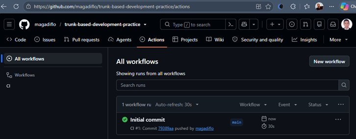

Ahora `dev-partner-lab` recibe el proyecto. Como clonó el repositorio cuando estaba vacío, aquí hace su primer `pull`;
**este es también su primer contacto con GitHub como colaborador**, así que es donde GCM puede pedirle iniciar sesión:

`[dev-partner-lab]`

````bash
magadiflo@SysEngJava UCRT64 /m/practice/dev-partner-lab/trunk-based-development-practice (main)
$ git pull --rebase
remote: Enumerating objects: 28, done.
remote: Counting objects: 100% (28/28), done.
remote: Compressing objects: 100% (16/16), done.
remote: Total 28 (delta 0), reused 28 (delta 0), pack-reused 0 (from 0)
Unpacking objects: 100% (28/28), 9.82 KiB | 201.00 KiB/s, done.
From https://github.com/magadiflo/trunk-based-development-practice
 * [new branch]      main       -> origin/main

magadiflo@SysEngJava UCRT64 /m/practice/dev-partner-lab/trunk-based-development-practice (main)
$ git s
## main...origin/main

magadiflo@SysEngJava UCRT64 /m/practice/dev-partner-lab/trunk-based-development-practice (main)
$ git lg
* 79389aa (HEAD -> main, origin/main, origin/HEAD) Initial commit
````

En mis configuraciones globales tengo configurado el siguiente alias:

- `alias.s=status -s -b`

Por lo que los siguientes comandos son equivalentes:

- `git s` == `git status -sb`

> **📖 Comandos de este bloque**
>
> `git pull --rebase`: trae los cambios nuevos del remoto y los integra en tu rama, **manteniendo el historial en
> línea recta**.
> - `git pull`: hace dos cosas seguidas: `git fetch` (descargar lo nuevo del remoto) y luego integrarlo en tu rama
>   actual.
> - `--rebase`: en lugar de crear un commit de unión (*merge*), "levanta" tus commits locales y los vuelve a colocar
>   encima de lo que bajó del remoto. Resultado: historial lineal, sin commits de merge.
>
> `git status -sb`: muestra el estado del repositorio en formato corto.
> - `git status`: indica qué archivos cambiaron, cuáles están en el *staging* y en qué rama estás.
> - `-s` (*--short*): formato compacto, una línea por archivo (por ejemplo, `UU` significa "conflicto: modificado por
>   ambos lados").
> - `-b` (*--branch*): agrega arriba la línea `## rama...remoto` con el seguimiento. Que aparezca
>   `## main...origin/main` confirma que tu `main` está enlazada con la remota.
>
> `git log --oneline --graph --all --decorate`: dibuja el historial de commits.
> - `git log`: lista los commits.
> - `--oneline`: un commit por línea (hash corto + mensaje).
> - `--graph`: dibuja el árbol de ramas con líneas ASCII.
> - `--all`: incluye todas las ramas (locales y remotas), no solo la actual.
> - `--decorate`: muestra los nombres junto al commit: `HEAD -> main` es dónde estás parado y `origin/main` es la copia
>   local de la rama remota.

**¿Quién rebasa a quién?** Siempre **tus commits locales** (los que aún no subiste) se colocan **encima** de lo que
trajo el remoto. Nunca al revés:

1. `git fetch` descarga los commits nuevos del remoto y mueve `origin/main`.
2. `git rebase origin/main` toma tus commits locales que no están en el remoto, los "levanta" y los vuelve a colocar
   encima del último commit de `origin/main`.
3. Tu `main` queda apuntando al final de esa línea. No hace falta ningún `git merge`.

Antes (tú tienes `D` y `E` sin subir; el remoto ya tiene `C`):

```text
A---B---C                origin/main (lo que bajó el fetch)
     \
      D---E              main (local)
```

- `A` y `B` están en ambos lados.
- `C` solo existe en el remoto.
- `D` y `E` solo existen en tu local, y nacen de `B`.

Después de `git pull --rebase`:

```text
A---B---C---D'---E'      main (local)
        |
        origin/main
```

- `D'` y `E'` son **copias** de `D` y `E`: mismo contenido y mismo mensaje, pero **con otro hash**, porque ahora tienen
  otro commit padre. Por eso se dice que el rebase "reescribe" tus commits locales.
- Los commits del remoto (`C`) **no se tocan**.
- Si no tenías commits locales, no hay nada que rebasar: tu `main` solo avanza hasta `origin/main`.
- Si un commit tuyo choca con lo que trajo el remoto, el rebase se detiene para que resuelvas el conflicto (lo veremos
  en el [Cambio #2](#cambio-2-conflicto-en-push-directo)).

> ⚠️ **Regla de oro:** solo se rebasan commits que **todavía no subiste**. Reescribir commits que otros ya descargaron
> les complica el historial.

#### 🔎 ¿Por qué `origin/HEAD` aparece en un clon y en otro no?

En el `git lg` de los dos clones, justo después del commit inicial, se ve esto:

`[magadiflo]`

````bash
M:\practice\magadiflo\trunk-based-development-practice (main -> origin)
$ git lg
* 79389aa (HEAD -> main, origin/main) Initial commit
````

`[dev-partner-lab]`

````bash
magadiflo@SysEngJava UCRT64 /m/practice/dev-partner-lab/trunk-based-development-practice (main)
$ git lg
* 79389aa (HEAD -> main, origin/main, origin/HEAD) Initial commit
````

**Qué es `origin/HEAD`.** Es una referencia que le dice a Git **cuál es la rama principal (por defecto) del remoto.**
En realidad es un “apuntador” a otra referencia: en este caso, a `origin/main`. Sirve para que Git y algunas
herramientas sepan cuál es la rama por defecto de origin (por ejemplo, `git remote show origin` la muestra como
`HEAD branch`). No cambia ni tu historial ni tus commits, y no influye en nada de lo que hacemos en la práctica.

**Por qué en `magadiflo` no está.** Git la crea al clonar un repositorio que ya tiene contenido, porque en ese momento
el remoto puede decirle cuál es su rama por defecto. Pero clonamos el repositorio vacío, y un repositorio vacío no tiene
rama por defecto que recordar. Después, `git push -u origin main` sube commits, pero no crea esa referencia. Por eso
`magadiflo` todavía no la tiene.

**Por qué en `dev-partner-lab` sí está.** Su clon también se hizo con el repositorio vacío, pero luego ejecutó
`git pull --rebase`, que primero hace un `git fetch`. Desde `Git 2.48`, `git fetch` tiene la opción
`remote.<nombre>.followRemoteHEAD`, cuyo valor por defecto es `create`: si el remoto tiene un `HEAD` y en tu copia
local no existe `origin/HEAD`, el fetch la crea. Con versiones anteriores de Git, esa referencia no se crea en este
flujo.

Cómo comprobarlo en tu máquina:

````bash
magadiflo@SysEngJava UCRT64 /m/practice/dev-partner-lab/trunk-based-development-practice (main)
$ git --version
git version 2.56.1.windows.1
````

````bash
magadiflo@SysEngJava UCRT64 /m/practice/dev-partner-lab/trunk-based-development-practice (main)
$ git symbolic-ref refs/remotes/origin/HEAD
refs/remotes/origin/main
````

````bash
magadiflo@SysEngJava UCRT64 /m/practice/dev-partner-lab/trunk-based-development-practice (main)
$ git branch -r
  origin/HEAD -> origin/main
  origin/main
````

> **📖 Comandos de este bloque**
>
> `git --version`: muestra la versión de Git instalada. Si es 2.48 o superior, tu Git crea `origin/HEAD` durante el
> fetch.
>
> `git symbolic-ref refs/remotes/origin/HEAD`: muestra a qué apunta `origin/HEAD`.
>
> - `git symbolic-ref`: lee (o escribe) una referencia simbólica, es decir, una referencia que apunta a otra.
> - `refs/remotes/origin/HEAD`: el nombre completo de `origin/HEAD`.
> - Si existe, responde `refs/remotes/origin/main`. Si no existe, no imprime nada y termina con error.
>
> `git branch -r`: lista las ramas remotas que tu copia local conoce.
>
> - `git branch`: administra ramas (ya explicado; sin argumentos lista las locales).
> - `-r (--remotes)`: en lugar de las locales, lista las ramas de seguimiento remoto `(origin/...)`.
> - La línea `origin/HEAD -> origin/main` muestra con claridad que `origin/HEAD` es un apuntador a `origin/main`.

**Qué pasará con `magadiflo`:** su clon todavía no tiene `origin/HEAD`, pero la tendrá en cuanto ejecute su primer
`git pull --rebase`, porque ese comando hace un `git fetch` y el `fetch` crea la referencia, aunque no haya commits
nuevos que descargar. Eso ocurre al empezar el `Cambio #1`, donde lo comprobaremos. Desde ese momento, los dos clones
se verán iguales.

### 6. Configurar cómo se integran los PR

Con `magadiflo`:

> **Repositorio > Settings > General > Pull Requests**
> - ⬜ Desmarca **Allow merge commits** (para mantener el historial lineal)
> - ✅ **Allow squash merging** (en *Default commit message* elige **Pull request title**)
> - ✅ **Automatically delete head branches** (la rama remota se borra sola al integrar el PR)


### Recomendación: `pull` siempre con `rebase`

En TBD se hace `git pull` muy seguido. Para mantener el historial lineal conviene configurarlo una vez en cada clon:

```bash
$ git config --local pull.rebase true
```

> **📖 Comandos de este bloque**
>
> `git config --local pull.rebase true`: hace que `git pull` use `--rebase` por defecto en este repositorio.
> - `pull.rebase`: la clave que decide cómo integra `git pull` lo que baja del remoto.
> - `true`: el valor; equivale a escribir siempre `--rebase`.

En los ejemplos se escribe de forma explícita `git pull --rebase`.

> En esta documentación se usa `git switch -c <rama>` en lugar de `git checkout -b <rama>`. Son equivalentes; `switch`
> es el comando más moderno.

---

## Cambio #1: commit directo a main (magadiflo)

Un cambio **pequeño y de bajo riesgo**: un endpoint de saludo con su prueba. Todavía **no hay protección** en `main`,
así que se puede empujar directo.

### Funcionalidad

`[magadiflo]`

```bash
M:\practice\magadiflo\trunk-based-development-practice (main -> origin)
$ git pull --rebase
Already up to date.

M:\practice\magadiflo\trunk-based-development-practice (main -> origin)
$ git lg
* 79389aa (HEAD -> main, origin/main, origin/HEAD) Initial commit
```

Observa que `git pull` respondió `Already up to date.` y, aun así, `origin/HEAD` apareció en el `git lg`. Es lo que
adelantamos en el apartado **¿Por qué `origin/HEAD` aparece en un clon y en otro no?**

Crea `src/main/java/dev/magadiflo/tbd/SaludoController.java`:

```java
package dev.magadiflo.tbd;

import org.springframework.web.bind.annotation.GetMapping;
import org.springframework.web.bind.annotation.RestController;

@RestController
public class SaludoController {

    @GetMapping(path = "/api/saludo")
    public String saludo() {
        return "Hola";
    }
}
```

Y su prueba, `src/test/java/dev/magadiflo/tbd/SaludoControllerTest.java`:

```java
package dev.magadiflo.tbd;

import org.junit.jupiter.api.Test;

import static org.assertj.core.api.Assertions.assertThat;

class SaludoControllerTest {
    @Test
    void saludoRetornaHola() {
        assertThat(new SaludoController().saludo())
                .isEqualTo("Hola");
    }
}
```

Antes de subir, **corre las pruebas en tu máquina** (en TBD nunca se sube sin probar):

```bash
M:\practice\magadiflo\trunk-based-development-practice (main -> origin)
$ mvnw verify
[INFO] Scanning for projects...
[INFO] Loaded 24543 auto-discovered prefixes for remote repository central (prefixes-central.txt)
...
[INFO] ------------------------------------------------------------------------
[INFO] BUILD SUCCESS
[INFO] ------------------------------------------------------------------------
[INFO] Total time:  5.546 s
[INFO] Finished at: 2026-11-18T18:10:40-05:00
[INFO] ------------------------------------------------------------------------
```

📖 **Comandos de este bloque**

**`mvnw verify`** ejecuta el ciclo de vida de Maven hasta la fase `verify`: compila, corre las pruebas, empaqueta la
aplicación y revisa que el resultado sea válido. Es la verificación completa del proyecto.

- **`mvnw`**: el *Maven Wrapper*. Es un script que viene dentro del proyecto y descarga la versión de Maven que el
  proyecto necesita, así que no hace falta tener Maven instalado. En Linux o macOS (y en el CI) se escribe `./mvnw`.
- **`verify`**: es una *fase* del ciclo de vida de Maven. Al pedir una fase, Maven ejecuta **todas las anteriores** en
  orden.

**¿En qué se diferencia de `mvnw test`?**

Las fases principales del ciclo, en orden, son:

```text
compile  →  test  →  package  →  integration-test  →  verify
```

| Comando       | Qué ejecuta                                                                                                                    | Qué deja en `target/`                        |
|---------------|--------------------------------------------------------------------------------------------------------------------------------|----------------------------------------------|
| `mvnw test`   | compila el código y ejecuta las pruebas unitarias                                                                              | solo clases compiladas y reportes de pruebas |
| `mvnw verify` | todo lo anterior + `package` (genera el `.jar`) + pruebas de integración si el proyecto las configuró + comprobaciones finales | además, el `.jar` ejecutable de Spring Boot  |

En un proyecto recién creado con Spring Initializr no hay pruebas de integración separadas. Por eso, aquí `verify`
equivale a **`test` + `package`**. La diferencia práctica es que `verify` también confirma que la aplicación **se puede
empaquetar** (por ejemplo, que `spring-boot-maven-plugin` genera el `.jar` sin errores), algo que `test` no comprueba.

**¿Cuál usar?**

- **Mientras desarrollas** (ciclo rápido de escribir, probar, corregir): `mvnw test` es suficiente y más rápido.
- **Antes de hacer `push` y en el CI**: `mvnw verify`. Si pasa en tu máquina, el CI debería pasar igual, porque ejecuta
  el mismo comando (`./mvnw -B verify`).

`-B`: *batch mode* (modo por lotes). Le dice a Maven que corra en modo **no interactivo**: nunca se detiene a pedir
datos por teclado y, si necesitara una respuesta, usa el valor por defecto en lugar de esperar. En un CI es
imprescindible, porque no hay nadie frente a la terminal y una pregunta dejaría el job colgado. Como efecto
secundario, también desactiva los colores y las animaciones de progreso en la salida, que en los logs de GitHub
Actions solo estorban.

Si comprobamos la salida en nuestra propia máquina: Con `verify` veremos, después de las pruebas
(`maven-surefire-plugin ... test`), las líneas de `maven-jar-plugin ... jar` y `spring-boot-maven-plugin ...
repackage`. Con `test` el comando termina justo después de las pruebas.

```bash
M:\practice\magadiflo\trunk-based-development-practice (main -> origin)
$ git add .

M:\practice\magadiflo\trunk-based-development-practice (main -> origin)
$ git commit -m "Agregar endpoint /api/saludo"
[main 2c7b7de] Agregar endpoint /api/saludo
 2 files changed, 26 insertions(+)
 create mode 100644 src/main/java/dev/magadiflo/tbd/SaludoController.java
 create mode 100644 src/test/java/dev/magadiflo/tbd/SaludoControllerTest.java

M:\practice\magadiflo\trunk-based-development-practice (main -> origin)
$ git push
Enumerating objects: 25, done.
Counting objects: 100% (25/25), done.
Delta compression using up to 8 threads
Compressing objects: 100% (8/8), done.
Writing objects: 100% (15/15), 1.29 KiB | 440.00 KiB/s, done.
Total 15 (delta 1), reused 0 (delta 0), pack-reused 0 (from 0)
remote: Resolving deltas: 100% (1/1), completed with 1 local object.
To https://github.com/magadiflo/trunk-based-development-practice.git
   79389aa..2c7b7de  main -> main
```

> **📖 Comandos de este bloque**
>
> `git push` (sin argumentos): sube los commits de la rama actual a la rama remota con la que está enlazada.
> Funciona sin `origin main` porque `-u` ya dejó ese enlace hecho.

`[dev-partner-lab]` recibe el cambio:

```bash
magadiflo@SysEngJava UCRT64 /m/practice/dev-partner-lab/trunk-based-development-practice (main)
$ git pull --rebase
remote: Enumerating objects: 25, done.
remote: Counting objects: 100% (25/25), done.
remote: Compressing objects: 100% (7/7), done.
remote: Total 15 (delta 1), reused 15 (delta 1), pack-reused 0 (from 0)
Unpacking objects: 100% (15/15), 1.27 KiB | 33.00 KiB/s, done.
From https://github.com/magadiflo/trunk-based-development-practice
   79389aa..2c7b7de  main       -> origin/main
Updating 79389aa..2c7b7de
Fast-forward
 src/main/java/dev/magadiflo/tbd/SaludoController.java     | 13 +++++++++++++
 src/test/java/dev/magadiflo/tbd/SaludoControllerTest.java | 13 +++++++++++++
 2 files changed, 26 insertions(+)
 create mode 100644 src/main/java/dev/magadiflo/tbd/SaludoController.java
 create mode 100644 src/test/java/dev/magadiflo/tbd/SaludoControllerTest.java

magadiflo@SysEngJava UCRT64 /m/practice/dev-partner-lab/trunk-based-development-practice (main)
$ git lg
* 2c7b7de (HEAD -> main, origin/main, origin/HEAD) Agregar endpoint /api/saludo
* 79389aa Initial commit
```

### Resultado

- Historial **lineal**, sin ramas ni commits de merge.
- En **GitHub > Actions** aparece una nueva ejecución de **CI** disparada por el `push` a `main`.

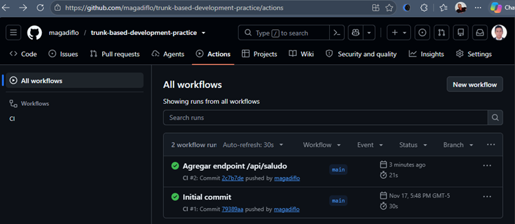

> **¡IMPORTANTE!** El commit directo a `main` solo es sano si tienes **pruebas locales y CI**. Cuando más abajo se
> active el `ruleset` que exige `Pull Request`, este tipo de push será **rechazado**.

---

## Cambio #2: conflicto en un push directo (magadiflo y dev-partner-lab)

Es el caso real de integrar seguido: **los dos tocan la misma zona del mismo archivo**. Ambos parten de `main`
actualizado.

### Funcionalidad

`[dev-partner-lab]` agrega una línea al final de `src/main/resources/application.yml` y **sube primero**:

````yml
spring:
  application:
    name: trunk-based-development-practice

app:
  cache:
    ttl: 60s
````

````bash
magadiflo@SysEngJava UCRT64 /m/practice/dev-partner-lab/trunk-based-development-practice (main)
$ git add .

magadiflo@SysEngJava UCRT64 /m/practice/dev-partner-lab/trunk-based-development-practice (main)
$ git commit -m "Configurar TTL de caché"
[main 0d0d372] Configurar TTL de caché
 1 file changed, 4 insertions(+)
 
magadiflo@SysEngJava UCRT64 /m/practice/dev-partner-lab/trunk-based-development-practice (main)
$ git push
````

Apenas ejecutamos el comando `git push` se nos abre la siguiente ventana de GitHub para iniciar sesión con nuestra
cuenta de colaborador `dev-partner-lab`:

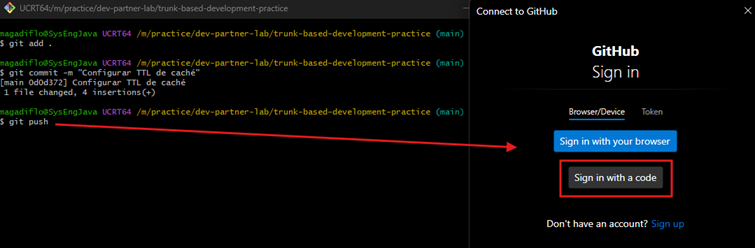

Seleccionamos `Sign in with a code` dado que si elegimos `Sign in with your browser`, lo más probable es que se use la
sesión que ya tenemos abierta en nuestro navegador predeterminado, es decir `magadiflo`. Así que para evitarnos
problemas elegiremos `Sign in with a code` y seguimos los siguientes pasos:

1. Con esta opción **no dependemos del navegador donde ya hay una sesión:** nos muestra un código y una dirección
   (normalmente https://github.com/login/device).

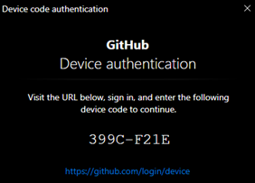

2. **Abrimos un navegador e iniciamos sesión como `dev-partner-lab`**

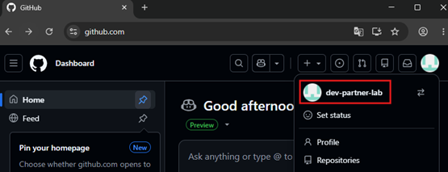

3. **En ese mismo navegador ingresamos a la dirección https://github.com/login/device** e introducimos el código.

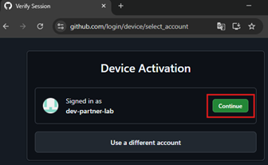

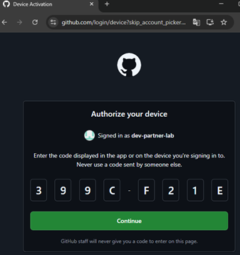


> **A partir de este momento GCM guarda dos cuentas** para `github.com`: `magadiflo` (la de siempre) y
> `dev-partner-lab`. Si algún repositorio no tuviera un usuario definido, GCM no sabría cuál usar y mostraría una
> ventana para elegir. **Por eso dejamos a `magadiflo` configurado como usuario por defecto en la configuración
> `global`.**

Una vez que nos hemos autenticado con nuestro usuario `dev-partner-lab` el comando `git push` continuará con su curso
y subirá nuestros commits al repositorio remoto:

````bash
magadiflo@SysEngJava UCRT64 /m/practice/dev-partner-lab/trunk-based-development-practice (main)
$ git push
Enumerating objects: 11, done.
Counting objects: 100% (11/11), done.
Delta compression using up to 8 threads
Compressing objects: 100% (5/5), done.
Writing objects: 100% (6/6), 557 bytes | 557.00 KiB/s, done.
Total 6 (delta 1), reused 0 (delta 0), pack-reused 0 (from 0)
remote: Resolving deltas: 100% (1/1), completed with 1 local object.
To https://github.com/magadiflo/trunk-based-development-practice.git
   2c7b7de..0d0d372  main -> main
   
magadiflo@SysEngJava UCRT64 /m/practice/dev-partner-lab/trunk-based-development-practice (main)
$ git lg
* 0d0d372 (HEAD -> main, origin/main, origin/HEAD) Configurar TTL de caché
* 2c7b7de Agregar endpoint /api/saludo
* 79389aa Initial commit 
````

`[magadiflo]`, sin haber hecho `pull`, agrega **otra línea en el mismo lugar** `src/main/resources/application.yml`
e intenta subir:

````yml
spring:
  application:
    name: trunk-based-development-practice

app:
  timeout: 5s
````

````bash
M:\practice\magadiflo\trunk-based-development-practice (main -> origin)
$ git add . && git commit -m "Configurar timeout de integración"
warning: in the working copy of 'src/main/resources/application.yml', LF will be replaced by CRLF the next time Git touches it
[main a8e7628] Configurar timeout de integración
 1 file changed, 3 insertions(+)
````

### El push es rechazado

`magadiflo` intenta subir su commit, pero Git **rechaza el push**: el remoto tiene un commit (el de `dev-partner-lab`)
que `magadiflo` todavía no tiene. Git no sobrescribe trabajo ajeno, así que pide integrar primero esos cambios. La pista
está en el mensaje: `rejected ... (fetch first)`.

````bash
M:\practice\magadiflo\trunk-based-development-practice (main -> origin)
$ git push
To https://github.com/magadiflo/trunk-based-development-practice.git
 ! [rejected]        main -> main (fetch first)
error: failed to push some refs to 'https://github.com/magadiflo/trunk-based-development-practice.git'
hint: Updates were rejected because the remote contains work that you do not
hint: have locally. This is usually caused by another repository pushing to
hint: the same ref. If you want to integrate the remote changes, use
hint: 'git pull' before pushing again.
hint: See the 'Note about fast-forwards' in 'git push --help' for details.
````

### Integrar los cambios del remoto con `git pull --rebase`

Antes de volver a subir, `magadiflo` debe traer el commit del remoto y colocar el suyo encima. El `hint` de Git sugiere
`git pull`, pero usaremos `git pull --rebase`: por defecto, `git pull` crearía un commit de merge, y con `--rebase`
el historial se mantiene en **línea recta**, que es lo que buscamos en `Trunk Based Development`.

```bash
M:\practice\magadiflo\trunk-based-development-practice (main -> origin)
$ git pull --rebase
remote: Enumerating objects: 11, done.
remote: Counting objects: 100% (11/11), done.
remote: Compressing objects: 100% (4/4), done.
remote: Total 6 (delta 1), reused 6 (delta 1), pack-reused 0 (from 0)
Unpacking objects: 100% (6/6), 537 bytes | 53.00 KiB/s, done.
From https://github.com/magadiflo/trunk-based-development-practice
   2c7b7de..0d0d372  main       -> origin/main
Auto-merging src/main/resources/application.yml
CONFLICT (content): Merge conflict in src/main/resources/application.yml
error: could not apply a8e7628... Configurar timeout de integración
hint: Resolve all conflicts manually, mark them as resolved with
hint: "git add/rm <conflicted_files>", then run "git rebase --continue".
hint: You can instead skip this commit: run "git rebase --skip".
hint: To abort and get back to the state before "git rebase", run "git rebase --abort".
hint: Disable this message with "git config set advice.mergeConflict false"
Could not apply a8e7628... # Configurar timeout de integración
```

### Aquí aparece el conflicto

Al ejecutar `git pull --rebase`, Git trajo el commit de `dev-partner-lab` y empezó a re-aplicar encima el commit de
`magadiflo`. Como los dos modificaron la misma zona de `application.yml`, Git no puede decidir solo qué conservar y
**detiene el rebase**. Lo que sigue es resolver ese conflicto.

Estas son las líneas clave de la salida:

- `CONFLICT (content): Merge conflict in src/main/resources/application.yml`: indica **en qué archivo** está el
  conflicto.
- `error: could not apply a8e7628... Configurar timeout de integración`: indica **qué commit** (el de `magadiflo`) no se
  pudo re-aplicar.
- Las líneas `hint:` son sugerencias de Git. Las tres opciones son:
    - resolver el conflicto, hacer `git add` y `git rebase --continue`;
    - `git rebase --skip`, que descarta ese commit;
    - `git rebase --abort`, que cancela todo y vuelve al estado anterior.

El prompt también cambió: ahora dice `(HEAD detached at 0d0d372)` en lugar de `(main -> origin)`. Es normal. Mientras
dura el rebase, Git se coloca temporalmente en el commit del remoto (`0d0d372`) y desde ahí re-aplica tus commits. Al
terminar, `main` vuelve a apuntar al resultado final.

Vemos el estado con `git s` y el contenido del archivo con `cat`:

````bash
M:\practice\magadiflo\trunk-based-development-practice (HEAD detached at 0d0d372)
$ git s
## HEAD (no branch)
UU src/main/resources/application.yml

M:\practice\magadiflo\trunk-based-development-practice (HEAD detached at 0d0d372)
$ cat src/main/resources/application.yml
spring:
  application:
    name: trunk-based-development-practice

app:
<<<<<<< HEAD
  cache:
    ttl: 60s
=======
  timeout: 5s
>>>>>>> a8e7628 (Configurar timeout de integración)
````

Podemos abrir el archivo `application.yml` con el usuario `magadiflo` y vemos que tenemos el conflicto que debemos
resolver:

```text
spring:
  application:
    name: trunk-based-development-practice

app:
<<<<<<< HEAD
  cache:
    ttl: 60s
=======
  timeout: 5s
>>>>>>> a8e7628 (Configurar timeout de integración)
```

> **📖 Comandos de este bloque**
>
> `cat src/main/resources/application.yml`: muestra en pantalla el contenido del archivo.
> - `cat`: imprime el contenido de un archivo.
> - La ruta indica cuál. Aquí sirve para ver las **marcas de conflicto** (`<<<<<<<`, `=======`, `>>>>>>>`) que dejó Git.

> **Ojo con la inversión de nombres durante un `rebase`:** `HEAD` (lo de arriba) es **lo que ya estaba en el remoto**
> (el cambio de `dev-partner-lab`) y lo de abajo es **el commit de `magadiflo` que se está re-aplicando**. Es al revés
> que en un `merge`.

`magadiflo` **conserva ambas líneas** (edita el archivo manualmente y borra las marcas `<<<<<<<`, `=======`, `>>>>>>>`;
en IntelliJ puedes usar *Git > Resolve Conflicts*):

```yml
spring:
  application:
    name: trunk-based-development-practice

app:
  cache:
    ttl: 60s
  timeout: 5s
```

````bash
M:\practice\magadiflo\trunk-based-development-practice (HEAD detached at 0d0d372)
$ git add src/main/resources/application.yml
````

Al hacer `git rebase --continue` se nos abrirá el editor para editar el commit, nosotros simplemente lo cerramos y
mantenemos el commit inicial *"Configurar timeout de integración"*.

````bash
M:\practice\magadiflo\trunk-based-development-practice (HEAD detached at 0d0d372)
$ git rebase --continue
[detached HEAD 7af7e27] Configurar timeout de integración
 1 file changed, 2 insertions(+)
Successfully rebased and updated refs/heads/main.
````

### Resumen: cómo resolver este conflicto

| Paso | Qué haces                                                            | Qué ocurre                                                                                                              |
|------|----------------------------------------------------------------------|-------------------------------------------------------------------------------------------------------------------------|
| 1    | `git pull --rebase`                                                  | Git trae los commits del remoto y empieza a re-aplicar el tuyo encima. Aparece el conflicto y el rebase **se detiene**. |
| 2    | `git status` (opcional)                                              | Muestra el archivo en conflicto marcado como `UU`.                                                                      |
| 3    | Editar el archivo a mano (o con IntelliJ: *Git > Resolve Conflicts*) | Decides qué se conserva y **borras las marcas** `<<<<<<<`, `=======` y `>>>>>>>`.                                       |
| 4    | `git add <archivo>`                                                  | Le avisas a Git que ese conflicto ya está resuelto.                                                                     |
| 5    | `git rebase --continue`                                              | Git crea el commit con la resolución y termina el rebase. Si se abre un editor, ciérralo.                               |

Si te pierdes en cualquier momento antes del paso 5, `git rebase --abort` cancela todo y vuelves al estado anterior.

> **El `git push` que viene a continuación ya no forma parte de la resolución del conflicto.** Es el mismo `push` que
> Git había **rechazado** al principio. Ahora que tu rama está encima de lo que había en el remoto, el `push` ya puede
> subir tus commits.

```bash
M:\practice\magadiflo\trunk-based-development-practice (main -> origin)
$ git push
Enumerating objects: 11, done.
Counting objects: 100% (11/11), done.
Delta compression using up to 8 threads
Compressing objects: 100% (5/5), done.
Writing objects: 100% (6/6), 521 bytes | 521.00 KiB/s, done.
Total 6 (delta 2), reused 0 (delta 0), pack-reused 0 (from 0)
remote: Resolving deltas: 100% (2/2), completed with 2 local objects.
To https://github.com/magadiflo/trunk-based-development-practice.git
   0d0d372..7af7e27  main -> main
```

> **📖 Comandos de este bloque**
>
> `git add src/main/resources/application.yml`: igual que `git add .`, pero prepara **solo ese archivo**.
> Aquí le avisa a Git que el conflicto de ese archivo ya está resuelto.
>
> `git rebase --continue`: sigue con el `rebase` después de resolver un conflicto.
> - `git rebase`: vuelve a aplicar tus commits sobre otra base (aquí, sobre el commit nuevo del remoto).
> - `--continue`: "ya resolví el conflicto y lo preparé con `git add`; continúa con los commits que faltan".
> - Su contraparte es `--abort`: cancela el `rebase` y deja la rama como estaba antes de empezarlo.

### Resultado

```bash
M:\practice\magadiflo\trunk-based-development-practice (main -> origin)
$ git lg
* 7af7e27 (HEAD -> main, origin/main, origin/HEAD) Configurar timeout de integración
* 0d0d372 Configurar TTL de caché
* 2c7b7de Agregar endpoint /api/saludo
* 79389aa Initial commit
```

Historial lineal otra vez. **Lección:** como los cambios son pequeños y frecuentes, el conflicto es de **una línea** y
se resuelve en un minuto. En `GitFlow`, ese mismo conflicto aparecería **semanas después**, al fusionar dos `feature`
enormes en `develop`.

> Si en medio del `rebase` te pierdes, vuelves atrás con `git rebase --abort`.

---

## Proteger main en GitHub

A partir de aquí **`main` es sagrada**: nadie empuja directo. Se protege con un *ruleset*.

Esta configuración la hace **`magadiflo`**, el dueño del repositorio, porque en un repositorio de cuenta personal solo
el dueño tiene permiso de administración. Un colaborador como `dev-partner-lab` puede subir ramas y abrir
`Pull Requests`, pero **no puede crear ni modificar rulesets**, así que tampoco puede quitar las reglas. Entramos al
repositorio con el usuario `magadiflo` y realizamos las siguientes configuraciones:

> **Repositorio > Settings > Rules > Rulesets > New ruleset > New branch ruleset**
> - **Ruleset name:** `proteger-main`
> - **Enforcement status:** `Active`
> - **Bypass list:** déjala **vacía** (así las reglas también aplican al dueño del repositorio)
> - **Target branches > Add target > Include default branch**
> - **Branch rules:**
>   - ✅ **Restrict deletions**
>   - ✅ **Require linear history**
>   - ✅ **Require a pull request before merging** → *Required approvals:* `1` → *Allowed merge methods:* solo `Squash`
>   - ✅ **Require status checks to pass** → **Add checks** → `build`
>   - ✅ **Block force pushes**

> El check `build` solo aparece en el buscador si el workflow **ya se ejecutó** recientemente. Por eso corrimos la CI en
> los Cambios #1 y #2 **antes** de crear el `ruleset`.

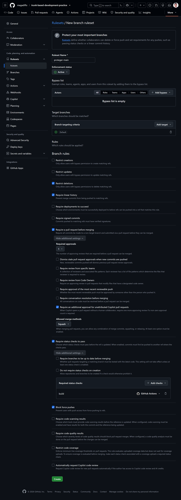

**Por qué 1 aprobación:** en GitHub **el autor de un PR no puede aprobar su propio PR**. Con dos cuentas, cada una
revisa los PR de la otra: justo el flujo real de un equipo.

> Si practicas **solo**, con una sola cuenta, pon *Required approvals* en `0` (o agrégate a la *Bypass list*); de lo
> contrario no podrás integrar tus propios PR.

Después de dar clic en el botón `Create`, se nos crea la regla `proteger-main`:

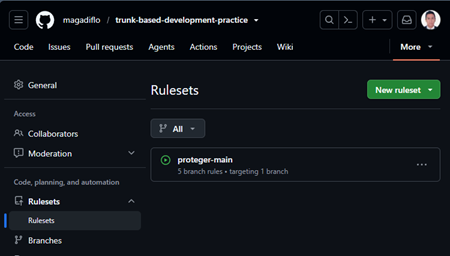

### Probar que main está protegida

`[magadiflo]` intenta, a propósito, un push directo. Primero creamos un archivo `README.md` en la raíz del proyecto
y le agregamos un texto `# Prueba`.

````bash
M:\practice\magadiflo\trunk-based-development-practice (main -> origin)
$ git s
## main...origin/main
?? README.md

M:\practice\magadiflo\trunk-based-development-practice (main -> origin)
$ cat README.md
# Prueba 
````

Agregamos al `Staging Area`, lo `commiteamos` y tratamos de hacer un `push` directo al repositorio remoto.

```bash
M:\practice\magadiflo\trunk-based-development-practice (main -> origin)
$ git add .

M:\practice\magadiflo\trunk-based-development-practice (main -> origin)
$ git commit -m "Intento de push directo"
[main ddd219f] Intento de push directo
 1 file changed, 1 insertion(+)
 create mode 100644 README.md

M:\practice\magadiflo\trunk-based-development-practice (main -> origin)
$ git push
Enumerating objects: 4, done.
Counting objects: 100% (4/4), done.
Delta compression using up to 8 threads
Compressing objects: 100% (2/2), done.
Writing objects: 100% (3/3), 297 bytes | 297.00 KiB/s, done.
Total 3 (delta 1), reused 0 (delta 0), pack-reused 0 (from 0)
remote: Resolving deltas: 100% (1/1), completed with 1 local object.
remote: error: GH013: Repository rule violations found for refs/heads/main.
remote: Review all repository rules at https://github.com/magadiflo/trunk-based-development-practice/rules?ref=refs%2Fheads%2Fmain
remote:
remote: - Changes must be made through a pull request.
remote:
remote: - Required status check "build" is expected.
remote:
To https://github.com/magadiflo/trunk-based-development-practice.git
 ! [remote rejected] main -> main (push declined due to repository rule violations)
error: failed to push some refs to 'https://github.com/magadiflo/trunk-based-development-practice.git'
```

GitHub lo **rechaza**, mostrando el siguiente mensaje:

```text
remote: error: GH013: Repository rule violations found for refs/heads/main.
remote: - Changes must be made through a pull request.
```

Deshaz ese commit de prueba (en `main` local) usando el comando `git reset --hard origin/main`:

```bash
M:\practice\magadiflo\trunk-based-development-practice (main -> origin)
$ git lg
* ddd219f (HEAD -> main) Intento de push directo
* 7af7e27 (origin/main, origin/HEAD) Configurar timeout de integración
* 0d0d372 Configurar TTL de caché
* 2c7b7de Agregar endpoint /api/saludo
* 79389aa Initial commit

M:\practice\magadiflo\trunk-based-development-practice (main -> origin)
$ git reset --hard origin/main
HEAD is now at 7af7e27 Configurar timeout de integración

M:\practice\magadiflo\trunk-based-development-practice (main -> origin)
$ git lg
* 7af7e27 (HEAD -> main, origin/main, origin/HEAD) Configurar timeout de integración
* 0d0d372 Configurar TTL de caché
* 2c7b7de Agregar endpoint /api/saludo
* 79389aa Initial commit
```

> **📖 Comandos de este bloque**
>
> `git reset --hard origin/main`: deja tu rama y tus archivos **exactamente como está `origin/main`**, descartando
> commits y cambios locales.
> - `git reset`: mueve la rama actual a otro commit.
> - `--hard`: además de mover la rama, **reescribe el *staging area* y los archivos de la carpeta** para que coincidan.
>   Los cambios sin commit se pierden.
> - `origin/main`: el destino: la copia local de la rama `main` del remoto.

> ⚠️ Úsalo aquí porque el commit de prueba nunca llegó al remoto. En otro contexto, `--hard` descarta trabajo sin
> posibilidad de recuperarlo fácilmente.

---

## Cambio #3: rama de vida corta + Pull Request (dev-partner-lab)

**Un cambio algo mayor:** validación de email con pruebas. Se usa una **rama que vive pocas horas**.

### Funcionalidad

`[dev-partner-lab]`

````bash
magadiflo@SysEngJava UCRT64 /m/practice/dev-partner-lab/trunk-based-development-practice (main)
$ git pull --rebase
remote: Enumerating objects: 11, done.
remote: Counting objects: 100% (11/11), done.
remote: Compressing objects: 100% (3/3), done.
remote: Total 6 (delta 2), reused 6 (delta 2), pack-reused 0 (from 0)
Unpacking objects: 100% (6/6), 501 bytes | 33.00 KiB/s, done.
From https://github.com/magadiflo/trunk-based-development-practice
   0d0d372..7af7e27  main       -> origin/main
Updating 0d0d372..7af7e27
Fast-forward
 src/main/resources/application.yml | 2 ++
 1 file changed, 2 insertions(+)

magadiflo@SysEngJava UCRT64 /m/practice/dev-partner-lab/trunk-based-development-practice (main)
$ git lg
* 7af7e27 (HEAD -> main, origin/main, origin/HEAD) Configurar timeout de integración
* 0d0d372 Configurar TTL de caché
* 2c7b7de Agregar endpoint /api/saludo
* 79389aa Initial commit
````

```bash
magadiflo@SysEngJava UCRT64 /m/practice/dev-partner-lab/trunk-based-development-practice (main)
$ git switch -c feature/validar-email
Switched to a new branch 'feature/validar-email'

magadiflo@SysEngJava UCRT64 /m/practice/dev-partner-lab/trunk-based-development-practice (feature/validar-email)
$
```

> **📖 Comandos de este bloque**
>
> `git switch -c feature/validar-email`: crea una rama nueva y te pasa a ella.
> - `git switch`: cambia de rama (es la versión moderna de `git checkout` para esto).
> - `-c` (*--create*): crea la rama antes de cambiarte, partiendo del commit en el que estás.
> - `feature/validar-email`: el nombre de la rama nueva. Con `git switch main` (sin `-c`) solo te mueves a una rama que
>   ya existe.

Crea `src/main/java/dev/magadiflo/tbd/EmailValidator.java`:

```java
package dev.magadiflo.tbd;

public class EmailValidator {

    private static final String REGEX = "^[A-Za-z0-9._]+@[A-Za-z0-9.-]+\\.[A-Za-z]{2,}$";

    public boolean esValido(String email) {
        return email != null && email.matches(REGEX);
    }

}
```

**Commits pequeños**

````bash
magadiflo@SysEngJava UCRT64 /m/practice/dev-partner-lab/trunk-based-development-practice (feature/validar-email)
$ git add .

magadiflo@SysEngJava UCRT64 /m/practice/dev-partner-lab/trunk-based-development-practice (feature/validar-email)
$ git commit -m "Agregar EmailValidator"
[feature/validar-email 434e044] Agregar EmailValidator
 1 file changed, 11 insertions(+)
 create mode 100644 src/main/java/dev/magadiflo/tbd/EmailValidator.java 
````

Y `src/test/java/dev/magadiflo/tbd/EmailValidatorTest.java`:

```java
package dev.magadiflo.tbd;

import org.junit.jupiter.api.Test;

import static org.assertj.core.api.Assertions.assertThat;

class EmailValidatorTest {

    private final EmailValidator validator = new EmailValidator();

    @Test
    void aceptaEmailSimple() {
        assertThat(this.validator.esValido("magadiflo@example.com")).isTrue();
    }

    @Test
    void rechazaEmailSinArroba() {
        assertThat(this.validator.esValido("magadiflo.example.com")).isFalse();
    }

    @Test
    void rechazaEmailNulo() {
        assertThat(this.validator.esValido(null)).isFalse();
    }
}
```

**Commits pequeños**

````bash
magadiflo@SysEngJava UCRT64 /m/practice/dev-partner-lab/trunk-based-development-practice (feature/validar-email)
$ git add .

magadiflo@SysEngJava UCRT64 /m/practice/dev-partner-lab/trunk-based-development-practice (feature/validar-email)
$ git commit -m "Agregar pruebas de EmailValidator"
[feature/validar-email 55af418] Agregar pruebas de EmailValidator
 1 file changed, 25 insertions(+)
 create mode 100644 src/test/java/dev/magadiflo/tbd/EmailValidatorTest.java 
````

**Push de la rama `feature/validar-email`**

```bash
magadiflo@SysEngJava UCRT64 /m/practice/dev-partner-lab/trunk-based-development-practice (feature/validar-email)
$ git push -u origin feature/validar-email
Enumerating objects: 28, done.
Counting objects: 100% (28/28), done.
Delta compression using up to 8 threads
Compressing objects: 100% (11/11), done.
Writing objects: 100% (18/18), 1.75 KiB | 895.00 KiB/s, done.
Total 18 (delta 2), reused 0 (delta 0), pack-reused 0 (from 0)
remote: Resolving deltas: 100% (2/2), completed with 1 local object.
remote:
remote: Create a pull request for 'feature/validar-email' on GitHub by visiting:
remote:      https://github.com/magadiflo/trunk-based-development-practice/pull/new/feature/validar-email
remote:
To https://github.com/magadiflo/trunk-based-development-practice.git
 * [new branch]      feature/validar-email -> feature/validar-email
branch 'feature/validar-email' set up to track 'origin/feature/validar-email'.
```

### Resultado (antes de integrar)

```bash
magadiflo@SysEngJava UCRT64 /m/practice/dev-partner-lab/trunk-based-development-practice (feature/validar-email)
$ git lg
* 55af418 (HEAD -> feature/validar-email, origin/feature/validar-email) Agregar pruebas de EmailValidator
* 434e044 Agregar EmailValidator
* 7af7e27 (origin/main, origin/HEAD, main) Configurar timeout de integración
* 0d0d372 Configurar TTL de caché
* 2c7b7de Agregar endpoint /api/saludo
* 79389aa Initial commit
```

### Pull Request

Con `dev-partner-lab`, en GitHub (aparece un aviso amarillo *Compare & pull request*, o desde la pestaña Pull
requests):

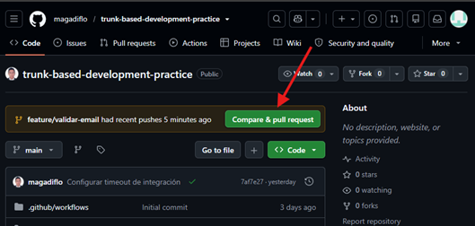

> **Repositorio > Pull requests > New pull request**
> - **base:** `main`
> - **compare:** `feature/validar-email`
> - **Título:** `Validar email al registrar usuario` *(será el mensaje del commit final)*

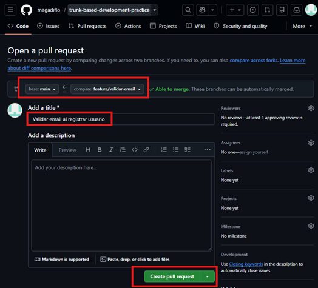

Diferencias con el PR de GitFlow:

- El destino es **`main`**, no `develop`.
- El PR debe ser **pequeño** (idealmente se revisa en minutos).
- Los **checks de CI** corren solos: debes ver **`build`** pasando.
- El botón de merge está **bloqueado** hasta tener el check en verde **y** 1 aprobación.

PR abierto con el check `build` y el mensaje *Review required*.

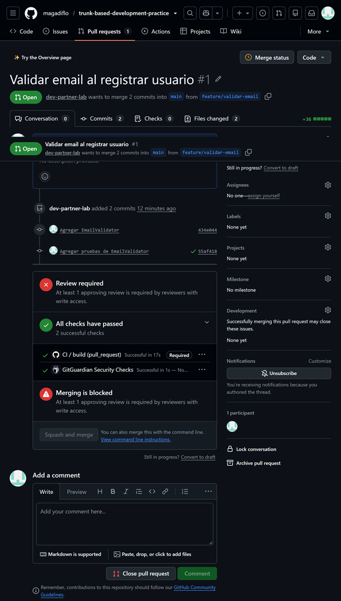

### Aprobando el Pull Request

Con `magadiflo` (abrimos el repositorio con la cuenta de **magadiflo** usando otro navegador):

> **Pull requests > (el PR) > Files changed > Review changes > Approve > Submit review**

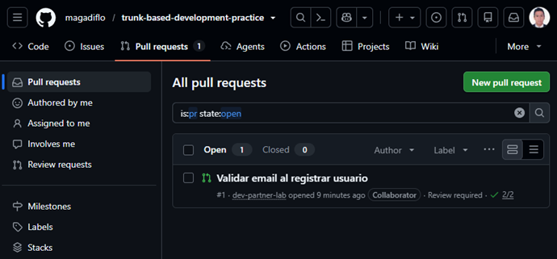

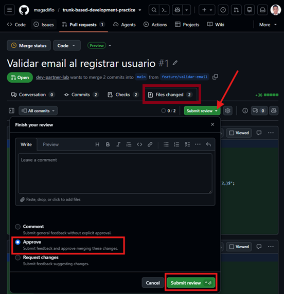

**¿Qué se hace en *Files changed*?** Esa pestaña muestra **todos los cambios del Pull Request**: cada archivo
modificado, con las líneas agregadas en verde y las eliminadas en rojo. Aquí es donde `magadiflo` hace la revisión:

- Lee los cambios. Si algo no le convence, puede dejar un comentario en una línea concreta (con el botón **+** que
  aparece al pasar el mouse junto al número de línea).
- Al terminar de revisar, pulsa `Submit review` (arriba a la derecha). Se abre un formulario con tres opciones:
    - **Comment**: deja comentarios sin aprobar ni rechazar.
    - **Approve**: da su conformidad. Es lo que exige nuestro ruleset (1 aprobación).
    - **Request changes**: pide cambios antes de poder fusionar.
- Para que la opción elegida quede registrada, pulsa `Submit review`.

Como el autor de un PR **no puede aprobar su propio Pull Request**, la aprobación la da la otra cuenta: aquí, el PR es
de `dev-partner-lab` y lo aprueba `magadiflo`.

> **Una buena revisión en TBD es corta:** como los PR son pequeños, revisarlos toma minutos, no horas. Esa es una de
> las razones para mantenerlos pequeños.

> Luego, en la pestaña *Conversation*: **Squash and merge > Confirm squash and merge**

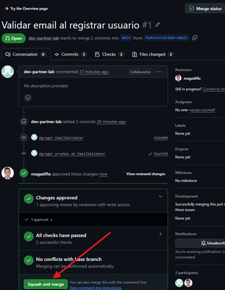

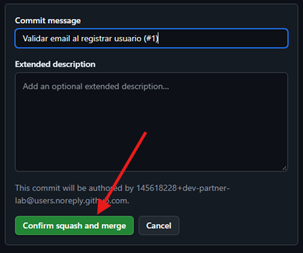

PR en estado *Merged* con la rama borrada.

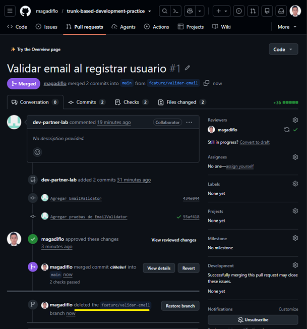

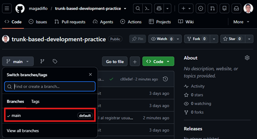

Los 2 commits de `dev-partner-lab` se convierten en **un solo commit** en `main`, y la rama remota se borra sola.

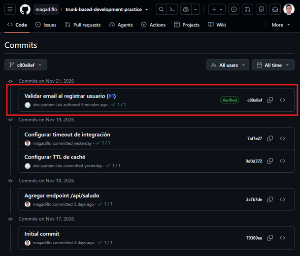

### Limpiar en local

La rama remota ya no existe, pero **la local sí**. Se actualiza `main`, se limpian referencias remotas y se borra la
rama local:

`[dev-partner-lab]`

````bash
magadiflo@SysEngJava UCRT64 /m/practice/dev-partner-lab/trunk-based-development-practice (feature/validar-email)
$ git switch main
Switched to branch 'main'
Your branch is up to date with 'origin/main'.

magadiflo@SysEngJava UCRT64 /m/practice/dev-partner-lab/trunk-based-development-practice (main)
$ git lg
* 55af418 (origin/feature/validar-email, feature/validar-email) Agregar pruebas de EmailValidator
* 434e044 Agregar EmailValidator
* 7af7e27 (HEAD -> main, origin/main, origin/HEAD) Configurar timeout de integración
* 0d0d372 Configurar TTL de caché
* 2c7b7de Agregar endpoint /api/saludo
* 79389aa Initial commit
````

````bash
magadiflo@SysEngJava UCRT64 /m/practice/dev-partner-lab/trunk-based-development-practice (main)
$ git pull --rebase
remote: Enumerating objects: 25, done.
remote: Counting objects: 100% (25/25), done.
remote: Compressing objects: 100% (7/7), done.
remote: Total 15 (delta 1), reused 14 (delta 1), pack-reused 0 (from 0)
Unpacking objects: 100% (15/15), 2.08 KiB | 236.00 KiB/s, done.
From https://github.com/magadiflo/trunk-based-development-practice
   7af7e27..c80e8ef  main       -> origin/main
Updating 7af7e27..c80e8ef
Fast-forward
 .../java/dev/magadiflo/tbd/EmailValidator.java     | 11 ++++++++++
 .../java/dev/magadiflo/tbd/EmailValidatorTest.java | 25 ++++++++++++++++++++++
 2 files changed, 36 insertions(+)
 create mode 100644 src/main/java/dev/magadiflo/tbd/EmailValidator.java
 create mode 100644 src/test/java/dev/magadiflo/tbd/EmailValidatorTest.java 
````

````bash
magadiflo@SysEngJava UCRT64 /m/practice/dev-partner-lab/trunk-based-development-practice (main)
$ git fetch --prune
From https://github.com/magadiflo/trunk-based-development-practice
 - [deleted]         (none)     -> origin/feature/validar-email 
````

```bash
magadiflo@SysEngJava UCRT64 /m/practice/dev-partner-lab/trunk-based-development-practice (main)
$ git branch -D feature/validar-email
Deleted branch feature/validar-email (was 55af418).
```

> **📖 Comandos de este bloque**
>
> **`git fetch --prune`**: descarga las novedades del remoto y limpia las referencias a ramas que ya no existen allá.
> - `git fetch`: descarga lo nuevo del remoto **sin integrarlo** en tu rama (a diferencia de `git pull`, que descarga e
>   integra).
> - `--prune`: elimina de tu copia local las ramas remotas (`origin/...`) que ya fueron borradas en GitHub. Por eso
>   aparece `- [deleted] ... -> origin/feature/validar-email`.
>
> **`git branch -d feature/validar-email`**: borra la rama **local**, solo si Git la considera ya integrada.
> - `git branch`: administra ramas (sin argumentos, las lista).
> - `-d` (*--delete*): borrado seguro; se niega si la rama tiene commits que no están en otra rama.
> - `-D` (mayúscula, *--delete --force*): borrado forzado; lo borra aunque Git no la vea integrada.

> **Detalle importante:** `git branch -d` **falla** después de un *Squash and merge*, porque Git no ve la rama como
> fusionada (el commit del squash es distinto a los originales). Es normal. Como ya está integrado, se borra con `-D`.

```bash
magadiflo@SysEngJava UCRT64 /m/practice/dev-partner-lab/trunk-based-development-practice (main)
$ git lg
* c80e8ef (HEAD -> main, origin/main, origin/HEAD) Validar email al registrar usuario (#1)
* 7af7e27 Configurar timeout de integración
* 0d0d372 Configurar TTL de caché
* 2c7b7de Agregar endpoint /api/saludo
* 79389aa Initial commit
```

El historial de `main` sigue siendo una **línea recta**: un commit por PR, con el número `(#1)` que agrega GitHub al
título.

`magadiflo` también actualiza su `main` con `git pull --rebase`.

````bash
M:\practice\magadiflo\trunk-based-development-practice (main -> origin)
$ git pull --rebase
remote: Enumerating objects: 25, done.
remote: Counting objects: 100% (25/25), done.
remote: Compressing objects: 100% (7/7), done.
remote: Total 15 (delta 1), reused 14 (delta 1), pack-reused 0 (from 0)
Unpacking objects: 100% (15/15), 2.08 KiB | 82.00 KiB/s, done.
From https://github.com/magadiflo/trunk-based-development-practice
   7af7e27..c80e8ef  main       -> origin/main
Updating 7af7e27..c80e8ef
Fast-forward
 src/main/java/dev/magadiflo/tbd/EmailValidator.java     | 11 +++++++++++
 src/test/java/dev/magadiflo/tbd/EmailValidatorTest.java | 25 +++++++++++++++++++++++++
 2 files changed, 36 insertions(+)
 create mode 100644 src/main/java/dev/magadiflo/tbd/EmailValidator.java
 create mode 100644 src/test/java/dev/magadiflo/tbd/EmailValidatorTest.java

M:\practice\magadiflo\trunk-based-development-practice (main -> origin)
$ git lg
* c80e8ef (HEAD -> main, origin/main, origin/HEAD) Validar email al registrar usuario (#1)
* 7af7e27 Configurar timeout de integración
* 0d0d372 Configurar TTL de caché
* 2c7b7de Agregar endpoint /api/saludo
* 79389aa Initial commit
````

---

## Cambio #4: funcionalidad incompleta detrás de un feature flag (magadiflo)

**magadiflo** debe construir un **nuevo checkout** que tomará varios días. En vez de abrir una rama larga, **integra el
esqueleto hoy mismo, apagado**.

### Funcionalidad

`[magadiflo]`

````bash
M:\practice\magadiflo\trunk-based-development-practice (main -> origin)
$ git pull --rebase
Already up to date. 

M:\practice\magadiflo\trunk-based-development-practice (main -> origin)
$ git switch -c feature/nuevo-checkout
Switched to a new branch 'feature/nuevo-checkout'

M:\practice\magadiflo\trunk-based-development-practice (feature/nuevo-checkout)
$
````

Crea `src/main/java/dev/magadiflo/tbd/CheckoutService.java`:

```java
package dev.magadiflo.tbd;

import org.springframework.beans.factory.annotation.Value;
import org.springframework.stereotype.Service;

@Service
public class CheckoutService {

    private final boolean nuevoCheckoutHabilitado;

    public CheckoutService(@Value("${feature.nuevo-checkout.enabled:false}") boolean nuevoCheckoutHabilitado) {
        this.nuevoCheckoutHabilitado = nuevoCheckoutHabilitado;
    }

    public String procesar() {
        if (this.nuevoCheckoutHabilitado) {
            return this.procesarConNuevoFlujo(); // en construcción
        }
        return this.procesarConFlujoActual();    // lo que ve producción hoy
    }

    private String procesarConFlujoActual() {
        return "checkout-actual";
    }

    private String procesarConNuevoFlujo() {
        return "checkout-nuevo (incompleto)";
    }
}
```

> La **inyección por constructor** permite probar ambos caminos sin levantar Spring.

`src/test/java/dev/magadiflo/tbd/CheckoutServiceTest.java` (se prueban **los dos caminos**):

```java
package dev.magadiflo.tbd;

import org.junit.jupiter.api.Test;

import static org.assertj.core.api.Assertions.assertThat;

class CheckoutServiceTest {

    @Test
    void conFlagApagadoUsaElFlujoActual() {
        assertThat(new CheckoutService(false).procesar())
                .isEqualTo("checkout-actual");
    }

    @Test
    void conFlagEncendidoUsaElNuevoFlujo() {
        assertThat(new CheckoutService(true).procesar())
                .isEqualTo("checkout-nuevo (incompleto)");
    }
}
```

Y el flag, **apagado**, al final de `application.yml`:

```yml
spring:
  application:
    name: trunk-based-development-practice

app:
  cache:
    ttl: 60s
  timeout: 5s

feature:
  nuevo-checkout:
    enabled: false
```

````bash
M:\practice\magadiflo\trunk-based-development-practice (feature/nuevo-checkout)
$ git add .

M:\practice\magadiflo\trunk-based-development-practice (feature/nuevo-checkout)
$ git commit -m "Agregar nuevo checkout detrás del flag feature.nuevo-checkout.enabed (apagado)"[feature/nuevo-checkout 59a7718] Agregar nuevo checkout detrás del flag feature.nuevo-checkout.enabed (apagado)
 3 files changed, 51 insertions(+)
 create mode 100644 src/main/java/dev/magadiflo/tbd/CheckoutService.java
 create mode 100644 src/test/java/dev/magadiflo/tbd/CheckoutServiceTest.java

M:\practice\magadiflo\trunk-based-development-practice (feature/nuevo-checkout)
$ git push -u origin feature/nuevo-checkout
Enumerating objects: 29, done.
Counting objects: 100% (29/29), done.
Delta compression using up to 8 threads
Compressing objects: 100% (9/9), done.
Writing objects: 100% (17/17), 1.73 KiB | 589.00 KiB/s, done.
Total 17 (delta 3), reused 0 (delta 0), pack-reused 0 (from 0)
remote: Resolving deltas: 100% (3/3), completed with 3 local objects.
remote:
remote: Create a pull request for 'feature/nuevo-checkout' on GitHub by visiting:
remote:      https://github.com/magadiflo/trunk-based-development-practice/pull/new/feature/nuevo-checkout
remote:
To https://github.com/magadiflo/trunk-based-development-practice.git
 * [new branch]      feature/nuevo-checkout -> feature/nuevo-checkout
branch 'feature/nuevo-checkout' set up to track 'origin/feature/nuevo-checkout'.
````

`magadiflo` abre el PR:

- **base:** `main`
- **compare:** `feature/nuevo-checkout`
- **título:** `Nuevo checkout detrás de feature flag`

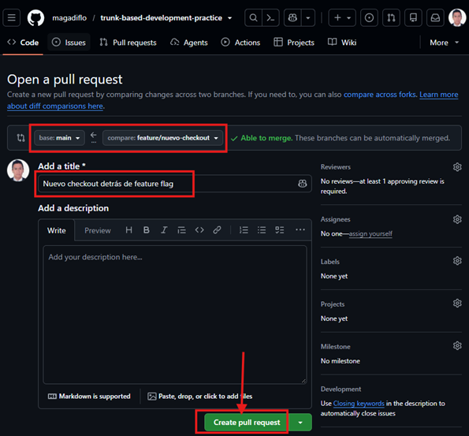

Una vez que hemos dado clic en el botón `Create pull request` veremos otra pantalla donde veremos:

- `Review required`
- `All checks have passed`
- `CI / build (pull_request)`
- `GitGuardian Security Checks`
- `Merging is blocked`

También veremos el título que le pusimos, seguido del número del PR: `Nuevo checkout detrás de feature flag #3`.
Aquí nos vamos a detener un segundo para explicar el número `#3` que está saliendo, porque a primera vista parece que
nos saltamos uno.

**¿Cómo numera GitHub los Pull Requests?** Cada repositorio tiene un **único contador** que comparten los Pull Requests
y los *issues*. Cada vez que se crea uno de los dos, recibe el siguiente número, y ese número **nunca se reutiliza**,
aunque el PR se cierre o se fusione. Es solo un identificador: no afecta en nada al funcionamiento.

**¿Por qué es el `#3` y no el `#2`?** Hasta ahora solo habíamos creado un PR en el repositorio: el del `Cambio #3`
(*Validar email al registrar usuario*), que recibió el `#1`. El siguiente debería haber sido el `#2`, pero en nuestra
práctica ese número ya está ocupado: hicimos unas pruebas en las que fusionamos el PR antes de tiempo con *Squash and
merge* y, por lo tanto, tuvimos que devolver `main` al estado anterior para rehacerlo. El PR `#2`
fusionado **sigue existiendo en GitHub** y no se puede reabrir ni deshacer desde la interfaz, así que el contador ya
había avanzado.

> **Si sigues esta práctica desde cero**, tu PR saldrá con el número `#2`, y los siguientes tendrán un número menos que
> los que se muestran en las capturas de este documento. Los commits que genere *Squash and merge* llevarán ese número
> entre paréntesis (por ejemplo, `Nuevo checkout detrás de feature flag (#3)`), así que también variará ahí.

Dicho de otro modo: lo que importa es que cada número **identifica de forma única** a un PR, no que sean consecutivos.

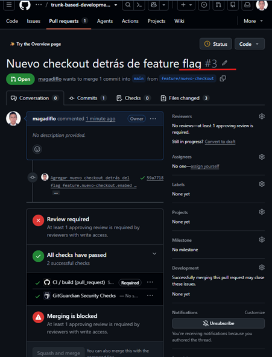

> `dev-partner-lab` lo revisa y lo aprueba (igual que en el `Cambio #3`), pero **todavía no hagas el *Squash and
> merge***: el PR se queda abierto y aprobado. Primero pasa al `Cambio #5`, donde lo fusionaremos en el momento justo
> para ver cómo reacciona un segundo PR abierto en paralelo.

Entonces, lo que sigue es:

- `dev-partner-lab` revisa y aprueba el PR en GitHub (*Files changed → Review changes → Approve → Submit review*).

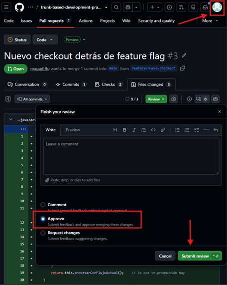

- El PR **queda abierto y aprobado**, pero **sin hacer *Squash and merge*** todavía.

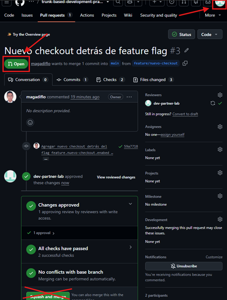

### Qué logrará este cambio cuando se integre

Recuerda que el PR sigue abierto y aprobado, y se fusionará al inicio del `Cambio #5`. Cuando eso ocurra:

- El código del nuevo checkout **estará en `main` (y podría llegar a producción)**, pero con
  `feature.nuevo-checkout.enabled=false` nadie lo verá.
- En los días siguientes se agregarán **pedazos pequeños** (nuevos PR) sobre el mismo flag. Cuando esté completo se
  encenderá, y más adelante se **eliminará el flag** y el código viejo.
- Ningún cambio debería vivir más de unas horas fuera de `main`.

> Más sobre feature flags (`@ConditionalOnProperty`, Togglz, FF4J, Unleash) en la
> sección [Feature flags en Spring Boot](#feature-flags-en-spring-boot).

---

## Cambio #5: dos PR en paralelo, el segundo entra en conflicto (dev-partner-lab)

Mientras el PR del `Cambio #4` espera su integración, `dev-partner-lab` empieza otro cambio **desde el mismo `main`**.
Los dos tocan el final de `application.yml`.

### Funcionalidad

`[dev-partner-lab]`

````bash
magadiflo@SysEngJava UCRT64 /m/practice/dev-partner-lab/trunk-based-development-practice (main)
$ git pull --rebase
remote: Enumerating objects: 29, done.
remote: Counting objects: 100% (29/29), done.
remote: Compressing objects: 100% (6/6), done.
remote: Total 17 (delta 3), reused 17 (delta 3), pack-reused 0 (from 0)
Unpacking objects: 100% (17/17), 1.71 KiB | 52.00 KiB/s, done.
From https://github.com/magadiflo/trunk-based-development-practice
 * [new branch]      feature/nuevo-checkout -> origin/feature/nuevo-checkout
Already up to date.

magadiflo@SysEngJava UCRT64 /m/practice/dev-partner-lab/trunk-based-development-practice (main)
$ git lg
* 59a7718 (origin/feature/nuevo-checkout) Agregar nuevo checkout detrás del flag feature.nuevo-checkout.enabed (apagado)
* c80e8ef (HEAD -> main, origin/main, origin/HEAD) Validar email al registrar usuario (#1)
* 7af7e27 Configurar timeout de integración
* 0d0d372 Configurar TTL de caché
* 2c7b7de Agregar endpoint /api/saludo
* 79389aa Initial commit

magadiflo@SysEngJava UCRT64 /m/practice/dev-partner-lab/trunk-based-development-practice (main)
$ git switch -c feature/configurar-reintentos
Switched to a new branch 'feature/configurar-reintentos'

magadiflo@SysEngJava UCRT64 /m/practice/dev-partner-lab/trunk-based-development-practice (feature/configurar-reintentos)
$
````

`application.yml`

````yml
spring:
  application:
    name: trunk-based-development-practice

app:
  cache:
    ttl: 60s
  timeout: 5s
  retry:
    max-attempts: 3
````

```bash
magadiflo@SysEngJava UCRT64 /m/practice/dev-partner-lab/trunk-based-development-practice (feature/configurar-reintentos)
$ git add .

magadiflo@SysEngJava UCRT64 /m/practice/dev-partner-lab/trunk-based-development-practice (feature/configurar-reintentos)
$ git commit -m "Configurar reintentos de integración"
[feature/configurar-reintentos bf22b9e] Configurar reintentos de integración
 1 file changed, 2 insertions(+), 1 deletion(-)

magadiflo@SysEngJava UCRT64 /m/practice/dev-partner-lab/trunk-based-development-practice (feature/configurar-reintentos)
$ git push -u origin feature/configurar-reintentos
Enumerating objects: 11, done.
Counting objects: 100% (11/11), done.
Delta compression using up to 8 threads
Compressing objects: 100% (5/5), done.
Writing objects: 100% (6/6), 540 bytes | 540.00 KiB/s, done.
Total 6 (delta 2), reused 0 (delta 0), pack-reused 0 (from 0)
remote: Resolving deltas: 100% (2/2), completed with 2 local objects.
remote:
remote: Create a pull request for 'feature/configurar-reintentos' on GitHub by visiting:
remote:      https://github.com/magadiflo/trunk-based-development-practice/pull/new/feature/configurar-reintentos
remote:
To https://github.com/magadiflo/trunk-based-development-practice.git
 * [new branch]      feature/configurar-reintentos -> feature/configurar-reintentos
branch 'feature/configurar-reintentos' set up to track 'origin/feature/configurar-reintentos'.

magadiflo@SysEngJava UCRT64 /m/practice/dev-partner-lab/trunk-based-development-practice (feature/configurar-reintentos)
$ git lg
* bf22b9e (HEAD -> feature/configurar-reintentos, origin/feature/configurar-reintentos) Configurar reintentos de integración
| * 59a7718 (origin/feature/nuevo-checkout) Agregar nuevo checkout detrás del flag feature.nuevo-checkout.enabed (apagado)
|/
* c80e8ef (origin/main, origin/HEAD, main) Validar email al registrar usuario (#1)
* 7af7e27 Configurar timeout de integración
* 0d0d372 Configurar TTL de caché
* 2c7b7de Agregar endpoint /api/saludo
* 79389aa Initial commit
```

Ahora `dev-partner-lab` abre su Pull Request en GitHub (**base:** `main`, **compare:** `feature/configurar-reintentos`)
y lo **deja abierto**.

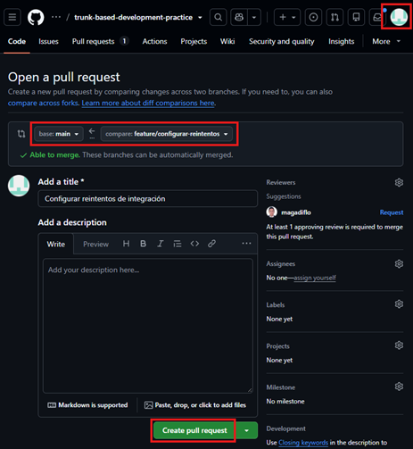

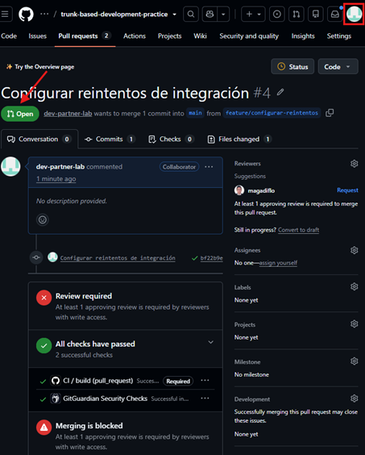

En este momento hay **dos PR abiertos a la vez**:

| PR                                                   | Autor             | Estado                          |
|------------------------------------------------------|-------------------|---------------------------------|
| El del `Cambio #4` (`feature/nuevo-checkout`)        | `magadiflo`       | Aprobado, pendiente de fusionar |
| El del `Cambio #5` (`feature/configurar-reintentos`) | `dev-partner-lab` | Recién abierto                  |

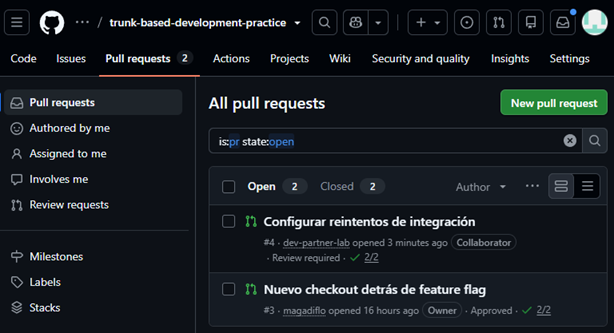

Ambas ramas nacieron del **mismo `main`** y tocan el final del mismo archivo. Ahora fusionamos primero el PR del
`Cambio #4`: en su pestaña *Conversation* pulsamos **Squash and merge > Confirm squash and merge**. Esto ocurre en
GitHub; los clones locales no se tocan todavía.

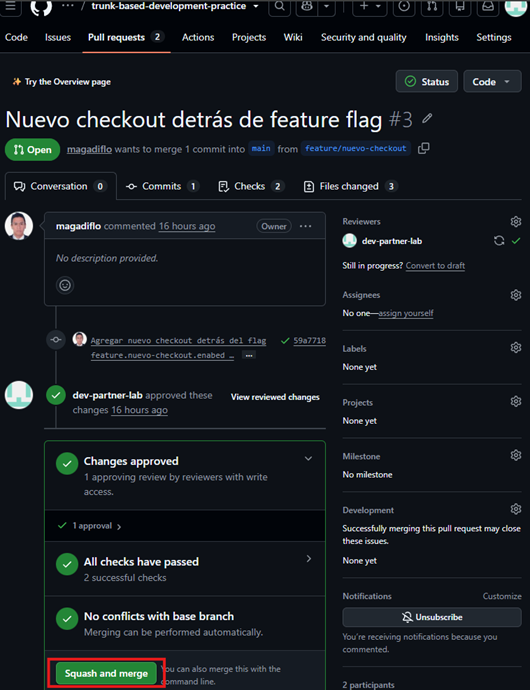

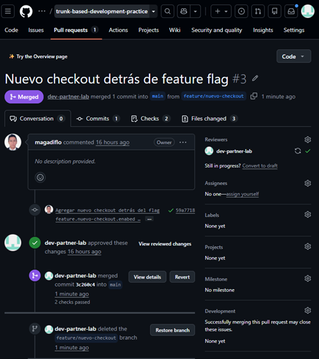

Con ese merge, `main` avanza, pero la rama de `dev-partner-lab` sigue partiendo del `main` anterior. Al volver al PR
del `Cambio #5`, GitHub avisa que **hay conflicto** (*This branch has conflicts that must be resolved*) y deshabilita
el botón de merge. GitHub puede tardar unos segundos en detectarlo; si no aparece, recarga la página.

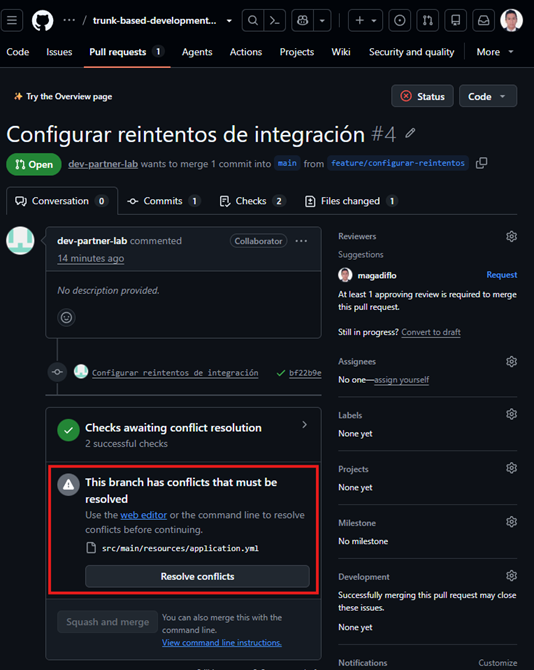

`magadiflo` actualiza su copia y limpia:

`[magadiflo]`

````bash
M:\practice\magadiflo\trunk-based-development-practice (feature/nuevo-checkout -> origin)
$ git switch main
Switched to branch 'main'
Your branch is up to date with 'origin/main'.

M:\practice\magadiflo\trunk-based-development-practice (main -> origin)
$ git pull --rebase
remote: Enumerating objects: 35, done.
remote: Counting objects: 100% (35/35), done.
remote: Compressing objects: 100% (9/9), done.
remote: Total 23 (delta 5), reused 22 (delta 5), pack-reused 0 (from 0)
Unpacking objects: 100% (23/23), 2.84 KiB | 161.00 KiB/s, done.
From https://github.com/magadiflo/trunk-based-development-practice
   c80e8ef..3c260c4  main                          -> origin/main
 * [new branch]      feature/configurar-reintentos -> origin/feature/configurar-reintentos
Updating c80e8ef..3c260c4
Fast-forward
 src/main/java/dev/magadiflo/tbd/CheckoutService.java     | 29 +++++++++++++++++++++++++++++
 src/main/resources/application.yml                       |  3 +++
 src/test/java/dev/magadiflo/tbd/CheckoutServiceTest.java | 19 +++++++++++++++++++
 3 files changed, 51 insertions(+)
 create mode 100644 src/main/java/dev/magadiflo/tbd/CheckoutService.java
 create mode 100644 src/test/java/dev/magadiflo/tbd/CheckoutServiceTest.java

M:\practice\magadiflo\trunk-based-development-practice (main -> origin)
$ git lg
* 3c260c4 (HEAD -> main, origin/main, origin/HEAD) Nuevo checkout detrás de feature flag (#3)
| * bf22b9e (origin/feature/configurar-reintentos) Configurar reintentos de integración
|/
| * 59a7718 (origin/feature/nuevo-checkout, feature/nuevo-checkout) Agregar nuevo checkout detrás del flag feature.nuevo-checkout.enabed (apagado)
|/
* c80e8ef Validar email al registrar usuario (#1)
* 7af7e27 Configurar timeout de integración
* 0d0d372 Configurar TTL de caché
* 2c7b7de Agregar endpoint /api/saludo
* 79389aa Initial commit

M:\practice\magadiflo\trunk-based-development-practice (main -> origin)
$ git fetch --prune
From https://github.com/magadiflo/trunk-based-development-practice
 - [deleted]         (none)     -> origin/feature/nuevo-checkout

M:\practice\magadiflo\trunk-based-development-practice (main -> origin)
$ git lg
* 3c260c4 (HEAD -> main, origin/main, origin/HEAD) Nuevo checkout detrás de feature flag (#3)
| * bf22b9e (origin/feature/configurar-reintentos) Configurar reintentos de integración
|/
| * 59a7718 (feature/nuevo-checkout) Agregar nuevo checkout detrás del flag feature.nuevo-checkout.enabed (apagado)
|/
* c80e8ef Validar email al registrar usuario (#1)
* 7af7e27 Configurar timeout de integración
* 0d0d372 Configurar TTL de caché
* 2c7b7de Agregar endpoint /api/saludo
* 79389aa Initial commit

M:\practice\magadiflo\trunk-based-development-practice (main -> origin)
$ git branch -D feature/nuevo-checkout
Deleted branch feature/nuevo-checkout (was 59a7718).

M:\practice\magadiflo\trunk-based-development-practice (main -> origin)
$ git lg
* 3c260c4 (HEAD -> main, origin/main, origin/HEAD) Nuevo checkout detrás de feature flag (#3)
| * bf22b9e (origin/feature/configurar-reintentos) Configurar reintentos de integración
|/
* c80e8ef Validar email al registrar usuario (#1)
* 7af7e27 Configurar timeout de integración
* 0d0d372 Configurar TTL de caché
* 2c7b7de Agregar endpoint /api/saludo
* 79389aa Initial commit
````

### Resolver el conflicto: `rebase` sobre `main`

GitHub ofrece un botón *Resolve conflicts* (editor web), pero en TBD se prefiere **rebasar en local**: así el historial
sigue lineal y pruebas el resultado antes de subirlo.

`[dev-partner-lab]`

```bash
magadiflo@SysEngJava UCRT64 /m/practice/dev-partner-lab/trunk-based-development-practice (feature/configurar-reintentos)
$ git fetch origin
remote: Enumerating objects: 29, done.
remote: Counting objects: 100% (29/29), done.
remote: Compressing objects: 100% (6/6), done.
remote: Total 17 (delta 3), reused 16 (delta 3), pack-reused 0 (from 0)
Unpacking objects: 100% (17/17), 2.34 KiB | 266.00 KiB/s, done.
From https://github.com/magadiflo/trunk-based-development-practice
   c80e8ef..3c260c4  main       -> origin/main

magadiflo@SysEngJava UCRT64 /m/practice/dev-partner-lab/trunk-based-development-practice (feature/configurar-reintentos)
$ git rebase origin/main
Auto-merging src/main/resources/application.yml
CONFLICT (content): Merge conflict in src/main/resources/application.yml
error: could not apply bf22b9e... Configurar reintentos de integración
hint: Resolve all conflicts manually, mark them as resolved with
hint: "git add/rm <conflicted_files>", then run "git rebase --continue".
hint: You can instead skip this commit: run "git rebase --skip".
hint: To abort and get back to the state before "git rebase", run "git rebase --abort".
hint: Disable this message with "git config set advice.mergeConflict false"
Could not apply bf22b9e... # Configurar reintentos de integración
```

> **📖 Comandos de este bloque**
>
> `git fetch origin`: igual que `git fetch --prune`, pero **indicando explícitamente el remoto** (`origin`) y sin
> limpiar ramas. Solo descarga; no toca tus archivos ni tu rama.
>
> `git rebase origin/main`: reubica los commits de tu rama encima de lo último de `main`.
> - `git rebase`: ya se explicó con `--continue`; aquí se usa para **empezar** el rebase.
> - `origin/main`: la nueva "base": tu rama se reescribe como si hubiera nacido del `main` más reciente. Si los mismos
>   archivos cambiaron en ambos lados, aparece un conflicto.

```bash
magadiflo@SysEngJava UCRT64 /m/practice/dev-partner-lab/trunk-based-development-practice (feature/configurar-reintentos|REBASE 1/1)
$ git s
## HEAD (no branch)
UU src/main/resources/application.yml

magadiflo@SysEngJava UCRT64 /m/practice/dev-partner-lab/trunk-based-development-practice (feature/configurar-reintentos|REBASE 1/1)
$ git diff *application.yml
diff --cc src/main/resources/application.yml
index ec96ff8,e538255..0000000
--- a/src/main/resources/application.yml
+++ b/src/main/resources/application.yml
@@@ -6,7 -6,5 +6,12 @@@ app
    cache:
      ttl: 60s
    timeout: 5s
++<<<<<<< HEAD
 +
 +feature:
 +  nuevo-checkout:
 +    enabled: false
++=======
+   retry:
+     max-attempts: 3
++>>>>>>> bf22b9e (Configurar reintentos de integración)
```

Se conservan **ambas líneas** `src/main/resources/application.yml`:

```yml
spring:
  application:
    name: trunk-based-development-practice

app:
  cache:
    ttl: 60s
  timeout: 5s

feature:
  nuevo-checkout:
    enabled: false
  retry:
    max-attempts: 3
```

```bash
magadiflo@SysEngJava UCRT64 /m/practice/dev-partner-lab/trunk-based-development-practice (feature/configurar-reintentos|REBASE 1/1)
$ git add src/main/resources/application.yml

magadiflo@SysEngJava UCRT64 /m/practice/dev-partner-lab/trunk-based-development-practice (feature/configurar-reintentos|REBASE 1/1)
$ git rebase --continue
[detached HEAD c9fc1e3] Configurar reintentos de integración
 1 file changed, 2 insertions(+)
Successfully rebased and updated refs/heads/feature/configurar-reintentos.
```

### Subir una rama reescrita: `--force-with-lease`

El rebase **reescribió** el commit (`0c4eeb1` → `ddd4095`), así que un `push` normal es rechazado:

```bash
magadiflo@SysEngJava UCRT64 /m/practice/dev-partner-lab/trunk-based-development-practice (feature/configurar-reintentos)
$ git push
To https://github.com/magadiflo/trunk-based-development-practice.git
 ! [rejected]        feature/configurar-reintentos -> feature/configurar-reintentos (non-fast-forward)
error: failed to push some refs to 'https://github.com/magadiflo/trunk-based-development-practice.git'
hint: Updates were rejected because the tip of your current branch is behind
hint: its remote counterpart. If you want to integrate the remote changes,
hint: use 'git pull' before pushing again.
hint: See the 'Note about fast-forwards' in 'git push --help' for details.
```

Se sube con **`--force-with-lease`**:

```bash
magadiflo@SysEngJava UCRT64 /m/practice/dev-partner-lab/trunk-based-development-practice (feature/configurar-reintentos)
$ git push --force-with-lease
Enumerating objects: 11, done.
Counting objects: 100% (11/11), done.
Delta compression using up to 8 threads
Compressing objects: 100% (5/5), done.
Writing objects: 100% (6/6), 548 bytes | 548.00 KiB/s, done.
Total 6 (delta 2), reused 0 (delta 0), pack-reused 0 (from 0)
remote: Resolving deltas: 100% (2/2), completed with 2 local objects.
To https://github.com/magadiflo/trunk-based-development-practice.git
 + bf22b9e...c9fc1e3 feature/configurar-reintentos -> feature/configurar-reintentos (forced update)

```

> **📖 Comandos de este bloque**
>
> `git push --force-with-lease`: sobrescribe la rama remota con tu versión reescrita, **pero solo si nadie más la
> cambió** desde la última vez que la descargaste.
> - `git push`: ya explicado.
> - `--force-with-lease`: es un "forzar con seguro". Un `--force` normal pisa lo que haya en el remoto sin preguntar;
>   con `--with-lease`, si el remoto tiene algo que tú no conoces, Git **se niega** en vez de borrar el trabajo ajeno.
> - En la salida, el `+` y `(forced update)` indican que la rama remota fue reemplazada.

> Es válido aquí porque se trata de **tu rama de vida corta**, **nunca** de `main` (el ruleset lo bloquea).

El PR se actualiza solo, el conflicto desaparece y la CI corre de nuevo. `magadiflo` lo aprueba y se hace **Squash and
merge**.

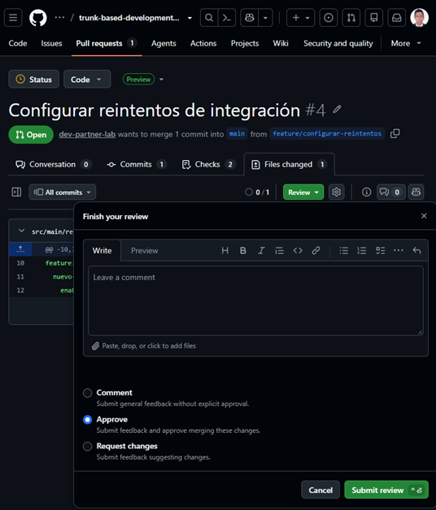

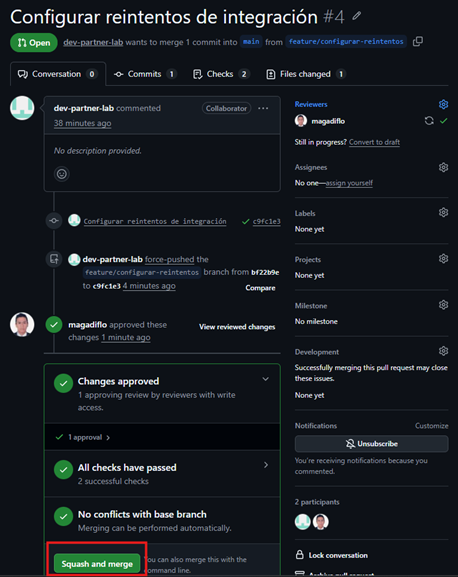

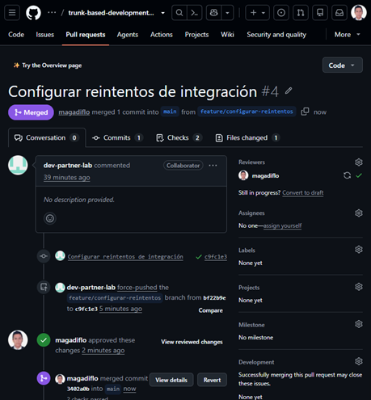

Luego:

`[dev-partner-lab]`

````bash
magadiflo@SysEngJava UCRT64 /m/practice/dev-partner-lab/trunk-based-development-practice (feature/configurar-reintentos)
$ git switch main
Switched to branch 'main'
Your branch is behind 'origin/main' by 1 commit, and can be fast-forwarded.
  (use "git pull" to update your local branch)

magadiflo@SysEngJava UCRT64 /m/practice/dev-partner-lab/trunk-based-development-practice (main)
$ git pull --rebase
remote: Enumerating objects: 11, done.
remote: Counting objects: 100% (11/11), done.
remote: Compressing objects: 100% (3/3), done.
remote: Total 6 (delta 2), reused 5 (delta 2), pack-reused 0 (from 0)
Unpacking objects: 100% (6/6), 1.16 KiB | 396.00 KiB/s, done.
From https://github.com/magadiflo/trunk-based-development-practice
   3c260c4..3402a0b  main       -> origin/main
Updating c80e8ef..3402a0b
Fast-forward
 .../java/dev/magadiflo/tbd/CheckoutService.java    | 29 ++++++++++++++++++++++
 src/main/resources/application.yml                 |  5 ++++
 .../dev/magadiflo/tbd/CheckoutServiceTest.java     | 19 ++++++++++++++
 3 files changed, 53 insertions(+)
 create mode 100644 src/main/java/dev/magadiflo/tbd/CheckoutService.java
 create mode 100644 src/test/java/dev/magadiflo/tbd/CheckoutServiceTest.java
 
magadiflo@SysEngJava UCRT64 /m/practice/dev-partner-lab/trunk-based-development-practice (main)
$ git fetch --prune
From https://github.com/magadiflo/trunk-based-development-practice
 - [deleted]         (none)     -> origin/feature/configurar-reintentos
 - [deleted]         (none)     -> origin/feature/nuevo-checkout

magadiflo@SysEngJava UCRT64 /m/practice/dev-partner-lab/trunk-based-development-practice (main)
$ git branch -D feature/configurar-reintentos
Deleted branch feature/configurar-reintentos (was c9fc1e3).

magadiflo@SysEngJava UCRT64 /m/practice/dev-partner-lab/trunk-based-development-practice (main)
$ git lg
* 3402a0b (HEAD -> main, origin/main, origin/HEAD) Configurar reintentos de integración (#4)
* 3c260c4 Nuevo checkout detrás de feature flag (#3)
* c80e8ef Validar email al registrar usuario (#1)
* 7af7e27 Configurar timeout de integración
* 0d0d372 Configurar TTL de caché
* 2c7b7de Agregar endpoint /api/saludo
* 79389aa Initial commit
````

**Lección:** el conflicto de dos PR en paralelo **lo resuelve quien llega segundo**, antes de integrar. Con PR pequeños
que viven horas, es raro y barato.

`[magadiflo]`

**magadiflo** también actualiza su copia. Su clon todavía no conoce el último merge, y sigue recordando la rama
`feature/configurar-reintentos`, que GitHub borró al fusionar:

````bash
M:\practice\magadiflo\trunk-based-development-practice (main -> origin)
$ git lg
* 3c260c4 (HEAD -> main, origin/main, origin/HEAD) Nuevo checkout detrás de feature flag (#3)
| * bf22b9e (origin/feature/configurar-reintentos) Configurar reintentos de integración
|/
* c80e8ef Validar email al registrar usuario (#1)
* 7af7e27 Configurar timeout de integración
* 0d0d372 Configurar TTL de caché
* 2c7b7de Agregar endpoint /api/saludo
* 79389aa Initial commit 

M:\practice\magadiflo\trunk-based-development-practice (main -> origin)
$ git pull --rebase
remote: Enumerating objects: 11, done.
remote: Counting objects: 100% (11/11), done.
remote: Compressing objects: 100% (3/3), done.
remote: Total 6 (delta 2), reused 5 (delta 2), pack-reused 0 (from 0)
Unpacking objects: 100% (6/6), 1.16 KiB | 99.00 KiB/s, done.
From https://github.com/magadiflo/trunk-based-development-practice
   3c260c4..3402a0b  main       -> origin/main
Updating 3c260c4..3402a0b
Fast-forward
 src/main/resources/application.yml | 2 ++
 1 file changed, 2 insertions(+)
 
M:\practice\magadiflo\trunk-based-development-practice (main -> origin)
$ git fetch --prune
From https://github.com/magadiflo/trunk-based-development-practice
 - [deleted]         (none)     -> origin/feature/configurar-reintentos
 
M:\practice\magadiflo\trunk-based-development-practice (main -> origin)
$ git lg
* 3402a0b (HEAD -> main, origin/main, origin/HEAD) Configurar reintentos de integración (#4)
* 3c260c4 Nuevo checkout detrás de feature flag (#3)
* c80e8ef Validar email al registrar usuario (#1)
* 7af7e27 Configurar timeout de integración
* 0d0d372 Configurar TTL de caché
* 2c7b7de Agregar endpoint /api/saludo
* 79389aa Initial commit
````

> Mientras no hacemos `fetch`, nuestro clon solo conoce el remoto **hasta la última vez que lo consultamos**. Por eso
> el historial de `magadiflo` se veía bifurcado: no era una bifurcación real, sino referencias remotas desactualizadas.

---

## Cambio #6: preparar la versión 1.0 con una release branch corta (magadiflo)

TBD **no obliga** a usar release branches (con despliegue continuo se despliega `main` y listo). Pero cuando se
necesita una "foto" estable de producción, se corta una rama **desde `main`**, sin pasar por `develop`.

### Funcionalidad

`[magadiflo]`

````bash
M:\practice\magadiflo\trunk-based-development-practice (main -> origin)
$ git pull --rebase
Already up to date.

M:\practice\magadiflo\trunk-based-development-practice (main -> origin)
$ git switch -c release/1.0
Switched to a new branch 'release/1.0'

M:\practice\magadiflo\trunk-based-development-practice (release/1.0)
$ git push -u origin release/1.0
Total 0 (delta 0), reused 0 (delta 0), pack-reused 0 (from 0)
remote:
remote: Create a pull request for 'release/1.0' on GitHub by visiting:
remote:      https://github.com/magadiflo/trunk-based-development-practice/pull/new/release/1.0
remote:
To https://github.com/magadiflo/trunk-based-development-practice.git
 * [new branch]      release/1.0 -> release/1.0
branch 'release/1.0' set up to track 'origin/release/1.0'.

M:\practice\magadiflo\trunk-based-development-practice (release/1.0 -> origin)
$ git tag -a v1.0.0 -m "Versión 1.0.0"

M:\practice\magadiflo\trunk-based-development-practice (release/1.0 -> origin)
$ git push origin v1.0.0
Enumerating objects: 1, done.
Counting objects: 100% (1/1), done.
Writing objects: 100% (1/1), 174 bytes | 174.00 KiB/s, done.
Total 1 (delta 0), reused 0 (delta 0), pack-reused 0 (from 0)
To https://github.com/magadiflo/trunk-based-development-practice.git
 * [new tag]         v1.0.0 -> v1.0.0

M:\practice\magadiflo\trunk-based-development-practice (release/1.0 -> origin)
$ git switch main
Switched to branch 'main'
Your branch is up to date with 'origin/main'.

M:\practice\magadiflo\trunk-based-development-practice (main -> origin)
$ git lg
* 3402a0b (HEAD -> main, tag: v1.0.0, origin/release/1.0, origin/main, origin/HEAD, release/1.0) Configurar reintentos de integración (#4)
* 3c260c4 Nuevo checkout detrás de feature flag (#3)
* c80e8ef Validar email al registrar usuario (#1)
* 7af7e27 Configurar timeout de integración
* 0d0d372 Configurar TTL de caché
* 2c7b7de Agregar endpoint /api/saludo
* 79389aa Initial commit
````

> **📖 Comandos de este bloque**
>
> `git tag -a v1.0.0 -m "Versión 1.0.0"`: pone una etiqueta con nombre y mensaje en el commit actual (una "marca" de
> versión que no se mueve).
> - `git tag`: administra etiquetas.
> - `-a` (*--annotate*): crea una etiqueta **anotada**, que guarda autor, fecha y mensaje (la recomendada para
>   versiones).
> - `v1.0.0`: el nombre de la etiqueta.
> - `-m "Versión 1.0.0"`: el mensaje de la etiqueta.
>
> `git push origin v1.0.0`: sube **esa etiqueta** al remoto.
> - Un `git push` normal **no** sube las etiquetas; hay que enviarlas por su nombre.
> - `origin`: el remoto; `v1.0.0`: la etiqueta a subir.

`[dev-partner-lab]` se entera al hacer `pull`:

```bash
magadiflo@SysEngJava UCRT64 /m/practice/dev-partner-lab/trunk-based-development-practice (main)
$ git pull --rebase
remote: Enumerating objects: 1, done.
remote: Counting objects: 100% (1/1), done.
remote: Total 1 (delta 0), reused 1 (delta 0), pack-reused 0 (from 0)
Unpacking objects: 100% (1/1), 154 bytes | 154.00 KiB/s, done.
From https://github.com/magadiflo/trunk-based-development-practice
 * [new branch]      release/1.0 -> origin/release/1.0
 * [new tag]         v1.0.0      -> v1.0.0
Already up to date.
```

> **Opcional, en GitHub:** crear un *Release* sobre el tag: **Releases > Draft a new release > Choose a tag: `v1.0.0` >
> Generate release notes > Publish**.

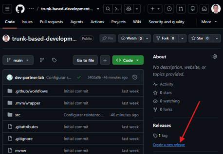

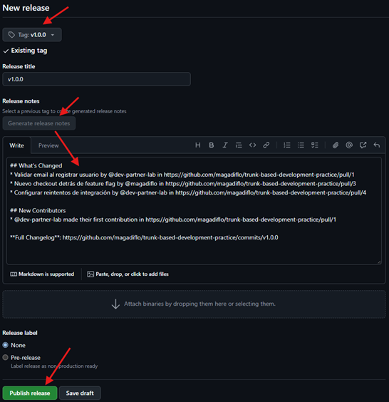

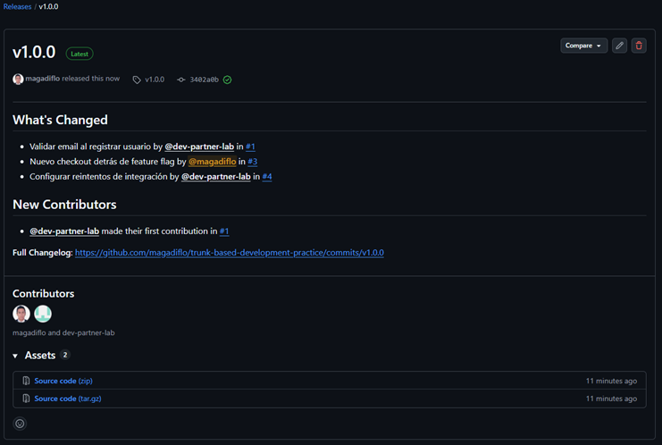

> `release/1.0` no tiene commits propios: es un puntero estable al mismo commit que `v1.0.0` y `main` (`3402a0b`).
> Además la rama **no está protegida** por el ruleset (que solo apunta a `main`); en un equipo real convendría
> protegerla también (`release/*`).

---

## Cambio #7: bug en producción: PR con el fix en `main` + `cherry-pick` a la release

Se detecta en producción (`v1.0.0`) que el email `ana+test@example.com` es rechazado: la expresión regular de
`EmailValidator` no permite el carácter `+`.

### Punto de partida

Es el estado con el que terminó el `Cambio #6`:

- `main`, `release/1.0` y el tag `v1.0.0` apuntan al mismo commit: `3402a0b`.
- `magadiflo` tiene `release/1.0` como rama local (la creó él).

````bash
M:\practice\magadiflo\trunk-based-development-practice (main -> origin)
$ git lg
* 3402a0b (HEAD -> main, tag: v1.0.0, origin/release/1.0, origin/main, origin/HEAD, release/1.0) Configurar reintentos de integración (#4)
* 3c260c4 Nuevo checkout detrás de feature flag (#3)
* c80e8ef Validar email al registrar usuario (#1)
* 7af7e27 Configurar timeout de integración
* 0d0d372 Configurar TTL de caché
* 2c7b7de Agregar endpoint /api/saludo
* 79389aa Initial commit
````

- `dev-partner-lab` solo conoce `origin/release/1.0`:

````bash
magadiflo@SysEngJava UCRT64 /m/practice/dev-partner-lab/trunk-based-development-practice (main)
$ git lg
* 3402a0b (HEAD -> main, tag: v1.0.0, origin/release/1.0, origin/main, origin/HEAD) Configurar reintentos de integración (#4)
* 3c260c4 Nuevo checkout detrás de feature flag (#3)
* c80e8ef Validar email al registrar usuario (#1)
* 7af7e27 Configurar timeout de integración
* 0d0d372 Configurar TTL de caché
* 2c7b7de Agregar endpoint /api/saludo
* 79389aa Initial commit
````

### Quién hace qué

Cada bloque lleva la marca `[magadiflo]` o `[dev-partner-lab]` para saber desde qué clon se ejecuta.

| Paso   | Quién                               | Qué hace                                                                                         |
|--------|-------------------------------------|--------------------------------------------------------------------------------------------------|
| 1 a 4  | `[dev-partner-lab]`                 | Crea la rama del arreglo, escribe la prueba que reproduce el bug, corrige el código y abre el PR |
| 5      | `[magadiflo]`                       | Revisa y aprueba el PR                                                                           |
| 6      | `[dev-partner-lab]`                 | Como autor, hace el *Squash and merge*                                                           |
| 7      | Ambos                               | Actualizan su `main`                                                                             |
| 8      | `[magadiflo]`                       | Lleva el arreglo a la release con `cherry-pick` y publica `v1.0.1`                               |
| 9      | `[dev-partner-lab]`                 | Sincroniza su clon                                                                               |
| Cierre | `[magadiflo]` y `[dev-partner-lab]` | Borran la release cuando ya no se necesita                                                       |

### ¿Por qué se hace así?

**Regla de oro en TBD: el arreglo se hace primero en `main`.** Si se arreglara solo en la release, la siguiente
versión (creada desde `main`) volvería a traer el bug. Como `main` está protegida, el arreglo entra por un Pull
Request.

**¿Por qué `cherry-pick` y no fusionar `main` en la release?** Porque `main` ya tiene cosas que **no están en
producción** (en nuestra práctica, el nuevo checkout y los reintentos). Fusionar `main` en la release las arrastraría a
una versión que ya está desplegada y validada. El `cherry-pick` copia **solo el commit del arreglo**. Gracias al *Squash
and merge*, ese arreglo es **un único commit** en `main`, así que es fácil de copiar.

Este es el esquema habitual en entornos donde producción corre una versión certificada, con aprobaciones formales:
la corrección debe cambiar lo mínimo sobre lo ya validado y dejar trazabilidad (`v1.0.1`, y de dónde vino cada
commit).

### Funcionalidad: primero en `main`, con una prueba que reproduce el bug

#### Paso 1: crear la rama del arreglo

`[dev-partner-lab]`

````bash
magadiflo@SysEngJava UCRT64 /m/practice/dev-partner-lab/trunk-based-development-practice (main)
$ git pull --rebase
Already up to date.

magadiflo@SysEngJava UCRT64 /m/practice/dev-partner-lab/trunk-based-development-practice (main)
$ git switch -c fix/email-con-signo-mas
Switched to a new branch 'fix/email-con-signo-mas'

magadiflo@SysEngJava UCRT64 /m/practice/dev-partner-lab/trunk-based-development-practice (fix/email-con-signo-mas)
$ git lg
* 3402a0b (HEAD -> fix/email-con-signo-mas, tag: v1.0.0, origin/release/1.0, origin/main, origin/HEAD, main) Configurar reintentos de integración (#4)
* 3c260c4 Nuevo checkout detrás de feature flag (#3)
* c80e8ef Validar email al registrar usuario (#1)
* 7af7e27 Configurar timeout de integración
* 0d0d372 Configurar TTL de caché
* 2c7b7de Agregar endpoint /api/saludo
* 79389aa Initial commit 
````

- `git pull --rebase`: nos aseguramos de partir del `main` más reciente. Debe responder `Already up to date.`
- `git switch -c fix/email-con-signo-mas`: crea la rama y se cambia a ella. El prefijo `fix/` indica que es una
  corrección.

#### Paso 2: la prueba que reproduce el bug

**Primero la prueba, antes de tocar el código.** Se agrega este método a `EmailValidatorTest`:

```java
@Test
void aceptaEmailConSignoMas() {
    assertThat(this.validator.esValido("ana+test@example.com")).isTrue();
}
```

Con el código actual la prueba **debe fallar**. Así comprobamos que realmente reproduce el bug:

`[dev-partner-lab]`

```bash
magadiflo@SysEngJava UCRT64 /m/practice/dev-partner-lab/trunk-based-development-practice (fix/email-con-signo-mas)
$ ./mvnw test
...
[INFO]
[INFO] Results:
[INFO]
[ERROR] Failures:
[ERROR]   EmailValidatorTest.aceptaEmailConSignoMas:28
Expecting value to be true but was false
[INFO]
[ERROR] Tests run: 8, Failures: 1, Errors: 0, Skipped: 0
[INFO]
[INFO] ------------------------------------------------------------------------
[ERROR] BUILD FAILURE
[INFO] ------------------------------------------------------------------------
[INFO] Total time:  6.609 s
[INFO] Finished at: 2026-11-24T17:06:26-05:00
[INFO] ------------------------------------------------------------------------
```

Usamos `test` porque aquí solo queremos el ciclo rápido de probar. Se hace commit de la prueba:

`[dev-partner-lab]`

```bash
magadiflo@SysEngJava UCRT64 /m/practice/dev-partner-lab/trunk-based-development-practice (fix/email-con-signo-mas)
$ git s
## fix/email-con-signo-mas
 M src/test/java/dev/magadiflo/tbd/EmailValidatorTest.java

magadiflo@SysEngJava UCRT64 /m/practice/dev-partner-lab/trunk-based-development-practice (fix/email-con-signo-mas)
$ git add .

magadiflo@SysEngJava UCRT64 /m/practice/dev-partner-lab/trunk-based-development-practice (fix/email-con-signo-mas)
$ git commit -m "Agregar prueba que reproduce el bug del signo +"
[fix/email-con-signo-mas 6d9a6c5] Agregar prueba que reproduce el bug del signo +
 1 file changed, 5 insertions(+)
```

#### Paso 3: corregir el código

En `EmailValidator.java` se agrega `+` a los caracteres permitidos antes de la `@`:

```java
// antes:  ^[A-Za-z0-9._]+@[A-Za-z0-9.-]+\\.[A-Za-z]{2,}$
// ahora:
private static final String REGEX = "^[A-Za-z0-9._+]+@[A-Za-z0-9.-]+\\.[A-Za-z]{2,}$";
```

Esta vez, antes de subir, corremos la verificación completa (la misma que usará el CI):

`[dev-partner-lab]`

````bash
magadiflo@SysEngJava UCRT64 /m/practice/dev-partner-lab/trunk-based-development-practice (fix/email-con-signo-mas)
$ ./mvnw verify
...
[INFO] ------------------------------------------------------------------------
[INFO] BUILD SUCCESS
[INFO] ------------------------------------------------------------------------
[INFO] Total time:  10.538 s
[INFO] Finished at: 2026-11-24T17:11:18-05:00
[INFO] ------------------------------------------------------------------------

magadiflo@SysEngJava UCRT64 /m/practice/dev-partner-lab/trunk-based-development-practice (fix/email-con-signo-mas)
$ git add .

magadiflo@SysEngJava UCRT64 /m/practice/dev-partner-lab/trunk-based-development-practice (fix/email-con-signo-mas)
$ git commit -m "Permitir + en la parte local del email"
[fix/email-con-signo-mas 43339e7] Permitir + en la parte local del email
 1 file changed, 1 insertion(+), 1 deletion(-)
````

La salida debe terminar en `BUILD SUCCESS`, con todas las pruebas en verde (la nueva incluida).

#### Paso 4: subir la rama y abrir el PR

`[dev-partner-lab]`

```bash
magadiflo@SysEngJava UCRT64 /m/practice/dev-partner-lab/trunk-based-development-practice (fix/email-con-signo-mas)
$ git push -u origin fix/email-con-signo-mas
Enumerating objects: 30, done.
Counting objects: 100% (30/30), done.
Delta compression using up to 8 threads
Compressing objects: 100% (11/11), done.
Writing objects: 100% (18/18), 1.38 KiB | 705.00 KiB/s, done.
Total 18 (delta 5), reused 0 (delta 0), pack-reused 0 (from 0)
remote: Resolving deltas: 100% (5/5), completed with 4 local objects.
remote:
remote: Create a pull request for 'fix/email-con-signo-mas' on GitHub by visiting:
remote:      https://github.com/magadiflo/trunk-based-development-practice/pull/new/fix/email-con-signo-mas
remote:
To https://github.com/magadiflo/trunk-based-development-practice.git
 * [new branch]      fix/email-con-signo-mas -> fix/email-con-signo-mas
branch 'fix/email-con-signo-mas' set up to track 'origin/fix/email-con-signo-mas'.
```

En GitHub se abre el Pull Request:

- **base:** `main`
- **compare:** `fix/email-con-signo-mas`
- **título:** `Corregir: permitir + en el email`

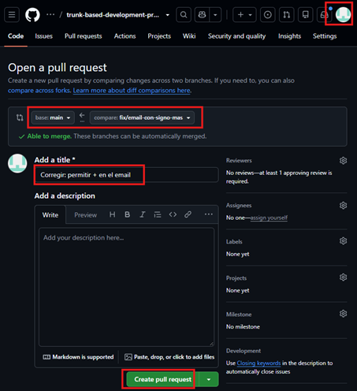

El check `build` se ejecutará (aparecerá como `CI / build (pull_request)`). Recuerda que el número del PR puede no
ser el que esperas (ver la nota del `Cambio #4`); en nuestra práctica será el `#6`.

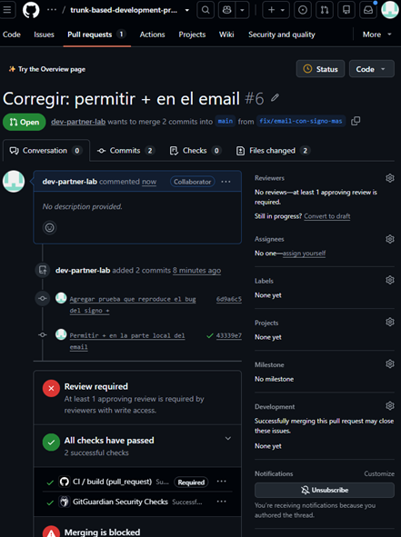

Aunque la rama tiene dos commits (la prueba y el arreglo), al hacer *Squash and merge* quedarán como **uno solo** en
`main`.

#### Paso 5: aprobar el PR

`[magadiflo]`

En GitHub: **Pull requests > (el PR) > Files changed > Review changes > Approve > Submit review**.

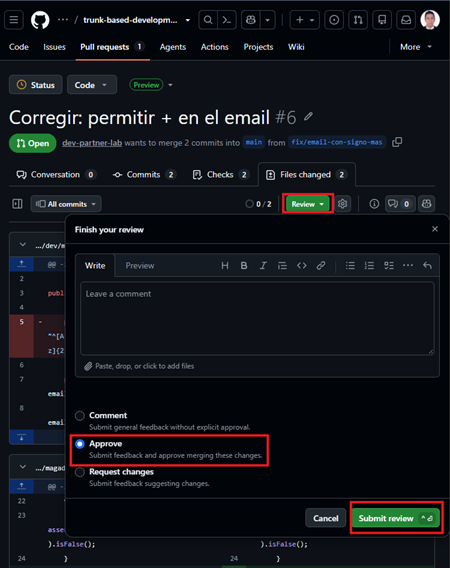

#### Paso 6: fusionar el PR

`[dev-partner-lab]`

Con el PR aprobado y el check `build` en verde, el autor lo fusiona en la pestaña *Conversation*:
**Squash and merge > Confirm squash and merge**. GitHub borra la rama remota automáticamente.

> Cualquier cuenta con permiso de escritura puede pulsar el botón. Lo habitual es que lo haga el autor del PR.

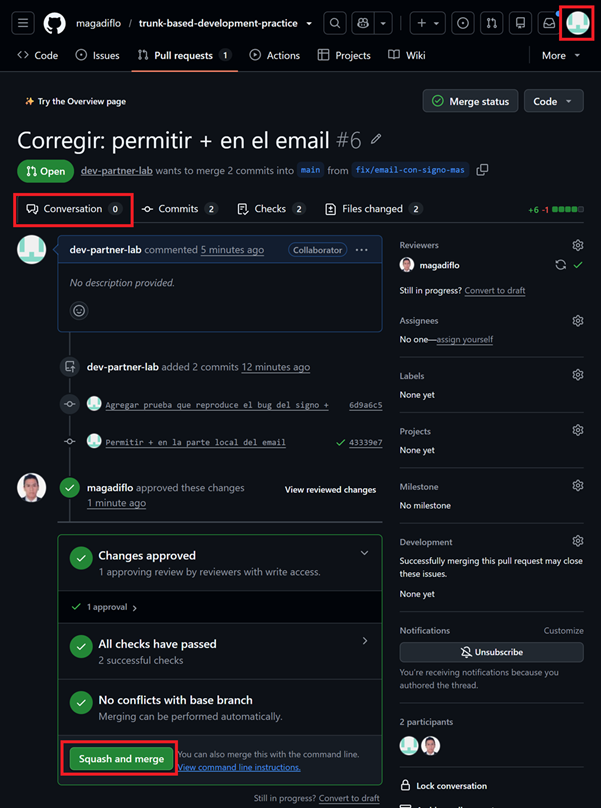

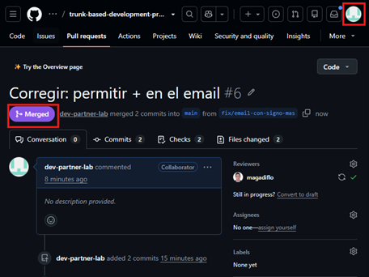

#### Paso 7: actualizar `main` en ambos clones

`[dev-partner-lab]`

````bash
magadiflo@SysEngJava UCRT64 /m/practice/dev-partner-lab/trunk-based-development-practice (fix/email-con-signo-mas)
$ git switch main
Switched to branch 'main'
Your branch is up to date with 'origin/main'.

magadiflo@SysEngJava UCRT64 /m/practice/dev-partner-lab/trunk-based-development-practice (main)
$ git lg
* 43339e7 (origin/fix/email-con-signo-mas, fix/email-con-signo-mas) Permitir + en la parte local del email
* 6d9a6c5 Agregar prueba que reproduce el bug del signo +
* 3402a0b (HEAD -> main, tag: v1.0.0, origin/release/1.0, origin/main, origin/HEAD) Configurar reintentos de integración (#4)
* 3c260c4 Nuevo checkout detrás de feature flag (#3)
* c80e8ef Validar email al registrar usuario (#1)
* 7af7e27 Configurar timeout de integración
* 0d0d372 Configurar TTL de caché
* 2c7b7de Agregar endpoint /api/saludo
* 79389aa Initial commit

magadiflo@SysEngJava UCRT64 /m/practice/dev-partner-lab/trunk-based-development-practice (main)
$ git pull --rebase
remote: Enumerating objects: 27, done.
remote: Counting objects: 100% (27/27), done.
remote: Compressing objects: 100% (4/4), done.
remote: Total 15 (delta 4), reused 14 (delta 4), pack-reused 0 (from 0)
Unpacking objects: 100% (15/15), 1.70 KiB | 347.00 KiB/s, done.
From https://github.com/magadiflo/trunk-based-development-practice
   3402a0b..d387283  main       -> origin/main
Updating 3402a0b..d387283
Fast-forward
 src/main/java/dev/magadiflo/tbd/EmailValidator.java     | 2 +-
 src/test/java/dev/magadiflo/tbd/EmailValidatorTest.java | 5 +++++
 2 files changed, 6 insertions(+), 1 deletion(-)

magadiflo@SysEngJava UCRT64 /m/practice/dev-partner-lab/trunk-based-development-practice (main)
$ git fetch --prune
From https://github.com/magadiflo/trunk-based-development-practice
 - [deleted]         (none)     -> origin/fix/email-con-signo-mas

magadiflo@SysEngJava UCRT64 /m/practice/dev-partner-lab/trunk-based-development-practice (main)
$ git branch -D fix/email-con-signo-mas
Deleted branch fix/email-con-signo-mas (was 43339e7).

magadiflo@SysEngJava UCRT64 /m/practice/dev-partner-lab/trunk-based-development-practice (main)
$ git lg
* d387283 (HEAD -> main, origin/main, origin/HEAD) Corregir: permitir + en el email (#6)
* 3402a0b (tag: v1.0.0, origin/release/1.0) Configurar reintentos de integración (#4)
* 3c260c4 Nuevo checkout detrás de feature flag (#3)
* c80e8ef Validar email al registrar usuario (#1)
* 7af7e27 Configurar timeout de integración
* 0d0d372 Configurar TTL de caché
* 2c7b7de Agregar endpoint /api/saludo
* 79389aa Initial commit
````

- **El orden importa:** hay que cambiar a `main` **antes** del `pull`. Si lo haces estando en la rama del arreglo,
  Git responde `Your configuration specifies to merge with the ref 'refs/heads/fix/email-con-signo-mas' from the
  remote, but no such ref was fetched`. Es porque GitHub ya borró esa rama remota al fusionar.
- `git branch -D`: se usa `-D` y no `-d`, porque tras un *Squash and merge* Git no ve la rama como fusionada.

`[magadiflo]`

```bash
M:\practice\magadiflo\trunk-based-development-practice (main -> origin)
$ git pull --rebase
remote: Enumerating objects: 27, done.
remote: Counting objects: 100% (27/27), done.
remote: Compressing objects: 100% (4/4), done.
remote: Total 15 (delta 4), reused 14 (delta 4), pack-reused 0 (from 0)
Unpacking objects: 100% (15/15), 1.70 KiB | 248.00 KiB/s, done.
From https://github.com/magadiflo/trunk-based-development-practice
   3402a0b..d387283  main       -> origin/main
Updating 3402a0b..d387283
Fast-forward
 src/main/java/dev/magadiflo/tbd/EmailValidator.java     | 2 +-
 src/test/java/dev/magadiflo/tbd/EmailValidatorTest.java | 5 +++++
 2 files changed, 6 insertions(+), 1 deletion(-)

M:\practice\magadiflo\trunk-based-development-practice (main -> origin)
$ git fetch --prune

M:\practice\magadiflo\trunk-based-development-practice (main -> origin)
$ git lg
* d387283 (HEAD -> main, origin/main, origin/HEAD) Corregir: permitir + en el email (#6)
* 3402a0b (tag: v1.0.0, origin/release/1.0, release/1.0) Configurar reintentos de integración (#4)
* 3c260c4 Nuevo checkout detrás de feature flag (#3)
* c80e8ef Validar email al registrar usuario (#1)
* 7af7e27 Configurar timeout de integración
* 0d0d372 Configurar TTL de caché
* 2c7b7de Agregar endpoint /api/saludo
* 79389aa Initial commit
```

El `pull` debe mostrar un *Fast-forward* con los dos archivos modificados. El `git lg` debe mostrar `main` un commit
por encima de `3402a0b`, que es el *squash* (en nuestro caso su hash es `d387283`).
`release/1.0` y `v1.0.0` siguen en `3402a0b`.

### Llevar la corrección a la release: `cherry-pick`

#### Paso 8: copiar el commit a la release y publicar `v1.0.1`

`[magadiflo]`

Primero ubicamos el commit del *squash* en `main`:

```bash
M:\practice\magadiflo\trunk-based-development-practice (main -> origin)
$ git lg -3
* d387283 (HEAD -> main, origin/main, origin/HEAD) Corregir: permitir + en el email (#6)
* 3402a0b (tag: v1.0.0, origin/release/1.0, release/1.0) Configurar reintentos de integración (#4)
* 3c260c4 Nuevo checkout detrás de feature flag (#3)
```

> **📖 Comandos de este bloque**
>
> `git lg -3`: muestra los últimos commits, uno por línea.
> - `-3`: limita la salida a los 3 más recientes.

El primero de la lista es el del *squash* (`Corregir: permitir + en el email (#6)`). Se **copia ese mismo commit** a la
release:

```bash
M:\practice\magadiflo\trunk-based-development-practice (main -> origin)
$ git switch release/1.0
Switched to branch 'release/1.0'
Your branch is up to date with 'origin/release/1.0'.

M:\practice\magadiflo\trunk-based-development-practice (release/1.0 -> origin)
$ git cherry-pick -x d387283
[release/1.0 537830e] Corregir: permitir + en el email (#6)
 Author: dev-partner-lab <145618228+dev-partner-lab@users.noreply.github.com>
 Date: Tue Nov 24 17:24:29 2026 -0500
 2 files changed, 6 insertions(+), 1 deletion(-)
```

> **📖 Comandos de este bloque**
>
> `git cherry-pick -x <hash>`: copia **un solo commit** de otra rama a la rama actual, como un commit nuevo.
> - `git cherry-pick`: toma los cambios de un commit concreto (identificado por su hash) y los aplica encima de donde
>   estás.
> - `-x`: agrega al mensaje del commit nuevo la línea `(cherry picked from commit ...)`, para dejar **trazabilidad**
>   de dónde vino.
> - `d387283`: el hash del commit a copiar (el del *squash* en `main`).

El commit copiado es **otro commit** (otro hash), aunque tenga el mismo contenido. Conserva el **autor original**
(`dev-partner-lab`) y el *committer* es `magadiflo`, quien lo aplicó. Se ve con:

````bash
M:\practice\magadiflo\trunk-based-development-practice (release/1.0 -> origin)
$ git lg
* 537830e (HEAD -> release/1.0) Corregir: permitir + en el email (#6)
| * d387283 (origin/main, origin/HEAD, main) Corregir: permitir + en el email (#6)
|/
* 3402a0b (tag: v1.0.0, origin/release/1.0) Configurar reintentos de integración (#4)
* 3c260c4 Nuevo checkout detrás de feature flag (#3)
* c80e8ef Validar email al registrar usuario (#1)
* 7af7e27 Configurar timeout de integración
* 0d0d372 Configurar TTL de caché
* 2c7b7de Agregar endpoint /api/saludo
* 79389aa Initial commit 

M:\practice\magadiflo\trunk-based-development-practice (release/1.0 -> origin)
$ git log -1 --format="autor=%an | committer=%cn" release/1.0
autor=dev-partner-lab | committer=Martín Díaz

M:\practice\magadiflo\trunk-based-development-practice (release/1.0 -> origin)
$ git log --stat -1
commit 537830e33f1edcbd38b298247b2ec75daba396b4 (HEAD -> release/1.0)
Author: dev-partner-lab <145618228+dev-partner-lab@users.noreply.github.com>
Date:   Tue Nov 24 17:24:29 2026 -0500

    Corregir: permitir + en el email (#6)

    (cherry picked from commit d3872834367482dd8d927e74ec1468644cef4f65)

 src/main/java/dev/magadiflo/tbd/EmailValidator.java     | 2 +-
 src/test/java/dev/magadiflo/tbd/EmailValidatorTest.java | 5 +++++
 2 files changed, 6 insertions(+), 1 deletion(-)
````

> **📖 Comandos de este bloque**
>
> `git log -1 --format="autor=%an | committer=%cn" release/1.0`: imprime un texto a medida sobre el último commit de
> `release/1.0`.
> - `-1`: solo el commit más reciente.
> - `--format="..."`: define el texto de salida con marcadores: `%an` = nombre del autor, `%cn` = nombre de quien aplicó
>   el commit (*committer*). (Otro marcador útil: `%B` = mensaje completo.)
> - `release/1.0`: la rama o referencia cuyo último commit se muestra.

**Antes de subir, verificamos la release.** Estamos en otra rama, con otra base, así que comprobamos que compile y
pase las pruebas:

```bash
M:\practice\magadiflo\trunk-based-development-practice (release/1.0 -> origin)
$ mvnw verify
...
[INFO] ------------------------------------------------------------------------
[INFO] BUILD SUCCESS
[INFO] ------------------------------------------------------------------------
[INFO] Total time:  5.811 s
[INFO] Finished at: 2026-11-24T18:01:59-05:00
[INFO] ------------------------------------------------------------------------
```

> **Nuestro CI solo corre para `main`** (su sección `on:` filtra por esa rama), así que esta verificación local es
> lo único que protege a la release. En un proyecto real también se agregaría `release/**` a los filtros del workflow,
> y la release estaría protegida igual que `main`.

Con la verificación en verde, se publica la corrección y se etiqueta la nueva versión:

````bash
M:\practice\magadiflo\trunk-based-development-practice (release/1.0 -> origin)
$ git push
Enumerating objects: 27, done.
Counting objects: 100% (27/27), done.
Delta compression using up to 8 threads
Compressing objects: 100% (8/8), done.
Writing objects: 100% (15/15), 1.15 KiB | 394.00 KiB/s, done.
Total 15 (delta 4), reused 0 (delta 0), pack-reused 0 (from 0)
remote: Resolving deltas: 100% (4/4), completed with 4 local objects.
To https://github.com/magadiflo/trunk-based-development-practice.git
   3402a0b..537830e  release/1.0 -> release/1.0 

M:\practice\magadiflo\trunk-based-development-practice (release/1.0 -> origin)
$ git tag -a v1.0.1 -m "Versión 1.0.1"

M:\practice\magadiflo\trunk-based-development-practice (release/1.0 -> origin)
$ git push origin v1.0.1
Enumerating objects: 1, done.
Counting objects: 100% (1/1), done.
Writing objects: 100% (1/1), 176 bytes | 176.00 KiB/s, done.
Total 1 (delta 0), reused 0 (delta 0), pack-reused 0 (from 0)
To https://github.com/magadiflo/trunk-based-development-practice.git
 * [new tag]         v1.0.1 -> v1.0.1

M:\practice\magadiflo\trunk-based-development-practice (release/1.0 -> origin)
$ git switch main
Switched to branch 'main'
Your branch is up to date with 'origin/main'.

M:\practice\magadiflo\trunk-based-development-practice (main -> origin)
$ git lg
* 537830e (tag: v1.0.1, origin/release/1.0, release/1.0) Corregir: permitir + en el email (#6)
| * d387283 (HEAD -> main, origin/main, origin/HEAD) Corregir: permitir + en el email (#6)
|/
* 3402a0b (tag: v1.0.0) Configurar reintentos de integración (#4)
* 3c260c4 Nuevo checkout detrás de feature flag (#3)
* c80e8ef Validar email al registrar usuario (#1)
* 7af7e27 Configurar timeout de integración
* 0d0d372 Configurar TTL de caché
* 2c7b7de Agregar endpoint /api/saludo
* 79389aa Initial commit
````

Los comandos de `tag` y `push` de etiquetas ya se explicaron en el `Cambio #6`.

#### Paso 9: sincronizar a `dev-partner-lab`

`[dev-partner-lab]`

```bash
magadiflo@SysEngJava UCRT64 /m/practice/dev-partner-lab/trunk-based-development-practice (main)
$ git fetch --prune
remote: Enumerating objects: 28, done.
remote: Counting objects: 100% (28/28), done.
remote: Compressing objects: 100% (5/5), done.
remote: Total 16 (delta 4), reused 16 (delta 4), pack-reused 0 (from 0)
Unpacking objects: 100% (16/16), 1.28 KiB | 163.00 KiB/s, done.
From https://github.com/magadiflo/trunk-based-development-practice
   3402a0b..537830e  release/1.0 -> origin/release/1.0
 * [new tag]         v1.0.1      -> v1.0.1

magadiflo@SysEngJava UCRT64 /m/practice/dev-partner-lab/trunk-based-development-practice (main)
$ git lg
* 537830e (tag: v1.0.1, origin/release/1.0) Corregir: permitir + en el email (#6)
| * d387283 (HEAD -> main, origin/main, origin/HEAD) Corregir: permitir + en el email (#6)
|/
* 3402a0b (tag: v1.0.0) Configurar reintentos de integración (#4)
* 3c260c4 Nuevo checkout detrás de feature flag (#3)
* c80e8ef Validar email al registrar usuario (#1)
* 7af7e27 Configurar timeout de integración
* 0d0d372 Configurar TTL de caché
* 2c7b7de Agregar endpoint /api/saludo
* 79389aa Initial commit
```

Como `release/1.0` todavía existe en el remoto, el `fetch` descarga también el tag `v1.0.1`.

> **Por eso se sincroniza antes de cerrar la release.** `git fetch` solo trae automáticamente los tags que cuelgan de
> commits alcanzables desde las ramas que descarga, y el tag `v1.0.1` cuelga de un commit que solo existe en
> `release/1.0`. Si `dev-partner-lab` hiciera el `fetch` **después** de que la rama se borrara, ese commit ya no
> sería alcanzable y el tag no se descargaría. En ese caso se usaría `git fetch --tags`, que descarga **todos** los
> tags del remoto.

### Resultado

`[magadiflo]`

```bash
M:\practice\magadiflo\trunk-based-development-practice (main -> origin)
$ git lg
* 537830e (tag: v1.0.1, origin/release/1.0, release/1.0) Corregir: permitir + en el email (#6)
| * d387283 (HEAD -> main, origin/main, origin/HEAD) Corregir: permitir + en el email (#6)
|/
* 3402a0b (tag: v1.0.0) Configurar reintentos de integración (#4)
* 3c260c4 Nuevo checkout detrás de feature flag (#3)
* c80e8ef Validar email al registrar usuario (#1)
* 7af7e27 Configurar timeout de integración
* 0d0d372 Configurar TTL de caché
* 2c7b7de Agregar endpoint /api/saludo
* 79389aa Initial commit
```

```bash
* <hash-del-cherry-pick> (tag: v1.0.1, origin/release/1.0, release/1.0) Corregir: permitir + en el email (#6)
| * <hash-del-squash> (HEAD -> main, origin/main, origin/HEAD) Corregir: permitir + en el email (#6)
|/
* 3402a0b (tag: v1.0.0) Configurar reintentos de integración (#4)
* 3c260c4 Nuevo checkout detrás de feature flag (#3)
...
```

**¿Es una bifurcación en TBD?** La línea lateral es la **release** (con su `cherry-pick` y su tag), no `main`. `main`
sigue **lineal**, sin commits de merge. El alias `git lg` usa `--all`, que dibuja todas las ramas y tags. Para ver
solo `main`:

```bash
git log --oneline --graph --decorate main
```

> **📖 Comandos de este bloque**
>
> `git log --oneline --graph --decorate main`: historial en forma de grafo, limitado a lo que se alcanza desde `main`.
> - `--graph`: dibuja las líneas del historial.
> - `--decorate`: muestra a qué rama o tag apunta cada commit.
> - `main`: en vez de `--all`, solo se muestra el historial de esa rama.

Compara con el `hotfix` de GitFlow:

|                                   | GitFlow                           | TBD                                       |
|-----------------------------------|-----------------------------------|-------------------------------------------|
| Rama aparte para la corrección    | `hotfix-1.1.0`                    | `fix/*` normal, desde `main`              |
| PR necesarios                     | 2 (a `main` y a `develop`)        | 1 (a `main`) + `cherry-pick` a la release |
| Riesgo de olvidar propagar el fix | Sí (hay que fusionar a `develop`) | No (el fix nace en `main`)                |

> **Nota sobre variantes:** las fuentes no son 100% uniformes. La referencia clásica del modelo lleva las correcciones
> del trunk a la release con *cherry-pick* (lo practicado aquí) y la release **no se fusiona de vuelta**; otras guías
> mencionan fusionar de vuelta las correcciones hechas en la release.
>
> **Alternativa: *fix forward*.** Cuando se despliega `main` de forma continua y en minutos, con feature flags, se
> suele arreglar en `main` y desplegar desde ahí, sin release que parchear. Es habitual en productos web con
> despliegue diario. Donde producción corre una versión certificada, como en entornos regulados, se prefiere parchear
> la release con `cherry-pick`. Lo importante en ambos casos es que **el arreglo llegue a `main` rápido**.

### Cierre de la release

`release/1.0` es una rama de **vida corta**: se borra cuando ya no se necesita, es decir, cuando la siguiente release
(`release/1.1`) esté estable en producción. Los tags `v1.0.0` y `v1.0.1` **permanecen**. Como en la práctica no vamos
a crear `release/1.1`, **simulamos ese momento** y cerramos la release:

`[magadiflo]`

```bash
M:\practice\magadiflo\trunk-based-development-practice (main -> origin)
$ git lg
* 537830e (tag: v1.0.1, origin/release/1.0, release/1.0) Corregir: permitir + en el email (#6)
| * d387283 (HEAD -> main, origin/main, origin/HEAD) Corregir: permitir + en el email (#6)
|/
* 3402a0b (tag: v1.0.0) Configurar reintentos de integración (#4)
* 3c260c4 Nuevo checkout detrás de feature flag (#3)
* c80e8ef Validar email al registrar usuario (#1)
* 7af7e27 Configurar timeout de integración
* 0d0d372 Configurar TTL de caché
* 2c7b7de Agregar endpoint /api/saludo
* 79389aa Initial commit

M:\practice\magadiflo\trunk-based-development-practice (main -> origin)
$ git push origin --delete release/1.0
To https://github.com/magadiflo/trunk-based-development-practice.git
 - [deleted]         release/1.0

M:\practice\magadiflo\trunk-based-development-practice (main -> origin)
$ git branch -D release/1.0
Deleted branch release/1.0 (was 537830e).

M:\practice\magadiflo\trunk-based-development-practice (main -> origin)
$ git tag
v1.0.0
v1.0.1

M:\practice\magadiflo\trunk-based-development-practice (main -> origin)
$ git lg
* 537830e (tag: v1.0.1) Corregir: permitir + en el email (#6)
| * d387283 (HEAD -> main, origin/main, origin/HEAD) Corregir: permitir + en el email (#6)
|/
* 3402a0b (tag: v1.0.0) Configurar reintentos de integración (#4)
* 3c260c4 Nuevo checkout detrás de feature flag (#3)
* c80e8ef Validar email al registrar usuario (#1)
* 7af7e27 Configurar timeout de integración
* 0d0d372 Configurar TTL de caché
* 2c7b7de Agregar endpoint /api/saludo
* 79389aa Initial commit
```

> **📖 Comandos de este bloque**
>
> `git push origin --delete release/1.0`: borra la rama **en el remoto** (GitHub).
> - `git push origin`: ya explicado.
> - `--delete`: en vez de subir, **elimina** la rama indicada del remoto.
> - `release/1.0`: la rama a eliminar. (Esto no borra tu copia local; para eso está `git branch -D`.)
>
> `git tag` (sin argumentos): **lista** las etiquetas existentes. Los tags permanecen aunque se borre la rama.

Se usa `-D` en `git branch`: el `cherry-pick` creó un commit **distinto** al de `main`, así que Git no considera la
rama como fusionada.

`[dev-partner-lab]`

```bash
magadiflo@SysEngJava UCRT64 /m/practice/dev-partner-lab/trunk-based-development-practice (main)
$ git lg
* 537830e (tag: v1.0.1, origin/release/1.0) Corregir: permitir + en el email (#6)
| * d387283 (HEAD -> main, origin/main, origin/HEAD) Corregir: permitir + en el email (#6)
|/
* 3402a0b (tag: v1.0.0) Configurar reintentos de integración (#4)
* 3c260c4 Nuevo checkout detrás de feature flag (#3)
* c80e8ef Validar email al registrar usuario (#1)
* 7af7e27 Configurar timeout de integración
* 0d0d372 Configurar TTL de caché
* 2c7b7de Agregar endpoint /api/saludo
* 79389aa Initial commit

magadiflo@SysEngJava UCRT64 /m/practice/dev-partner-lab/trunk-based-development-practice (main)
$ git fetch --prune
From https://github.com/magadiflo/trunk-based-development-practice
 - [deleted]         (none)     -> origin/release/1.0

magadiflo@SysEngJava UCRT64 /m/practice/dev-partner-lab/trunk-based-development-practice (main)
$ git lg
* 537830e (tag: v1.0.1) Corregir: permitir + en el email (#6)
| * d387283 (HEAD -> main, origin/main, origin/HEAD) Corregir: permitir + en el email (#6)
|/
* 3402a0b (tag: v1.0.0) Configurar reintentos de integración (#4)
* 3c260c4 Nuevo checkout detrás de feature flag (#3)
* c80e8ef Validar email al registrar usuario (#1)
* 7af7e27 Configurar timeout de integración
* 0d0d372 Configurar TTL de caché
* 2c7b7de Agregar endpoint /api/saludo
* 79389aa Initial commit
```

Esto elimina la referencia `origin/release/1.0`, que ya no existe en el remoto. El tag `v1.0.1` no se pierde:
`dev-partner-lab` ya lo descargó en el paso 9.

**Resultado final:** la rama `release/1.0` desapareció, pero el commit del `cherry-pick` sigue visible porque el tag
`v1.0.1` lo mantiene vivo. Los dos clones deberían mostrar lo mismo:

```bash
* <hash-del-cherry-pick> (tag: v1.0.1) Corregir: permitir + en el email (#6)
| * <hash-del-squash> (HEAD -> main, origin/main, origin/HEAD) Corregir: permitir + en el email (#6)
|/
* 3402a0b (tag: v1.0.0) Configurar reintentos de integración (#4)
...
```

#### Resultado final

`[magadiflo]`

````bash
M:\practice\magadiflo\trunk-based-development-practice (main -> origin)
$ git lg
* 537830e (tag: v1.0.1) Corregir: permitir + en el email (#6)
| * d387283 (HEAD -> main, origin/main, origin/HEAD) Corregir: permitir + en el email (#6)
|/
* 3402a0b (tag: v1.0.0) Configurar reintentos de integración (#4)
* 3c260c4 Nuevo checkout detrás de feature flag (#3)
* c80e8ef Validar email al registrar usuario (#1)
* 7af7e27 Configurar timeout de integración
* 0d0d372 Configurar TTL de caché
* 2c7b7de Agregar endpoint /api/saludo
* 79389aa Initial commit 
````

`[dev-partner-lab]`

````bash
magadiflo@SysEngJava UCRT64 /m/practice/dev-partner-lab/trunk-based-development-practice (main)
$ git lg
* 537830e (tag: v1.0.1) Corregir: permitir + en el email (#6)
| * d387283 (HEAD -> main, origin/main, origin/HEAD) Corregir: permitir + en el email (#6)
|/
* 3402a0b (tag: v1.0.0) Configurar reintentos de integración (#4)
* 3c260c4 Nuevo checkout detrás de feature flag (#3)
* c80e8ef Validar email al registrar usuario (#1)
* 7af7e27 Configurar timeout de integración
* 0d0d372 Configurar TTL de caché
* 2c7b7de Agregar endpoint /api/saludo
* 79389aa Initial commit
````

### ¿Cómo seguirá el historial a partir de aquí?

Ya terminamos con un historial de este tipo: una línea recta (`main`) y una **aleta** corta, como la de un pez, que
cuelga de ella. Veamos cómo seguirá creciendo.

- **Las nuevas funcionalidades y correcciones siguen entrando por `main`.** Cada PR fusionado con *Squash and merge*
  agrega **un commit nuevo encima de `main`**. La línea sigue recta, sin commits de merge.
- **La aleta es el commit `537830e`**, la copia de la corrección que viaja a la release (el `cherry-pick`). Seguirá
  ahí mientras exista el tag `v1.0.1`, porque ese tag lo mantiene vivo. Los tags son el registro permanente de lo que
  se publicó, así que esa aleta se queda en el historial aunque la rama `release/1.0` ya se haya borrado.
- **¿Cuándo se forma una aleta?** Solo cuando a una release se le agrega un commit que no está en `main`, es decir,
  cuando se lleva una corrección con `cherry-pick`. Cada corrección nueva sobre la misma release (por ejemplo,
  `v1.0.2`) alarga su aleta. **Crear una release no forma una aleta**: la rama nace en el mismo commit que `main`,
  y mientras no reciba commits propios, se ve solo como una etiqueta sobre ese punto.
- **¿Dónde nace la siguiente release?** Siempre desde `main`, en el momento en que se corta, ya con todo lo que se
  haya integrado hasta entonces. No sale de la aleta de la anterior: queda "al nivel de `main`". El número depende del
  esquema de versionado (con *SemVer*, `1.1.0` si agrega funcionalidad compatible y `2.0.0` si rompe compatibilidad).
  En este ejemplo usaríamos `release/1.1`.
- **¿Dónde terminan las releases?** Son de **vida corta**: la rama se borra cuando la siguiente release está estable
  en producción. Los tags permanecen.

Un esquema conceptual de cómo se vería más adelante (no es una salida real):

```text
* (HEAD -> main, origin/main, release/1.1) Nueva funcionalidad C    <- release/1.1 nace aquí, sin aleta
* Nueva funcionalidad B
* Nueva funcionalidad A
* d387283 Corregir: permitir + en el email (#6)
| * 537830e (tag: v1.0.1) Corregir: permitir + en el email (#6)     <- aleta de la release 1.0
|/
* 3402a0b (tag: v1.0.0) Configurar reintentos de integración (#4)   <- aquí se cortó release/1.0
...
```

**Regla práctica:** `main` es **una sola línea**, y cada release es, como máximo, **una aleta corta** con sus tags. Si
quieres ver solo la línea recta, usa `git log --oneline --graph --decorate main`.

## Problemas frecuentes al practicar con GitHub

| Síntoma                                                                                                            | Causa probable                                                                                 | Solución                                                                                                                                                     |
|--------------------------------------------------------------------------------------------------------------------|------------------------------------------------------------------------------------------------|--------------------------------------------------------------------------------------------------------------------------------------------------------------|
| Los pushes de dev-partner-lab salen como **magadiflo** (no hay error, pero en GitHub aparece la cuenta equivocada) | GCM reutilizó la cuenta guardada porque el clon no indica usuario                              | `git config --local credential.https://github.com.username "dev-partner-lab"` en ese clon; revisa `git credential-manager github list` y vuelve a autenticar |
| `remote: Permission to magadiflo/... denied to <usuario>` o error 403 al hacer push                                | La cuenta con la que se autenticó no tiene acceso (invitación sin aceptar o cuenta equivocada) | Acepta la invitación; revisa qué usuario envía Git/GCM **(GitHub, no verificado)**                                                                           |
| El navegador de GCM abre la sesión de la otra cuenta                                                               | El navegador predeterminado tiene abierta la sesión de magadiflo                               | Usa ventana de incógnito, código de dispositivo o un token clásico con permiso `repo`                                                                        |
| Los commits de dev-partner-lab aparecen como magadiflo                                                             | El clon usa la identidad global en vez de la local                                             | `git config --show-origin user.name` en ese clon; configura `user.name/email` con `--local`                                                                  |
| Los commits salen sin avatar ni usuario                                                                            | El `user.email` no pertenece a la cuenta                                                       | Usa el correo de la cuenta o su correo noreply (Settings > Emails)                                                                                           |
| La CI falla con `./mvnw: Permission denied`                                                                        | `mvnw` se subió sin permiso de ejecución                                                       | `git update-index --chmod=+x mvnw` y nuevo commit                                                                                                            |
| No aparece el check `build` al crear el ruleset                                                                    | El workflow aún no se ha ejecutado                                                             | Haz un push o PR para que corra y vuelve a buscarlo                                                                                                          |
| El botón de merge está bloqueado                                                                                   | Falta la aprobación o el check `build` no pasó                                                 | Revisa el panel de requisitos del PR                                                                                                                         |
| No puedes aprobar tu propio PR                                                                                     | GitHub no lo permite                                                                           | Aprueba con la otra cuenta                                                                                                                                   |
| `git branch -d` dice *not fully merged*                                                                            | Es normal tras *Squash and merge* o `cherry-pick`                                              | Usa `git branch -D` (si ya está integrado)                                                                                                                   |
| `git push` rechazado tras un `rebase`                                                                              | Se reescribió la historia de la rama                                                           | `git push --force-with-lease` (solo en tu rama de vida corta)                                                                                                |
| `git push` a `main` rechazado con `GH013`                                                                          | El ruleset está haciendo su trabajo                                                            | Usa una rama y un PR                                                                                                                                         |

## Errores comunes (anti-patrones)

| Error                                    | Por qué rompe TBD                                                                                                            |
|------------------------------------------|------------------------------------------------------------------------------------------------------------------------------|
| Ramas `feature` que viven semanas        | Es GitFlow disfrazado. La referencia del modelo indica que una rama corta dura uno o dos días y debe borrarse al integrarse. |
| Varias personas en la misma rama "corta" | Se vuelve una mini-release branch con desarrollo activo.                                                                     |
| PR gigantes                              | No se revisan rápido y se acumulan conflictos.                                                                               |
| Integrar sin pruebas ni CI               | `main` se rompe y todos pierden tiempo.                                                                                      |
| No usar feature flags                    | Obliga a esperar a terminar todo para integrar, es decir, ramas largas.                                                      |
| Arreglar solo en la release branch       | El bug reaparece en la siguiente versión.                                                                                    |
| Flags que nunca se limpian               | Código muerto y combinaciones imposibles de probar.                                                                          |

## Equivalencias GitFlow → Trunk Based Development

| En GitFlow hacías...                       | En TBD haces...                                         |
|--------------------------------------------|---------------------------------------------------------|
| Crear `feature/*` desde `develop`          | Rama corta desde `main` (o commit directo)              |
| Mergear `feature` a `develop`              | PR + *Squash and merge* a `main` en menos de 1-2 días   |
| Tener `develop` con "lo que viene"         | `main` siempre lista; lo incompleto va apagado con flag |
| Rama `release-*` larga con ajustes finales | Tag sobre `main`, o `release/*` corta con cherry-pick   |
| Rama `hotfix-*` + 2 PR (main y develop)    | Fix en `main` + cherry-pick a la release si hace falta  |
| Esperar a la "fecha de release"            | Desplegar desde `main` con frecuencia                   |

## Preguntas típicas de entrevista

- **¿Qué es Trunk Based Development?** Estrategia donde todos integran en una sola rama (`main`) con cambios pequeño
  y frecuentes, usando ramas de vida corta y feature flags.
- **¿Diferencia principal con GitFlow?** TBD no tiene `develop` ni ramas largas; la vida de las ramas se mide en
  horas, no semanas.
- **¿Cómo manejas código incompleto?** Se integra apagado con un *feature flag*.
- **¿Qué necesita un equipo para adoptarlo?** CI rápida, pruebas automatizadas, revisiones ágiles y feature flags.
- **¿Cómo se hace un hotfix?** La corrección se hace **primero en `main`** y luego se lleva a la release:
    1. Desde `main`, actualizado, se crea una rama `fix/...`.
    2. En esa rama se escribe **primero la prueba que reproduce el bug** (falla) y luego **la corrección** (la prueba
       pasa). Suelen ser dos commits.
    3. Se abre un Pull Request hacia `main`. Con la aprobación y el CI en verde se fusiona con *Squash and merge*, y los
       dos commits quedan como **uno solo** en `main`.
    4. Se actualiza el `main` local con `git pull --rebase`. Ahora `main` tiene la corrección, pero la release todavía
       no.
    5. Parado en la rama de la release, se hace `git cherry-pick -x` del commit del *squash*. Eso **copia** la
       corrección a la release como un commit nuevo (otro hash, mismo contenido). Se verifica con `./mvnw verify` y se
       sube la rama.
    6. Se crea el tag de la nueva versión (`v1.0.1`) **sobre ese commit de la release** y se sube el tag.
    7. Producción se actualiza desde ese tag, con lo mínimo que cambió respecto a la versión anterior.

  **Cómo queda el historial:** `main` sigue siendo una línea recta, con la corrección como un commit más. La release
  tiene una pequeña aleta con su copia de la corrección y el tag nuevo.

- **¿Qué haces si tu PR entra en conflicto?** `rebase` sobre `main`, resuelvo en local, pruebo y subo con
  `--force-with-lease`.
- **¿Cómo proteges `main`?** Ruleset/branch protection: PR obligatorio, aprobaciones, checks de CI requeridos,
  historial lineal y sin force push.
- **¿Cuándo NO usarías TBD?** Cuando se publican versiones por calendario con revisiones largas o se mantienen varias
  versiones en paralelo durante años.
