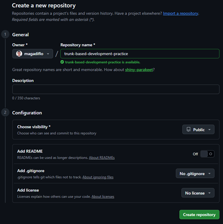

# Trunk Based Development y GitHub

- [Trunk Based Development (sitio de referencia)](https://trunkbaseddevelopment.com/)
    - Y su sección [You're doing it wrong](https://trunkbaseddevelopment.com/youre-doing-it-wrong)
- [How to Implement Trunk-Based Development: A Practical Guide (Unleash)](https://getunleash.io/trunk-based-development)
- [What Is Trunk-Based Development? A Complete Guide (Flagsmith)](https://flagsmith.com/blog/trunk-based-development)
- [Trunk-Based Development (Mergify)](https://mergify.com/learn/trunk-based-development)
- [Available rules for rulesets (GitHub Docs)](https://docs.github.com/en/repositories/configuring-branches-and-merges-in-your-repository/managing-rulesets/available-rules-for-rulesets)
- [Git Credential Manager: varios usuarios (multiple-users.md)](https://github.com/git-ecosystem/git-credential-manager/blob/release/docs/multiple-users.md)
- [Managing your personal access tokens (GitHub Docs)](https://docs.github.com/en/authentication/keeping-your-account-and-data-secure/managing-your-personal-access-tokens)

> **Cómo leer esta documentación**
>
> - La práctica se hace en **GitHub real** con dos cuentas: **`magadiflo`** (dueño del repositorio, el desarrollador
>   principal) y **`dev-partner-lab`** (el compañero de equipo). El repositorio se llama
>   **`trunk-based-development-practice`**.
> - Los bloques `bash` muestran **quién** ejecuta cada comando con una etiqueta: `[magadiflo]` o
>   `[dev-partner-lab]`.
> - **Cada comando se explica al pie del bloque donde aparece por primera vez** (primero qué hace el comando completo y
>   luego cada una de sus partes). Si más adelante reaparece, ya no se vuelve a explicar; solo se explica lo nuevo
>   (por ejemplo, una opción que antes no se había usado). Los bloques de explicación empiezan con **📖 Comandos de
>   este bloque**.
> - Las salidas de terminal (`text`) provienen de **una simulación local** con los mismos usuarios, repositorio y
>   comandos. Los **hashes** (`93fd7e3`, etc.) y las fechas serán distintos en tu máquina. Como en la simulación el
>   remoto es una carpeta local y no GitHub, en tu terminal verás además líneas `remote:` que agrega GitHub (por
>   ejemplo, un enlace para crear el PR) y la URL `https://github.com/...` en vez de una ruta local.
> - Lo que es propio de GitHub (pantallas, rulesets, Actions, mensajes de rechazo del remoto) y de Git Credential
>   Manager está escrito a partir de la documentación y **no fue ejecutado**. Se indica con **(GitHub, no
>   verificado)**
>   o **(GCM, no verificado)**. Si algo no coincide con lo que ves, la interfaz habrá cambiado: ajústalo y anótalo.
> - Donde dice **📷 Captura sugerida**, conviene guardar una imagen en `./assets/` (como hiciste en GitFlow).

## ¿Qué es Trunk Based Development?

Trunk Based Development (TBD) es una estrategia de branching donde **todos los desarrolladores integran sus cambios en
una única rama compartida, el `trunk` (el "tronco"), que en Git es `main`**, con cambios **pequeños y frecuentes**, en
lugar de trabajar semanas en ramas largas.

La idea central no es "no usar ramas", sino **que las ramas vivan muy poco** (horas, a lo sumo uno o dos días) y que
`main` esté **siempre en un estado desplegable**.

> En GitFlow la pregunta es *"¿en qué rama va esto?"*. En TBD la pregunta es *"¿cómo lo hago lo bastante pequeño para
> integrarlo hoy sin romper nada?"*.

```text
GitFlow                                   Trunk Based Development

main     ──●────────────────●──           main  ──●──●──●──●──●──●──●──●──
develop  ──●──●──●──●──●──●──●──                    \/   \/    \/
feature     └──────●────┘                       (ramas de horas, se borran)
release              └──●──┘
```

### Principios

- Existe **una sola rama de vida infinita: `main`**. No hay `develop`.
- Los cambios se integran **al menos una vez al día**.
- `main` **siempre debe compilar y pasar las pruebas**. Se protege con integración continua (CI).
- El trabajo incompleto **no se esconde en una rama larga**: se integra a `main` **apagado detrás de un feature flag**.
- Los lanzamientos salen desde `main` (o desde una *release branch* corta).

### Estilos de TBD según el tamaño del equipo

| Estilo                                 | Cuándo se usa                               | Cómo se integra                                                                      |
|----------------------------------------|---------------------------------------------|--------------------------------------------------------------------------------------|
| **Commit directo al trunk**            | Equipos pequeños y de mucha confianza       | `git pull --rebase` → `git commit` → `git push` directo a `main`                     |
| **Ramas de vida corta + Pull Request** | Equipos medianos/grandes (el más común hoy) | Rama de menos de 1 día → PR pequeño → *Squash and merge* a `main` → se borra la rama |

En esta práctica se recorren **los dos estilos**: primero commits directos (Cambios `#1` y `#2`) y luego se **protege
`main`** y se trabaja con PR (Cambios `#3` al `#7`).

### Tipos de ramas

| Rama                   | Vida                   | Descripción                                                                                                                                                       |
|------------------------|------------------------|-------------------------------------------------------------------------------------------------------------------------------------------------------------------|
| `main` (trunk)         | Infinita               | Única fuente de verdad. Siempre desplegable.                                                                                                                      |
| `feature/*`, `fix/*`   | Horas, máximo 1-2 días | Una sola persona (o pareja). Se borra al integrarse.                                                                                                              |
| `release/*` (opcional) | Corta                  | Solo si se necesita una "foto" estable para producción. **No es una línea de desarrollo**: los arreglos se hacen primero en `main` y se llevan con `cherry-pick`. |

### Feature flags (feature toggles)

Si una funcionalidad tarda 2 semanas, **no** se deja 2 semanas en una rama. Se divide en pedazos pequeños que se
integran cada día, y el código incompleto queda **desactivado por un flag**:

```bash
if (nuevoCheckoutHabilitado) {
    return procesarConNuevoFlujo();   // en construcción
}
return procesarConFlujoActual();      // lo que ve producción
```

Así se **desacopla el despliegue (deploy) del lanzamiento (release)**: el código llega a producción, pero el usuario no
lo ve hasta que se enciende el flag.

### Requisitos para que funcione

Sin estas prácticas, TBD termina degradándose a "feature branching con otro nombre":

1. **CI rápida** en cada PR/commit (compilar + pruebas).
2. **Pruebas automatizadas** confiables.
3. **Feature flags** para código incompleto.
4. **Revisión de código ágil** (PR pequeños que se revisan en minutos, no en días).
5. **Cultura de commits pequeños.**

## Comparación: GitFlow vs Trunk Based Development

| Aspecto                      | GitFlow                                                           | Trunk Based Development                                    |
|------------------------------|-------------------------------------------------------------------|------------------------------------------------------------|
| Ramas de vida infinita       | `main` y `develop`                                                | Solo `main`                                                |
| Vida de las ramas de trabajo | Días o semanas (`feature`)                                        | Horas o 1-2 días                                           |
| Rama de integración          | `develop`                                                         | `main` directamente                                        |
| Preparar un lanzamiento      | Rama `release-*` con ajustes                                      | `main` ya está lista (o `release/*` corta con cherry-pick) |
| Hotfix                       | Rama `hotfix-*` → `main` **y** `develop`                          | Fix en `main` (+ cherry-pick a la release si aplica)       |
| Código incompleto            | Se queda en la rama `feature`                                     | Se integra apagado con feature flag                        |
| Riesgo de conflictos         | Alto (las ramas divergen mucho)                                   | Bajo (cambios pequeños y frecuentes)                       |
| Frecuencia de despliegue     | Por versiones planificadas                                        | Continua / varias veces al día                             |
| Exigencia de CI/CD y tests   | Moderada                                                          | **Alta (imprescindible)**                                  |
| Encaja mejor con             | Software con versiones calendarizadas (móvil, embebido, regulado) | Aplicaciones web/backend con despliegue continuo           |

### Cuándo conviene y cuándo no

- **Conviene:** servicios backend (Spring Boot, microservicios), equipos con CI/CD y buenas pruebas, despliegue
  frecuente.
- **No tanto:** software que se publica por calendario con revisiones largas (app stores) o que debe mantener varias
  versiones en paralelo durante años. Ahí las *release branches* de larga vida tienen sentido real.

## Origen y destino de las ramificaciones

| Rama                   | Origen                                                                                               | Destino                                                      | Convención          | Ejemplo                 |
|------------------------|------------------------------------------------------------------------------------------------------|--------------------------------------------------------------|---------------------|-------------------------|
| **main** (trunk)       |                                                                                                      |                                                              |                     |                         |
| **feature / fix**      | main                                                                                                 | main (PR + *Squash and merge*)                               | `feature/` · `fix/` | `feature/validar-email` |
| **release** (opcional) | main                                                                                                 | **no se fusiona de vuelta** (se borra al salir la siguiente) | `release/`          | `release/1.0`           |
| **hotfix**             | **No existe como rama aparte**: el arreglo nace en `main` y se lleva con `cherry-pick` a `release/*` |                                                              |                     |                         |

## Práctica: Tabla de cambios

| ID        | DESCRIPCIÓN CORTA                                               | RAMA DE TRABAJO                           | RAMA ORIGEN | RAMA DESTINO         | QUIÉN TRABAJA                               | QUIÉN REVISA    |
|-----------|-----------------------------------------------------------------|-------------------------------------------|-------------|----------------------|---------------------------------------------|-----------------|
| Cambio #1 | Endpoint `/api/saludo` (commit directo)                         | *(ninguna)*                               | main        | main                 | magadiflo                                   | —               |
| Cambio #2 | Conflicto: ambos editan `application.properties` (push directo) | *(ninguna)*                               | main        | main                 | magadiflo y dev-partner-lab                 | —               |
| Cambio #3 | Validar email al registrar usuario                              | `feature/validar-email`                   | main        | main                 | dev-partner-lab                             | magadiflo       |
| Cambio #4 | Nuevo checkout **incompleto** detrás de un feature flag         | `feature/nuevo-checkout`                  | main        | main                 | magadiflo                                   | dev-partner-lab |
| Cambio #5 | Dos PR en paralelo: el segundo entra en conflicto               | `feature/configurar-reintentos`           | main        | main                 | dev-partner-lab                             | magadiflo       |
| Cambio #6 | Preparar la versión 1.0                                         | `release/1.0`                             | main        | *(no vuelve a main)* | magadiflo                                   | —               |
| Cambio #7 | Bug en producción (v1.0.0) → v1.0.1                             | `fix/email-con-signo-mas` y `cherry-pick` | main        | main y `release/1.0` | dev-partner-lab (fix) y magadiflo (release) | magadiflo       |

> Entre los Cambios `#2` y `#3` se **activa la protección de `main`**. Por eso los dos primeros se hacen con commit
> directo y el resto con Pull Request.

## Inicio: preparación del entorno

### 1. Crear el repositorio en GitHub

Con la cuenta `magadiflo`:

> **GitHub > New repository**
> - **Repository name:** `trunk-based-development-practice`
> - **Visibility:** **Public** (los *rulesets* están disponibles en repositorios públicos con el plan gratuito)
> - **No** marcar *Add a README*, *.gitignore* ni *license* (el repositorio debe quedar vacío)



### 2. Invitar a `dev-partner-lab` como colaborador

Con `magadiflo`:

> **Repositorio > Settings > Collaborators > Add people** → buscar `dev-partner-lab` → rol **Write**

Con `dev-partner-lab`: aceptar la invitación desde el correo, o entrando a:

```text
https://github.com/magadiflo/trunk-based-development-practice/invitations
```


### 3. Dos cuentas en la misma PC: HTTPS y configuración local de Git

Si utilizas HTTPS, puedes trabajar con dos cuentas de GitHub desde la misma PC sin necesidad de generar y administrar
una llave SSH por cada cuenta.

La idea es mantener la configuración global de Git para tu cuenta principal (`magadiflo`) y establecer una configuración
local para el repositorio donde trabajarás como colaborador (`dev-partner-lab`). De esta manera, cada clon tendrá su
propia identidad de Git, sin afectar los demás repositorios de tu equipo.

#### Configuración global (`magadiflo`)

Si ya tienes configurada tu identidad principal, no necesitas modificar nada. Puedes comprobarla con:

```bash
C:\cmder
$ git config --global user.name
Martín Díaz

C:\cmder
$ git config --global user.email
tu-correo@ejemplo.com
```

> **📖 Comandos de este bloque**
>
> **`git config --global user.name`** y **`git config --global user.email`**: muestran la identidad que Git usa por
> defecto en **todos** tus repositorios.
> - `git config`: lee o escribe la configuración de Git. Si le das **solo la clave** (como aquí), **muestra** su valor;
>   si le das la clave **y un valor**, lo **guarda**.
> - `--global`: indica que se trabaja con la configuración **de tu usuario del sistema** (archivo `.gitconfig` de tu
>   carpeta personal), que vale para todos los repositorios. Los otros niveles son `--system` (toda la PC) y `--local`
>   (un solo repositorio).
> - `user.name` / `user.email`: las claves con el nombre y el correo que Git escribe como **autor** de cada commit.

#### Configuración local (`dev-partner-lab`)

Cuando clones el repositorio para trabajar como colaborador, configurarás su identidad únicamente dentro de ese
repositorio:

```bash
$ git config --local user.name "dev-partner-lab"
$ git config --local user.email "martin.g.diaz.flores@gmail.com"
```

> **📖 Comandos de este bloque**
>
> **`git config --local user.name "dev-partner-lab"`** y
> **`git config --local user.email "martin.g.diaz.flores@gmail.com"`**: guardan la identidad de `dev-partner-lab` **solo
> en este repositorio**.
> - `--local`: el valor se guarda en el archivo `.git/config` del repositorio actual. Tiene **prioridad** sobre
>   `--global`, así que dentro de este clon manda la identidad local y en los demás proyectos sigue la global. (Orden
>   de prioridad: local → global → system.)
> - `"dev-partner-lab"` / `"martin.g.diaz.flores@gmail.com"`: ahora sí hay **valor**, por eso el comando **escribe** en
>   lugar de mostrar. Si el correo no pertenece a la cuenta, GitHub mostrará los commits sin el usuario asociado.

> `git config --local` no modifica la configuración global ni afecta a los demás proyectos.

#### ¿Cómo funciona la autenticación con HTTPS?

La identidad configurada mediante `user.name` y `user.email` determina quién aparece como **autor de los commits**, pero
**no determina qué cuenta de GitHub realiza el push**. De hecho, la documentación de Git Credential Manager lo advierte:
`user.name` y `user.email` no afectan a GCM.

Para autenticar las operaciones HTTPS utilizaremos **Git Credential Manager (GCM)**, que gestiona las credenciales de
GitHub:

- `magadiflo` seguirá utilizando su autenticación habitual.
- `dev-partner-lab` deberá autenticarse con sus propias credenciales de GitHub.

**El problema:** si no se le indica nada, Git le pide credenciales a GCM **sin decirle qué usuario quiere** (para Git,
el usuario del remoto queda vacío). Si GCM ya tiene guardada tu cuenta principal, **puede reutilizarla**, y entonces el
push de `dev-partner-lab` saldría como `magadiflo` sin darte ningún error: los commits dirían `dev-partner-lab`, pero
quien empuja sería `magadiflo`. Con dos cuentas en el mismo dominio (`github.com`) hay que indicar el usuario de forma
explícita.

#### Indicar a GCM qué cuenta usa cada clon

GCM documenta dos formas de hacerlo: poner el usuario en la URL del remoto, o configurar
`credential.https://github.com.username`. Aquí usamos la segunda, **de forma local en cada clon**, porque encaja con la
idea de "configurar el repositorio local":

```bash
# en el clon de magadiflo
$ git config --local credential.https://github.com.username "magadiflo"

# en el clon de dev-partner-lab
$ git config --local credential.https://github.com.username "dev-partner-lab"
```

> **📖 Comandos de este bloque**
>
> `git config --local credential.https://github.com.username "..."`: le dice a Git qué **usuario de GitHub** debe
> pedirle a GCM al hablar con `https://github.com` desde este repositorio.
> - `credential.https://github.com.username`: es una clave con el formato `credential.<URL>.username`. El `<URL>` (aquí
>   `https://github.com`) limita el efecto a ese sitio: para otros servidores (GitLab, etc.) no se envía ningún
>   usuario.
> - `"dev-partner-lab"` / `"magadiflo"`: el usuario que GCM debe buscar o crear. Cada usuario tiene sus propias
>   credenciales guardadas, así que **ya no se mezclan**.

> Se configura la cuenta de **magadiflo** también, aunque sea la principal: cuando GCM tenga **dos** cuentas para
> `github.com`, un clon sin usuario definido es ambiguo.

> **Alternativa equivalente:** poner el usuario en la URL,
> `https://dev-partner-lab@github.com/magadiflo/trunk-based-development-practice.git`. Funciona igual, pero deja el
> usuario visible dentro de la URL del remoto.

#### Primer push de `dev-partner-lab`: iniciar sesión con la cuenta correcta

La primera vez que `dev-partner-lab` empuje, GCM no encontrará credenciales para ese usuario y abrirá su ventana de
inicio de sesión de GitHub.

Precauciones:

- Si tu navegador predeterminado tiene abierta la sesión de **magadiflo**, autoriza con **dev-partner-lab**: abre el
  enlace en una ventana de incógnito o elige la opción de **código de dispositivo** (*device code*), que puedes
  completar en un navegador donde esté la otra cuenta.
- Si prefieres un token, debe ser un **token clásico (*classic*) con el permiso `repo`**. Según GitHub Docs, los tokens
  de grano fino (*fine-grained*) todavía no cubren el caso de contribuir a repositorios donde eres colaborador de otra
  cuenta personal.

Para comprobar qué cuentas guardó GCM:

```bash
$ git credential-manager github list
```

> **📖 Comandos de este bloque**
>
> `git credential-manager github list`: lista las cuentas de GitHub que Git Credential Manager tiene guardadas.
> - `git credential-manager`: invoca a GCM desde Git.
> - `github`: el subcomando para el proveedor GitHub (también existen `login` y `logout` para iniciar o cerrar sesión de
>   una cuenta; mira `git credential-manager github --help` para sus opciones).
> - `list`: muestra las cuentas guardadas. Tras el primer push de `dev-partner-lab` deberían aparecer **las dos**.

No es necesario configurar una llave SSH por cuenta ni modificar la configuración global de Git para establecer las
identidades locales.

